# VoiceLab AI user manual

[Español](es.md) · **English** · [Français](fr.md) · [Italiano](it.md) · [Português](pt.md) · [Русский](ru.md) · [中文](zh.md) · [日本語](ja.md)

VoiceLab AI is a voice studio for Windows: change your voice in real time, clone voices with artificial intelligence and turn text into speech. Everything runs on your computer, with no subscriptions or cloud services.

> This manual covers version 0.10. The screenshots use sample profiles and devices.
>
> **The app's interface is in Spanish.** In this manual, buttons and options appear as they do on screen, followed by their meaning: **Modulador** (Modulator).

## Contents

1. [What you can do](#1-what-you-can-do)
2. [Requirements](#2-requirements)
3. [Installation](#3-installation)
4. [Home screen](#4-home-screen)
5. [Real-time modulator](#5-real-time-modulator)
6. [AI voices](#6-ai-voices)
7. [Text to speech](#7-text-to-speech)
8. [Audio editor](#8-audio-editor)
9. [Voice library](#9-voice-library)
10. [Settings](#10-settings)
11. [Using your voice in Discord, games, OBS and video editors](#11-using-your-voice-in-discord-games-obs-and-video-editors)
12. [Troubleshooting](#12-troubleshooting)
13. [Privacy and responsible use](#13-privacy-and-responsible-use)

---

## 1. What you can do

- **Change your voice live** with effects (pitch, formants, robot, radio, echo, reverb…) and send it to any program through a virtual microphone.
- **Clone a voice** from an audio or video file and use it to read text aloud (text to speech) or to talk live.
- **Train a "faithful voice"**: an RVC model that sounds much closer to the original voice, for talking live with little delay.
- **Record and edit audio**: trim, join, remove noise, apply effects and export to WAV, MP3, FLAC or OGG.
- **Organise your voices** in a library with folders, favourites, export and backups.

## 2. Requirements

| | Minimum | Recommended |
|---|---|---|
| System | Windows 10, 64-bit | Windows 11 |
| Processor | 4 cores | 8 cores (for instant voices and training) |
| Memory | 8 GB | 16 GB or more |
| Disk | 1 GB for the app | +8 GB if you install every AI model |
| Graphics card | Not required | DirectX 12 compatible (AMD, NVIDIA or Intel) for live RVC voices |
| Virtual microphone | [VB-CABLE](https://vb-audio.com/Cable/) (free) | — |

You only need the Internet to download the app and, once, the AI models you choose.

## 3. Installation

### 3.1 Install the app

1. Download `VoiceLabAI-Setup-x.y.z.exe` from the [Releases](https://github.com/demfisalvarez/VoiceLab-AI/releases/latest) page.
2. Run it. If Windows shows "Windows protected your PC", click **More info → Run anyway** (the installer is not signed with a commercial certificate).
3. Follow the wizard. It installs for your user only and does not need administrator rights.
4. Open **VoiceLab AI** from the Start menu or the desktop.

To uninstall it: *Windows Settings → Apps → VoiceLab AI → Uninstall*. Your profiles and settings are stored in `%APPDATA%\VoiceLabAI`.

### 3.2 Install the virtual microphone (VB-CABLE)

The virtual microphone is what lets Discord, games or your browser "hear" your modified voice.

1. Download VB-CABLE from its [official page](https://vb-audio.com/Cable/) (free, signed by Microsoft).
2. Unzip it, right-click `VBCABLE_Setup_x64.exe` → **Run as administrator** → **Install Driver**.
3. Restart your computer.
4. Optional: rename it so it is easier to spot. In **Ajustes → Abrir panel de Sonido** (Settings → Open Sound panel), on the **Recording** tab, open **CABLE Output → Properties** and rename it "VoiceLab AI Microphone".

### 3.3 First launch

When you open the app you will see the **Inicio** (Home) screen. The **Configuración inicial** (Initial setup) card checks your microphone and the virtual microphone and tells you what is missing.

## 4. Home screen

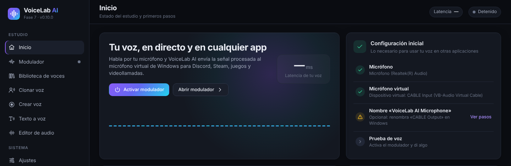

- **Activar modulador** (Turn on modulator) switches the modulator on without leaving this screen. You can also press **Ctrl + M** at any time.
- **Abrir modulador** (Open modulator) takes you to the full panel.
- **Configuración inicial** (Initial setup) lists what you need: microphone, virtual microphone, device name and a voice test. A green circle means that step is done.

At the bottom of the sidebar you can always see the modulator status and the input (**ENT**) and output (**SAL**) meters.

## 5. Real-time modulator

1. Press the big **power button**. It changes to **Activo** (Active) and shows the sample rate, block size, CPU use and **latency** (how much your voice is delayed, in milliseconds).
2. The **Entrada** (Input) and **Salida** (Output) meters show the level of your microphone and of the processed voice (peak and RMS). Ideally, speak with the bar between −24 and −12 dB.
3. In the **Entrada** (Input) card:
   - **Cambiar** (Change) opens the list of microphones.
   - **Ganancia de entrada** (Input gain) raises or lowers your microphone volume before the effects.
   - **Puerta de ruido** (Noise gate) mutes the microphone when you are not speaking. Turn it on and raise the threshold if background noise (keyboard, fan) gets through.
4. In the **Voz activa** (Active voice) card you choose the voice in use:
   - **Perfil guardado** (Saved profile) switches profiles instantly, without stopping the modulator.
   - **Guardar como perfil nuevo** (Save as new profile) stores the current effects as a profile.
   - **Guardar cambios en el perfil** (Save changes to profile) updates the profile you are using.
   - **Voz original** (Original voice) removes all effects.

### 5.1 Outputs

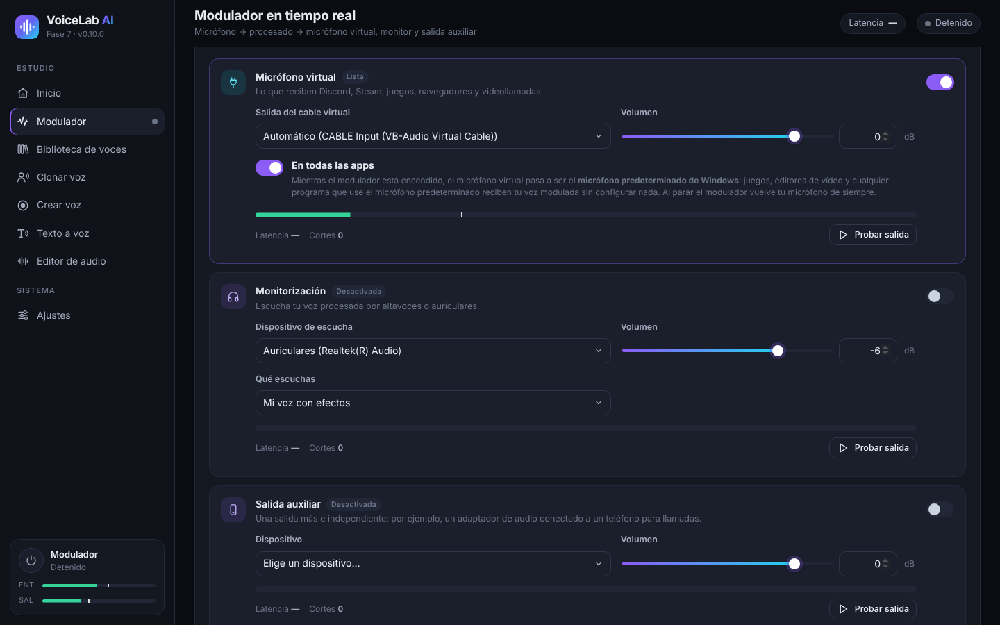

You can turn on several outputs at once and change them without stopping the modulator.

- **Micrófono virtual** (Virtual microphone) sends your processed voice to VB-CABLE. Discord, Steam, games, browsers and video calls receive it from there. With **Automático** (Automatic), VoiceLab picks "CABLE Input" by itself.
- **En todas las apps** (In all apps), on by default: while the modulator is on, the virtual microphone becomes the **Windows default microphone**. Any program that uses the default microphone (games, video editors, the browser…) then receives your modulated voice with no setup. VoiceLab keeps listening to your real microphone. When you stop the modulator or close the app, Windows goes back to your usual microphone.
- **Monitorización** (Monitoring) lets you hear yourself through headphones. In **Qué escuchas** (What you hear) choose "Mi voz con efectos" (my voice with effects) or "Mi micrófono original (sin efectos)" (my original microphone, no effects). Use headphones: speakers can cause feedback (a loud whistle), and the app warns you before turning it on.
- **Salida auxiliar** (Auxiliary output) is one more independent output, for example an audio adapter connected to a phone for calls.
- Each output has its own **Volumen** (Volume), a meter, its latency, a **Cortes** (Dropouts) counter and a **Probar salida** (Test output) button that plays a test sound.

### 5.2 Effects and presets

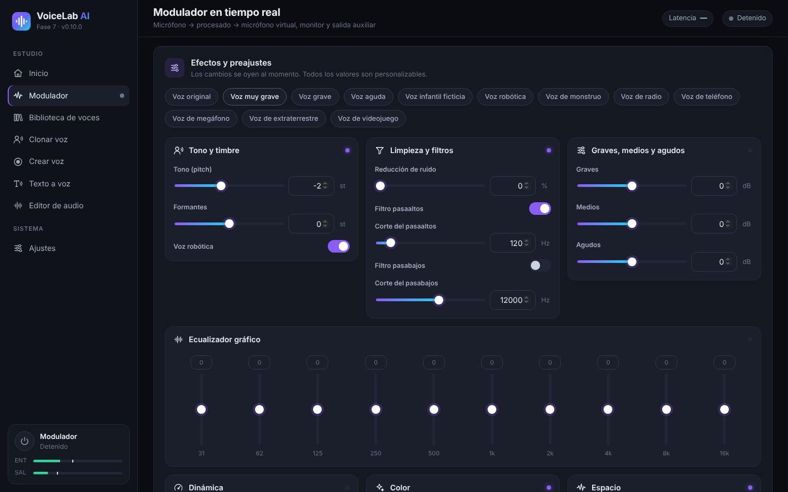

At the top are the **presets**: original voice, very deep, deep, high, fictional child, robot, monster, radio, telephone, megaphone, alien and video game. Changes are heard instantly and every value can be adjusted:

| Group | Controls |
|---|---|
| Tono y timbre (Pitch and timbre) | **Tono (pitch)** in semitones, **Formantes** (Formants: how "big" or "small" the voice sounds) and **Voz robótica** (Robot voice) |
| Limpieza y filtros (Cleanup and filters) | Noise reduction, high-pass filter and low-pass filter |
| Graves, medios y agudos (Bass, mids and treble) | Simple three-band equaliser |
| Ecualizador gráfico (Graphic equaliser) | 10 bands, from 31 Hz to 16 kHz |
| Dinámica (Dynamics) | Compressor (threshold, ratio, makeup), limiter and output gain |
| Color (Colour) | Saturation, distortion, 8-bit lo-fi and ring modulation |
| Espacio (Space) | Chorus, echo and reverb |

Tip: for a deeper but natural voice, lower the **Tono** (Pitch) and lower the **Formantes** (Formants) a little. If you only lower the pitch, the voice sounds like a cartoon.

## 6. AI voices

There are three kinds of AI voice:

| Type | What you need | What it is for | Resemblance |
|---|---|---|---|
| **IA instantánea** (Instant AI) | 10–30 s of voice | Text to speech and talking live (0.25–0.45 s delay) | Good |
| **Voz fiel** (Faithful voice, trained RVC) | At least 1 min of voice (10 min or more is better) and 30 min to 4 h of training | Talking live with little delay | Very high |
| **Imported RVC model** | An `.onnx` file you already have | Talking live | Depends on the model |

Before using them, install the AI engine and models in **Ajustes → Motor de IA y modelos** (Settings → AI engine and models). See [10.3](#103-ai-engine-and-models).

### 6.1 Clone a voice

1. Go to **Clonar voz** (Clone voice) and drag in an audio or video file, or click **elígelo en tu equipo** (choose it on your computer). Supported formats: MP3, WAV, FLAC, M4A, AAC, OGG, MP4, MKV, MOV and WEBM. Audio is extracted from videos automatically. You can also pick an audio file that is already in VoiceLab.

   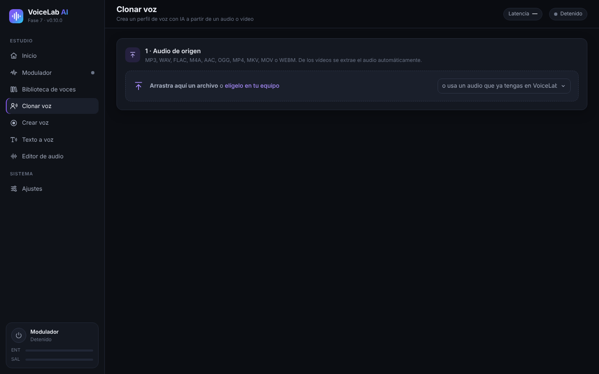

2. **Elige el fragmento con la voz** (Choose the part with the voice): drag over the waveform to select it. Use **Escuchar selección** (Play selection) to check that only one person is speaking. For an instant voice, 10–30 clear seconds is ideal. If you later want to **train a faithful voice**, select all the usable speech (at least 1 minute, 10 minutes or more is better).

   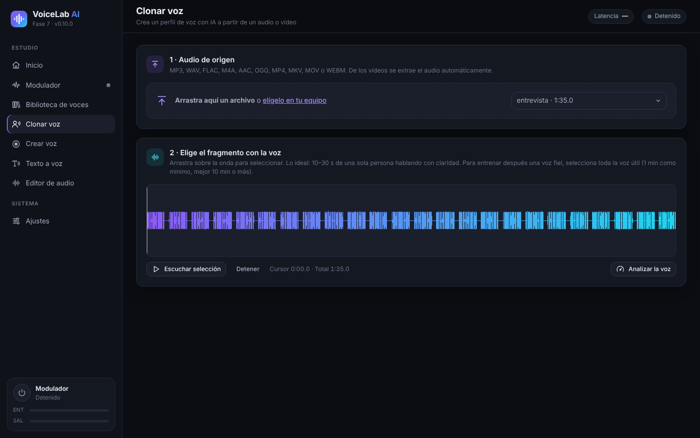

3. Click **Analizar la voz** (Analyse voice). You will see the seconds of usable speech, the signal-to-noise ratio, the average pitch and the level. A bar shows what that is enough for: 10 s for an instant voice, 5 min for a faithful voice and 10 min for an ideal faithful voice.
4. **Crear el perfil** (Create the profile): type a name and the language of the voice and, if you like, a folder and a description. Leave **Limpiar ruido de fondo y silencios largos** (Remove background noise and long silences) ticked.
5. Confirm whether **Es mi propia voz** (It is my own voice) or **Tengo autorización de la persona** (I have the person's permission). This is required.
6. Click **Crear perfil de voz** (Create voice profile).

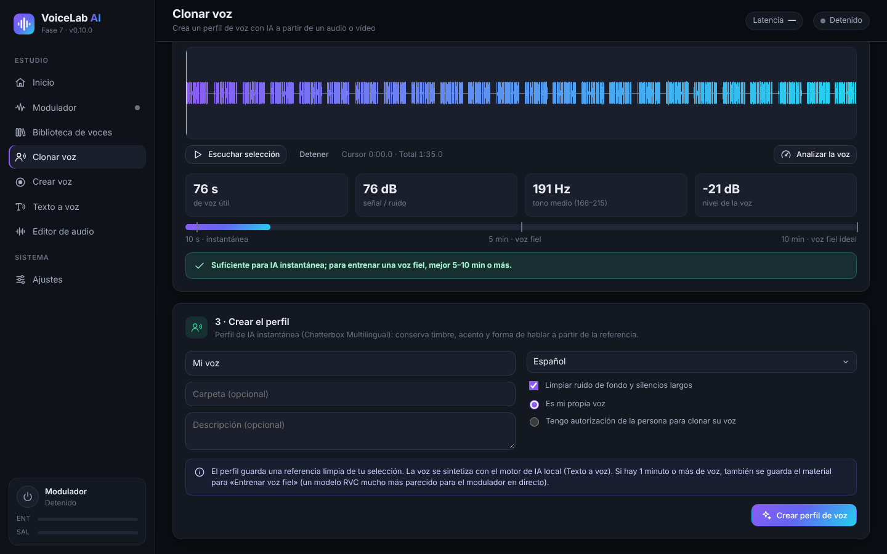

The profile keeps a clean reference. If your selection has 1 minute or more of speech, it also keeps the material for training a faithful voice.

### 6.2 Record your voice (Crear voz)

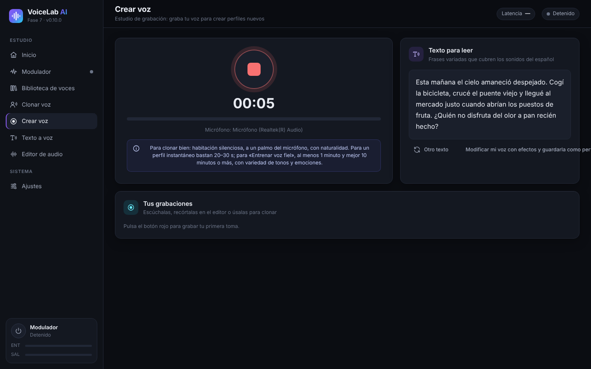

1. Go to **Crear voz** (Create voice) and press the **red button** to record. Press it again to stop.
2. Read the sentences in **Texto para leer** (Text to read). They cover all the sounds of Spanish. **Otro texto** (Another text) shows different sentences.
3. Your takes appear in **Tus grabaciones** (Your recordings). From there you can play them, open them in the editor or use them for cloning.
4. **Modificar mi voz con efectos y guardarla como perfil** (Modify my voice with effects and save it as a profile) takes you to the modulator with your recording.

For a good recording: a quiet room, about a hand's width from the microphone, speaking naturally with a variety of tones and emotions.

### 6.3 Talk live with an instant voice

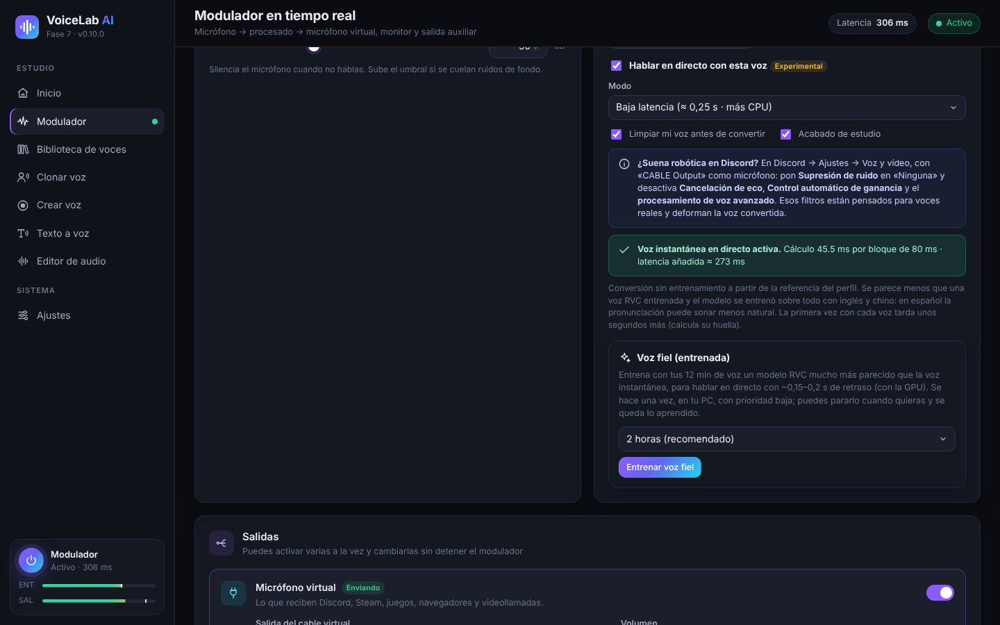

1. In the modulator, choose an "IA instantánea" (Instant AI) profile in **Perfil guardado** (Saved profile).
2. The first time, click **Instalar la voz en directo** (Install live voice). It downloads about 1.9 GB and takes about 2.7 GB of disk space. When it finishes, the app measures your PC's speed and picks the best mode.
3. Tick **Hablar en directo con esta voz** (Talk live with this voice) and turn on the modulator. The first time with each voice takes a few more seconds (it computes the voice's fingerprint).
4. **Modo** (Mode):
   - **Baja latencia** (Low latency, ≈ 0.25 s): less delay, but uses about three times more CPU.
   - **Calidad** (Quality, ≈ 0.45 s): the voice sounds closer and uses less CPU.
5. Options:
   - **Limpiar mi voz antes de convertir** (Clean my voice before converting) removes noise from your microphone before the AI.
   - **Acabado de estudio** (Studio finish) adds a de-esser, compression and automatic level.
   - **Alta definición 48 kHz** (48 kHz high definition) only works in Quality mode and if your CPU can handle it. It is an optional 119 MB download.
6. The green status line shows the processing time per block and the real **latencia añadida** (added latency). If **"El procesador no llega a tiempo"** (The processor can't keep up) appears, switch to Quality, turn off high definition or close heavy programs.

The instant voice needs no training, but it sounds less like the original than a faithful voice. The model was trained mainly on English and Chinese, so pronunciation in other languages may sound less natural.

### 6.4 Train a faithful voice (RVC)

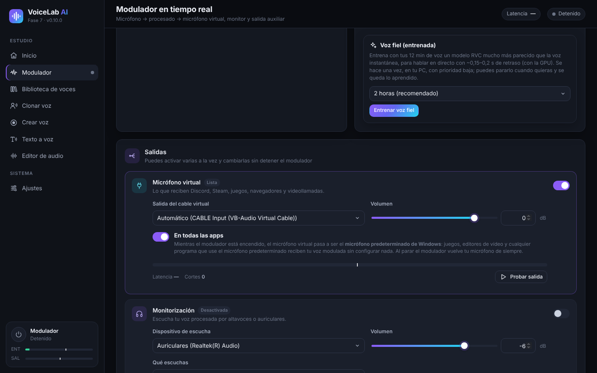

A faithful voice is an RVC model trained on your audio, on your PC. It sounds much closer to the original voice and has little delay live (about 0.15–0.2 s with a graphics card).

1. Activate an instant AI profile created with **1 minute of speech or more** (10 minutes or more is better). If your profile was created with less, create it again in **Clonar voz** (Clone voice) with a longer audio file.
2. In the **Voz fiel (entrenada)** (Faithful voice, trained) card, choose how long to train: 30 min (quick test), 1 hour, **2 horas (recomendado)** (2 hours, recommended) or 4 hours (maximum). More time means a closer match.
3. Click **Entrenar voz fiel** (Train faithful voice). The first time, PyTorch (about 250 MB) and the base models (about 0.2 GB) are downloaded.
4. You will see the progress, the current stage and the time left. Training uses the CPU at low priority, so you can keep using your PC.
5. **Parar y usar lo aprendido** (Stop and use what has been learned) stops training and creates the voice from what it has learned so far. If you close the app, progress is saved and **Continuar el entrenamiento** (Continue training) appears later.
6. When it finishes, a new profile called "*name* (fiel)" is created. Click **Usar la voz fiel** (Use the faithful voice) to activate it. You can improve it later with **Seguir entrenando** (Keep training).

**Pitch adjustment**: the faithful voice follows the pitch of your own voice. If the original voice is higher or lower than yours, use **Ajuste de tono para esta voz** (Pitch adjustment for this voice), from −24 to +24 semitones, in the profile card. As a guide, male to female usually works between +8 and +12, and female to male between −8 and −12.

### 6.5 Import an RVC model

If you already have an RVC model in `.onnx` format:

1. Install the AI engine and **Base para conversión RVC** (RVC conversion base) in *Ajustes* (Settings).
2. Go to **Biblioteca de voces → Importar modelo RVC** (Voice library → Import RVC model), type a name and choose the file.
3. Activate it in the modulator. The profile card has the **Ajuste de tono** (Pitch adjustment).

Only `.onnx` models are supported. `.pth` models must first be converted with the RVC export tool.

## 7. Text to speech

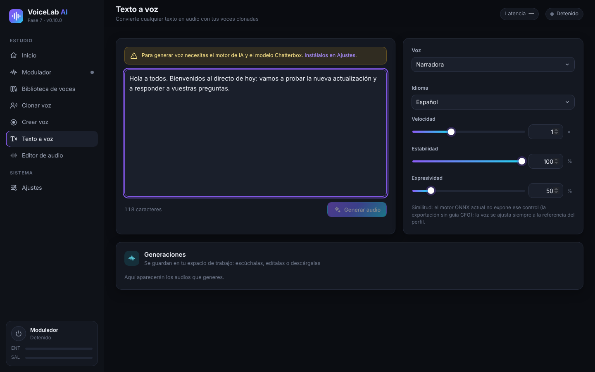

1. Install the AI engine and the **Chatterbox Multilingual** model (about 3.2 GB) in *Ajustes → Motor de IA y modelos* (Settings → AI engine and models).
2. Go to **Texto a voz** (Text to speech) and type or paste your text.
3. Choose the **Voz** (Voice), which can be any cloned profile, and the **Idioma** (Language). There are 23 languages, including Spanish, English, French, Italian, Portuguese, Russian, Chinese and Japanese.
4. Adjust:
   - **Velocidad** (Speed).
   - **Estabilidad** (Stability): higher is more even, lower is more varied.
   - **Expresividad** (Expressiveness): more emotion and emphasis.
5. Click **Generar audio** (Generate audio). The first generation takes longer (the model loads in 1–4 minutes). **Cancelar** (Cancel) stops it.
6. The result appears in **Generaciones** (Generations): you can play it, open it in the editor or download it as WAV, MP3, FLAC or OGG.

Text to speech runs on the CPU by default. You can try the GPU in *Ajustes* (Settings); if it fails, the app switches back to the CPU automatically.

## 8. Audio editor

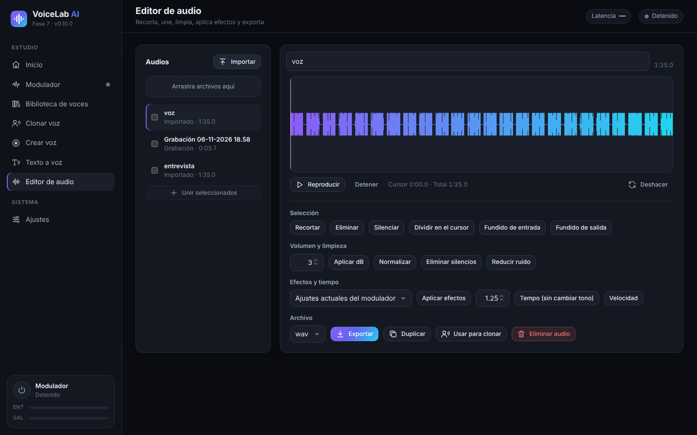

- **Audios**: import files (or drag them in); your recordings and generations also appear here. Tick several and click **Unir seleccionados** (Join selected) to combine them.
- **Waveform**: drag to select. You have **Reproducir** (Play), **Detener** (Stop) and **Deshacer** (Undo).
- **Selección** (Selection): trim, delete, silence, split at cursor, fade in and fade out.
- **Volumen y limpieza** (Volume and cleanup): apply dB, normalise, remove silences and reduce noise.
- **Efectos y tiempo** (Effects and timing):
  - **Aplicar efectos** (Apply effects) uses the modulator's current settings or a saved profile.
  - **Tempo** changes the speed without changing the pitch.
  - **Velocidad** (Speed) changes speed and pitch together.
- **Archivo** (File): choose the format (WAV, MP3, FLAC or OGG) and click **Exportar** (Export). You can also **Duplicar** (Duplicate), **Usar para clonar** (Use for cloning) or **Eliminar audio** (Delete audio).

## 9. Voice library

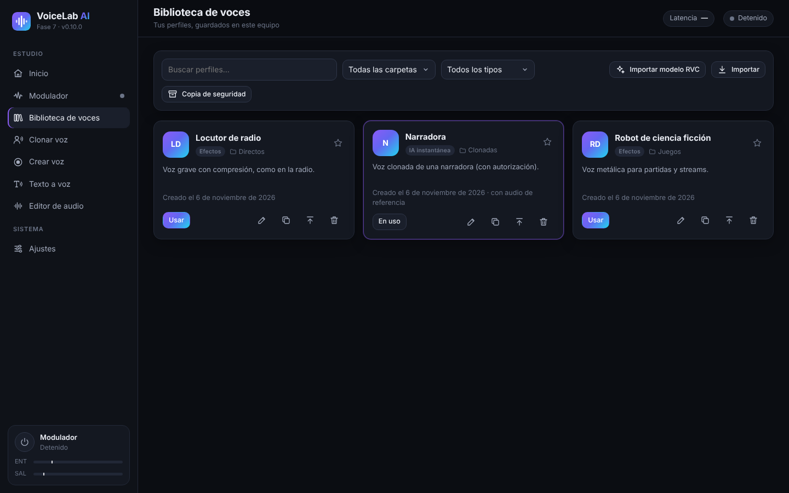

- **Search** by name and **filter** by folder or by type: effects, instant AI or trained AI (RVC).
- Each card shows the profile's type, folder and description. The star marks it as a favourite.
- Buttons on each card:
  - **Usar** (Use) activates the profile in the modulator.
  - **Edit** changes the name, folder or description.
  - **Duplicate**.
  - **Export** creates a `.vlprofile` file to move it to another PC.
  - **Delete**.
- **Importar** (Import) adds exported profiles (`.vlprofile`). **Importar modelo RVC** (Import RVC model) adds `.onnx` models.
- **Copia de seguridad** (Backup) saves all your profiles in a single file.

## 10. Settings

### 10.1 Audio devices

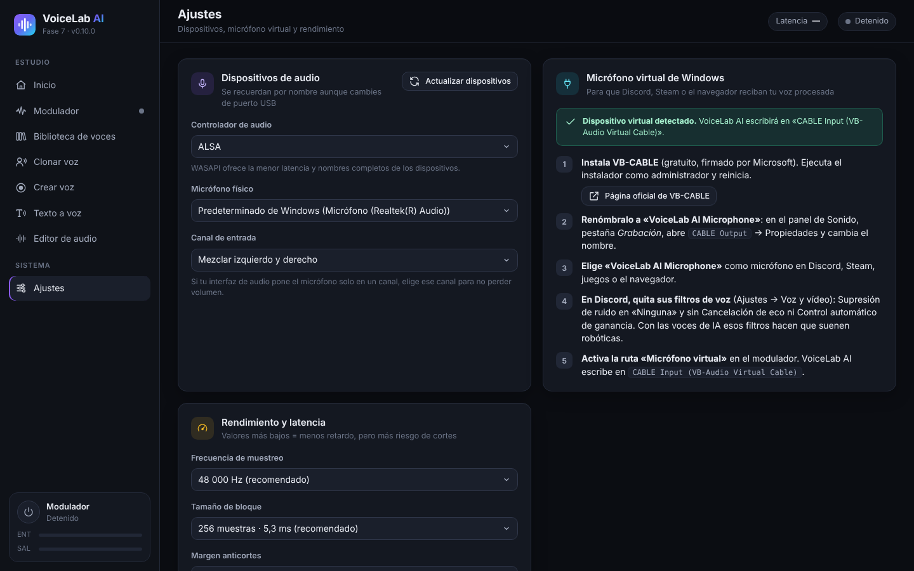

- **Controlador de audio** (Audio driver): on Windows, **WASAPI** gives the lowest latency.
- **Micrófono físico** (Physical microphone) is the real microphone VoiceLab listens to. It is remembered by name, even if you change USB port.
- **Canal de entrada** (Input channel): if your audio interface puts the microphone on one channel only, choose that channel.
- **Actualizar dispositivos** (Refresh devices) searches again if you plug in something new.
- The **Micrófono virtual de Windows** (Windows virtual microphone) card repeats the VB-CABLE installation steps and tells you whether it is detected.

### 10.2 Performance and latency

- **Frecuencia de muestreo** (Sample rate): 48,000 Hz (recommended) or 44,100 Hz.
- **Tamaño de bloque** (Block size): smaller means less delay, but a higher risk of dropouts. 256 samples (5.3 ms) works on almost every computer.
- **Margen anticortes** (Anti-dropout margin): raise it if you hear clicks.

### 10.3 AI engine and models

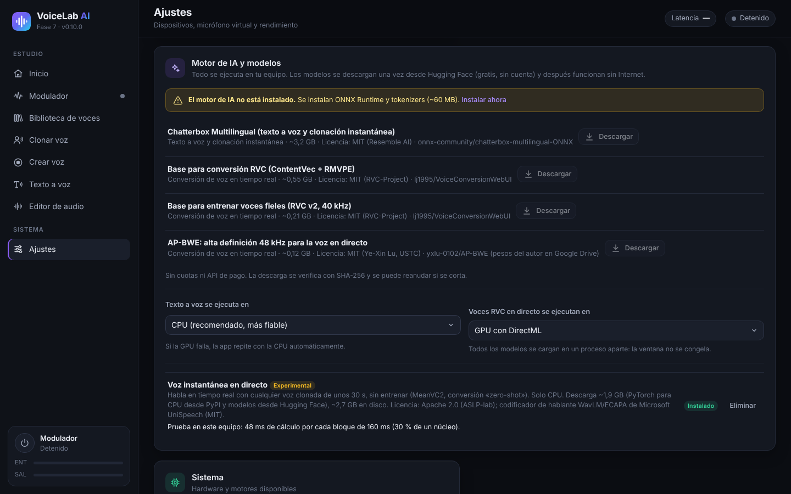

Models are downloaded once from Hugging Face (free, no account needed) and then work offline. Every download is verified and can resume if it is interrupted.

| Component | Size | Used for |
|---|---|---|
| AI engine (ONNX Runtime and tokenizers) | ~60 MB | Required for everything AI |
| Chatterbox Multilingual | ~3.2 GB | Text to speech and instant cloning |
| RVC conversion base (ContentVec + RMVPE) | ~0.55 GB | Live RVC voices (imported or trained) |
| Base for training faithful voices (RVC v2, 40 kHz) | ~0.21 GB | Training a faithful voice |
| AP-BWE (high definition) | ~0.12 GB | Optional, for the instant voice in Quality mode |
| Live instant voice (MeanVC2 + PyTorch for CPU) | ~1.9 GB download | Talking live with instant voices |

You also choose where each part runs:

- **Texto a voz se ejecuta en** (Text to speech runs on): CPU (recommended) or GPU.
- **Voces RVC en directo se ejecutan en** (Live RVC voices run on): GPU with DirectML (recommended if you have a graphics card) or CPU.

## 11. Using your voice in Discord, games, OBS and video editors

With **En todas las apps** (In all apps) turned on (see [5.1](#51-outputs)), any program that uses the Windows default microphone already receives your modulated voice. Some programs need one more step:

- **Discord**:
  1. In *User Settings → Voice & Video*, set the **Input Device** to "CABLE Output" (or "VoiceLab AI Microphone") or to "Default".
  2. Set **Noise Suppression** to **None**.
  3. Turn off **Echo Cancellation**, **Automatic Gain Control** and **Advanced Voice Activity**. These filters make AI voices sound robotic.
- **Games**: almost all of them use the default microphone. If a game only checks the microphone when it starts, launch it with the modulator already on.
- **OBS Studio**: add an **Audio Input Capture** source with "CABLE Output", or use "Default".
- **Video editors** (DaVinci Resolve, Premiere, CapCut…): to record a voice-over with effects, choose "CABLE Output" or the default microphone as the recording input.
- **Browser and video calls** (Meet, Teams, Zoom): choose "CABLE Output" or "Default" in each service's audio settings.

## 12. Troubleshooting

| Problem | What to do |
|---|---|
| Nobody can hear me | Check that the modulator is **Activo** (Active) and the **Micrófono virtual** (Virtual microphone) output is on. In the other program, choose "CABLE Output" or "Default". |
| "Virtual microphone not detected" | Install VB-CABLE as administrator and restart your PC. Then click **Actualizar dispositivos** (Refresh devices) in *Ajustes* (Settings). |
| The AI voice sounds robotic in Discord | Turn off Discord's voice filters (see [11](#11-using-your-voice-in-discord-games-obs-and-video-editors)). |
| Dropouts, clicks or "El procesador no llega a tiempo" (The processor can't keep up) | Use **Calidad** (Quality) mode without high definition and close heavy programs. Raise the **Margen anticortes** (Anti-dropout margin) or the **Tamaño de bloque** (Block size). |
| Too much delay | Use **Baja latencia** (Low latency) if your CPU can handle it, or a **faithful voice** on the GPU. The real latency is shown in the modulator. |
| Whistling or feedback | Use headphones for monitoring, not speakers. |
| Background noise | Turn on the **Puerta de ruido** (Noise gate) and **Reducción de ruido** (Noise reduction), or **Limpiar mi voz antes de convertir** (Clean my voice before converting) for AI voices. |
| Text to speech is slow the first time | That is normal: the model loads in 1–4 minutes. Later generations are faster. |
| A program still uses the old microphone | Some programs only read the microphone when they open: close it and open it again with the modulator on. |
| I need the logs to ask for help | They are in `%APPDATA%\VoiceLabAI\logs` (`voicelab.log`, `voz-instantanea.log` and `entrenamiento.log`). |

## 13. Privacy and responsible use

- **Everything is processed on your PC.** Your voice, profiles and recordings are never sent to any server. The Internet is only used to download the app and the models.
- **Only clone your own voice or the voices of people who have given you permission.** The app asks you to confirm this for every profile.
- Do not use cloned voices to deceive, impersonate anyone or commit fraud. In many countries it is illegal.
- The AI models have their own licences (MIT and Apache 2.0). You can find them in *Ajustes → Motor de IA y modelos* (Settings → AI engine and models) and in the [README](../../README.md).

---

Shortcut: **Ctrl + M** turns the modulator on and off. App data: `%APPDATA%\VoiceLabAI`.
