# Manual de VoiceLab AI

**Español** · [English](en.md) · [Français](fr.md) · [Italiano](it.md) · [Português](pt.md) · [Русский](ru.md) · [中文](zh.md) · [日本語](ja.md)

VoiceLab AI es un estudio de voz para Windows: cambia tu voz en tiempo real, clona voces con inteligencia artificial y convierte texto en voz. Todo funciona en tu ordenador, sin suscripciones ni servicios en la nube.

> Este manual corresponde a la versión 0.10. Las capturas usan perfiles y dispositivos de ejemplo.

## Índice

1. [Qué puedes hacer](#1-qué-puedes-hacer)
2. [Requisitos](#2-requisitos)
3. [Instalación](#3-instalación)
4. [Pantalla de inicio](#4-pantalla-de-inicio)
5. [Modulador en tiempo real](#5-modulador-en-tiempo-real)
6. [Voces con inteligencia artificial](#6-voces-con-inteligencia-artificial)
7. [Texto a voz](#7-texto-a-voz)
8. [Editor de audio](#8-editor-de-audio)
9. [Biblioteca de voces](#9-biblioteca-de-voces)
10. [Ajustes](#10-ajustes)
11. [Usar tu voz en Discord, juegos, OBS y editores de vídeo](#11-usar-tu-voz-en-discord-juegos-obs-y-editores-de-vídeo)
12. [Solución de problemas](#12-solución-de-problemas)
13. [Privacidad y uso responsable](#13-privacidad-y-uso-responsable)

---

## 1. Qué puedes hacer

- **Modular tu voz en directo** con efectos (tono, formantes, robot, radio, eco, reverberación…) y enviarla a cualquier programa a través de un micrófono virtual.
- **Clonar una voz** a partir de un audio o un vídeo y usarla para leer textos (texto a voz) o para hablar en directo.
- **Entrenar una «voz fiel»**: un modelo RVC mucho más parecido a la voz original, para hablar en directo con poco retraso.
- **Grabar y editar audio**: recortar, unir, limpiar ruido, aplicar efectos y exportar a WAV, MP3, FLAC u OGG.
- **Organizar tus voces** en una biblioteca con carpetas, favoritos, exportación y copias de seguridad.

## 2. Requisitos

| | Mínimo | Recomendado |
|---|---|---|
| Sistema | Windows 10 de 64 bits | Windows 11 |
| Procesador | 4 núcleos | 8 núcleos (para la voz instantánea y el entrenamiento) |
| Memoria | 8 GB | 16 GB o más |
| Disco | 1 GB para la app | +8 GB si instalas todos los modelos de IA |
| Tarjeta gráfica | No es necesaria | Compatible con DirectX 12 (AMD, NVIDIA o Intel) para las voces RVC en directo |
| Micrófono virtual | [VB-CABLE](https://vb-audio.com/Cable/) (gratuito) | — |

Solo hace falta Internet para descargar la app y, una vez, los modelos de IA que elijas.

## 3. Instalación

### 3.1 Instalar la app

1. Descarga `VoiceLabAI-Setup-x.y.z.exe` de la página de [versiones (Releases)](https://github.com/demfisalvarez/VoiceLab-AI/releases/latest).
2. Ábrelo. Si Windows muestra «Windows protegió tu PC», pulsa **Más información → Ejecutar de todas formas** (el instalador no está firmado con un certificado comercial).
3. Sigue el asistente. Se instala solo para tu usuario y no pide permisos de administrador.
4. Abre **VoiceLab AI** desde el menú Inicio o el escritorio.

Para desinstalarla: *Configuración de Windows → Aplicaciones → VoiceLab AI → Desinstalar*. Tus perfiles y ajustes se guardan en `%APPDATA%\VoiceLabAI`.

### 3.2 Instalar el micrófono virtual (VB-CABLE)

El micrófono virtual es lo que permite que Discord, los juegos o el navegador «oigan» tu voz modificada.

1. Descarga VB-CABLE de su [página oficial](https://vb-audio.com/Cable/) (gratuito, firmado por Microsoft).
2. Descomprime el archivo, haz clic derecho en `VBCABLE_Setup_x64.exe` → **Ejecutar como administrador** → **Install Driver**.
3. Reinicia el ordenador.
4. Opcional: renómbralo para reconocerlo mejor. En *Ajustes → Abrir panel de Sonido*, pestaña **Grabación**, abre **CABLE Output → Propiedades** y cámbiale el nombre a «VoiceLab AI Microphone».

### 3.3 Primer arranque

Al abrir la app verás la pantalla de **Inicio**. La tarjeta **Configuración inicial** comprueba tu micrófono y el micrófono virtual, y te indica lo que falta.

## 4. Pantalla de inicio

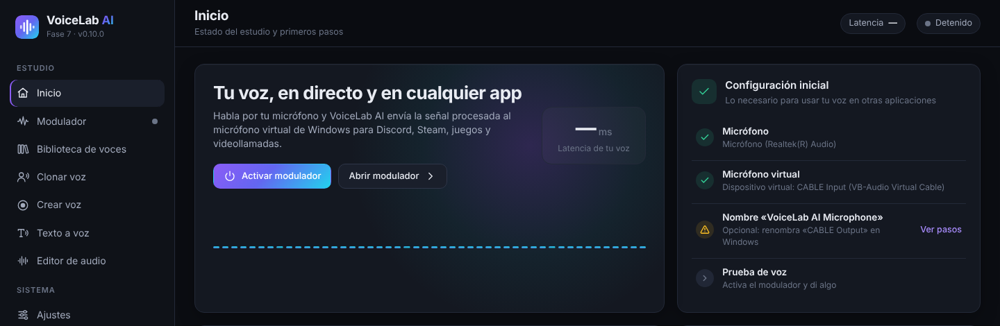

- **Activar modulador**: enciende el modulador sin salir de esta pantalla. También puedes usar **Ctrl + M** en cualquier momento.
- **Abrir modulador**: lleva al panel completo.
- **Configuración inicial**: una lista con lo necesario (micrófono, micrófono virtual, nombre del dispositivo y una prueba de voz). Un círculo verde significa que ese paso está listo.

En la barra lateral, abajo a la izquierda, siempre ves el estado del modulador y los medidores de entrada (**ENT**) y salida (**SAL**).

## 5. Modulador en tiempo real

1. Pulsa el **botón de encendido** grande. Pasa a **Activo** y muestra la frecuencia de muestreo, el tamaño de bloque, el uso de CPU y la **latencia** (el retraso de tu voz, en milisegundos).
2. Los medidores **Entrada** y **Salida** muestran el nivel de tu micrófono y de la voz procesada (pico y RMS). Lo ideal es que hables con la barra entre −24 y −12 dB.
3. En la tarjeta **Entrada**:
   - **Cambiar** abre la lista de micrófonos.
   - **Ganancia de entrada** sube o baja el volumen de tu micrófono antes de los efectos.
   - **Puerta de ruido** silencia el micrófono cuando no hablas. Actívala y sube el umbral si se oyen ruidos de fondo (teclado, ventilador).
4. En la tarjeta **Voz activa** eliges la voz que se usa:
   - **Perfil guardado**: cambia de perfil al instante, sin parar el modulador.
   - **Guardar como perfil nuevo** guarda los efectos actuales como un perfil.
   - **Guardar cambios en el perfil** actualiza el perfil que estás usando.
   - **Voz original** quita todos los efectos.

### 5.1 Salidas

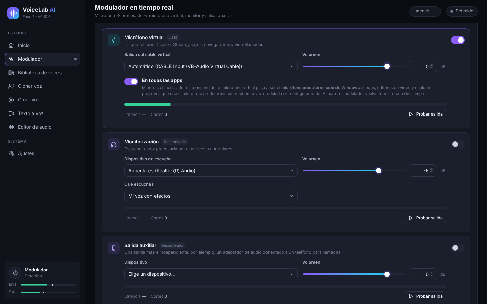

Puedes activar varias salidas a la vez y cambiarlas sin parar el modulador.

- **Micrófono virtual**: envía tu voz procesada a VB-CABLE. Es lo que reciben Discord, Steam, los juegos, los navegadores y las videollamadas. Con **Automático**, VoiceLab elige «CABLE Input» solo.
- **En todas las apps** (activado por defecto): mientras el modulador está encendido, el micrófono virtual pasa a ser el **micrófono predeterminado de Windows**. Así cualquier programa que use el micrófono predeterminado (juegos, editores de vídeo, el navegador…) recibe tu voz modulada sin configurar nada. VoiceLab sigue escuchando tu micrófono real. Al parar el modulador o cerrar la app, Windows vuelve a tu micrófono de siempre.
- **Monitorización**: para escucharte por los auriculares. En **Qué escuchas** eliges «Mi voz con efectos» o «Mi micrófono original (sin efectos)». Usa auriculares: con altavoces se puede producir acople (pitido), y la app te avisa antes de activarla.
- **Salida auxiliar**: una salida más e independiente, por ejemplo un adaptador de audio conectado a un teléfono para llamadas.
- Cada salida tiene su **Volumen**, un medidor, su latencia, un contador de **Cortes** y el botón **Probar salida**, que reproduce un sonido de prueba.

### 5.2 Efectos y preajustes

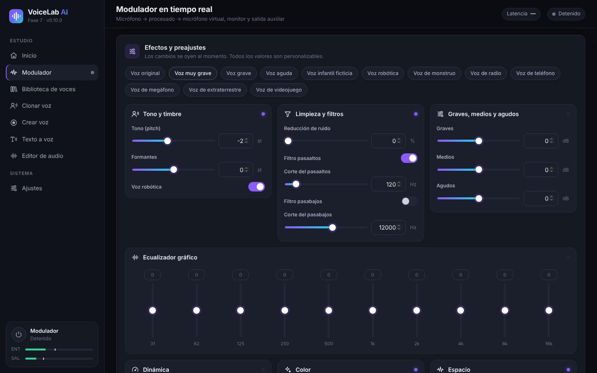

Arriba están los **preajustes**: Voz original, Voz muy grave, Voz grave, Voz aguda, Voz infantil ficticia, Voz robótica, Voz de monstruo, Voz de radio, Voz de teléfono, Voz de megáfono, Voz de extraterrestre y Voz de videojuego. Los cambios se oyen al momento y todos los valores se pueden ajustar:

| Grupo | Controles |
|---|---|
| Tono y timbre | **Tono (pitch)** en semitonos, **Formantes** (lo «grande» o «pequeña» que suena la voz) y **Voz robótica** |
| Limpieza y filtros | Reducción de ruido, filtro pasaaltos y filtro pasabajos |
| Graves, medios y agudos | Ecualizador sencillo de tres bandas |
| Ecualizador gráfico | 10 bandas, de 31 Hz a 16 kHz |
| Dinámica | Compresor (umbral, relación, compensación), limitador y ganancia de salida |
| Color | Saturación, distorsión, lo-fi de 8 bits y modulación en anillo |
| Espacio | Chorus, eco y reverberación |

Consejo: para una voz más grave pero natural, baja el **Tono** y baja un poco los **Formantes**. Si solo bajas el tono, la voz suena «de dibujos animados».

## 6. Voces con inteligencia artificial

Hay tres tipos de voces de IA:

| Tipo | Qué necesitas | Para qué sirve | Parecido |
|---|---|---|---|
| **IA instantánea** | 10–30 s de voz | Texto a voz y hablar en directo (retraso de 0,25 a 0,45 s) | Bueno |
| **Voz fiel (RVC entrenada)** | 1 min de voz como mínimo (mejor 10 min o más) y un entrenamiento de 30 min a 4 h | Hablar en directo con poco retraso | Muy alto |
| **Modelo RVC importado** | Un archivo `.onnx` que ya tengas | Hablar en directo | Depende del modelo |

Antes de usarlas, instala el motor de IA y los modelos en **Ajustes → Motor de IA y modelos** (ver [10.3](#103-motor-de-ia-y-modelos)).

### 6.1 Clonar una voz

1. Ve a **Clonar voz** y arrastra un archivo de audio o vídeo, o pulsa **elígelo en tu equipo**. Admite MP3, WAV, FLAC, M4A, AAC, OGG, MP4, MKV, MOV y WEBM; de los vídeos se extrae el audio solo. También puedes elegir un audio que ya tengas en VoiceLab.

   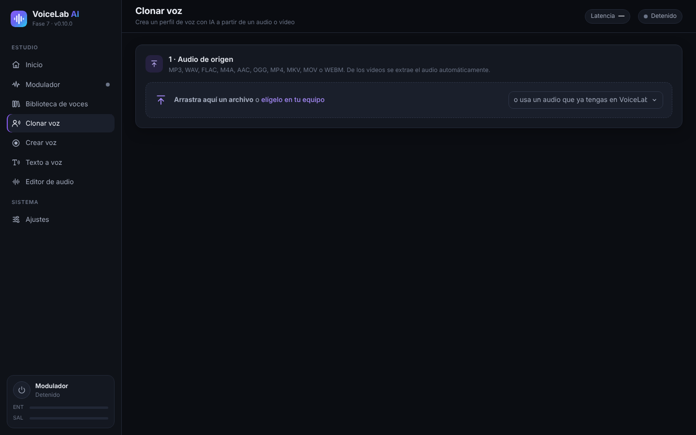

2. **Elige el fragmento con la voz**: arrastra sobre la onda para seleccionar. Con **Escuchar selección** compruebas que solo habla una persona. Lo ideal para la voz instantánea son 10–30 s claros. Si después quieres **entrenar una voz fiel**, selecciona toda la voz útil (1 minuto como mínimo, mejor 10 minutos o más).

   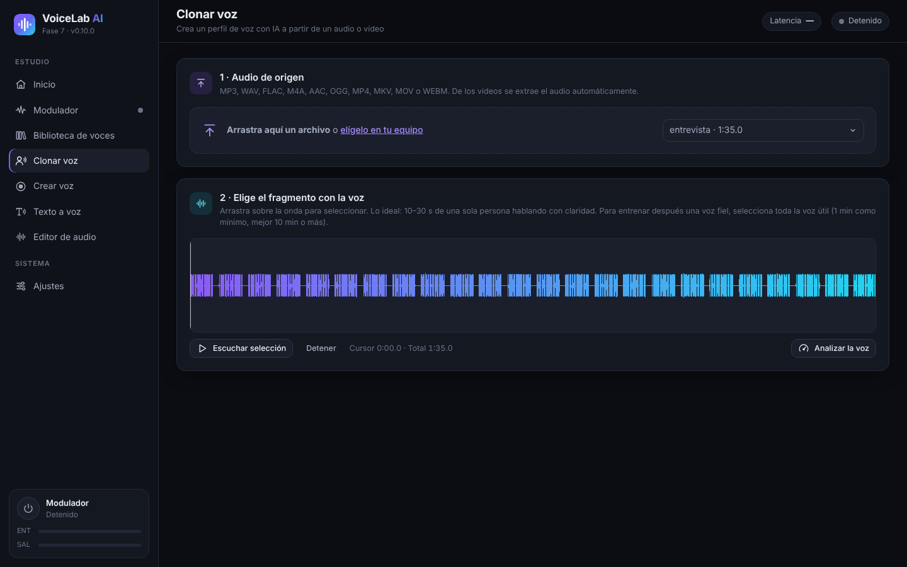

3. Pulsa **Analizar la voz**. Verás los segundos de voz útil, la relación señal/ruido, el tono medio y el nivel, y una barra que indica para qué alcanza: 10 s para la IA instantánea, 5 min para una voz fiel y 10 min para una voz fiel ideal.
4. **Crea el perfil**: escribe un nombre, el idioma de la voz y, si quieres, una carpeta y una descripción. Deja marcado **Limpiar ruido de fondo y silencios largos**.
5. Indica si **es tu propia voz** o si **tienes autorización** de la persona. Es obligatorio.
6. Pulsa **Crear perfil de voz**.

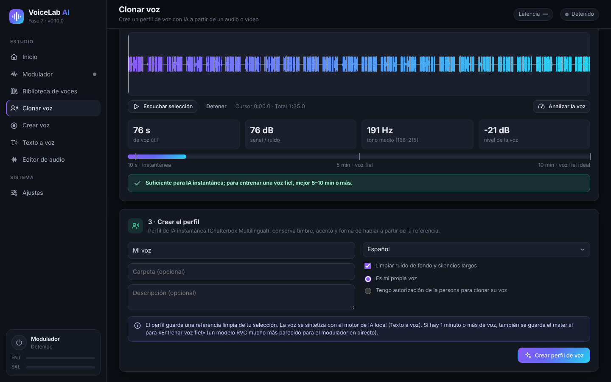

El perfil guarda una referencia limpia. Si la selección tiene 1 minuto o más de voz, también guarda el material para entrenar la voz fiel.

### 6.2 Grabar tu voz (Crear voz)

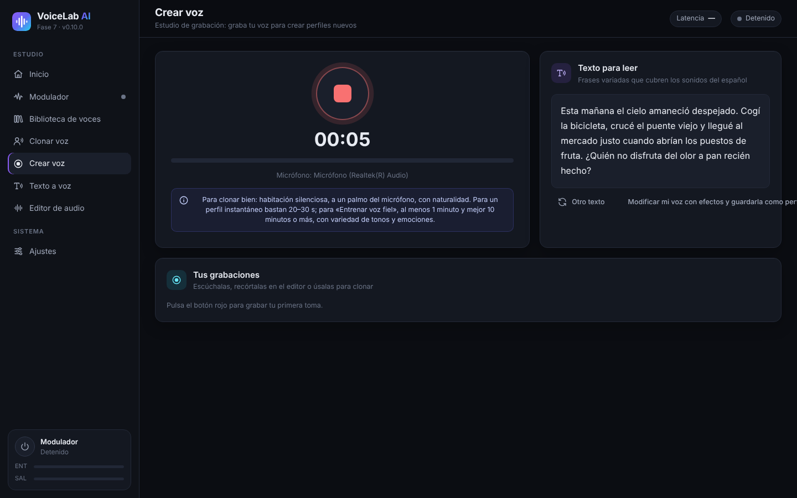

1. Ve a **Crear voz** y pulsa el **botón rojo** para grabar. Vuelve a pulsarlo para parar.
2. Lee las frases de **Texto para leer**: cubren todos los sonidos del español. **Otro texto** te muestra otras frases.
3. Tus tomas aparecen en **Tus grabaciones**. Desde ahí puedes escucharlas, abrirlas en el editor o usarlas para clonar.
4. **Modificar mi voz con efectos y guardarla como perfil** te lleva al modulador con tu grabación.

Para grabar bien: habitación silenciosa, a un palmo del micrófono y hablando con naturalidad, con variedad de tonos y emociones.

### 6.3 Hablar en directo con una voz instantánea

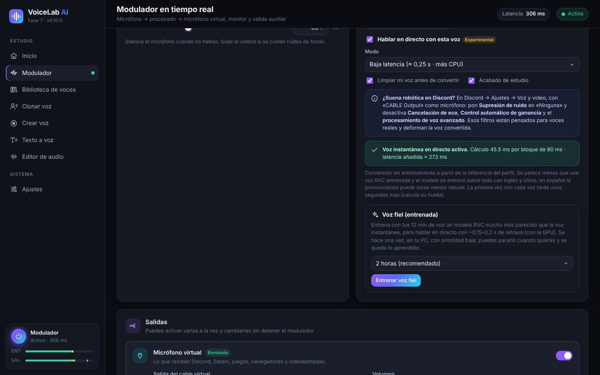

1. En el modulador, elige en **Perfil guardado** un perfil de tipo «IA instantánea».
2. La primera vez, pulsa **Instalar la voz en directo** (descarga unos 1,9 GB y ocupa unos 2,7 GB). Al terminar, la app mide la velocidad de tu PC y elige el mejor modo.
3. Marca **Hablar en directo con esta voz** y enciende el modulador. La primera vez con cada voz tarda unos segundos más (calcula su huella de voz).
4. **Modo**:
   - **Baja latencia** (≈ 0,25 s): menos retraso, pero usa unas tres veces más CPU.
   - **Calidad** (≈ 0,45 s): la voz se parece más y gasta menos CPU.
5. Opciones:
   - **Limpiar mi voz antes de convertir**: quita ruido de tu micrófono antes de la IA.
   - **Acabado de estudio**: de-esser, compresión y nivel automático.
   - **Alta definición 48 kHz**: solo en modo Calidad y si tu CPU la aguanta. Es una descarga opcional de 119 MB.
6. La línea verde de estado muestra el tiempo de cálculo por bloque y la **latencia añadida** real. Si aparece **«El procesador no llega a tiempo»**, cambia a «Calidad», desactiva la alta definición o cierra programas pesados.

La voz instantánea no necesita entrenamiento, pero se parece menos que una voz fiel. El modelo se entrenó sobre todo con inglés y chino, así que en otros idiomas la pronunciación puede sonar menos natural.

### 6.4 Entrenar una voz fiel (RVC)

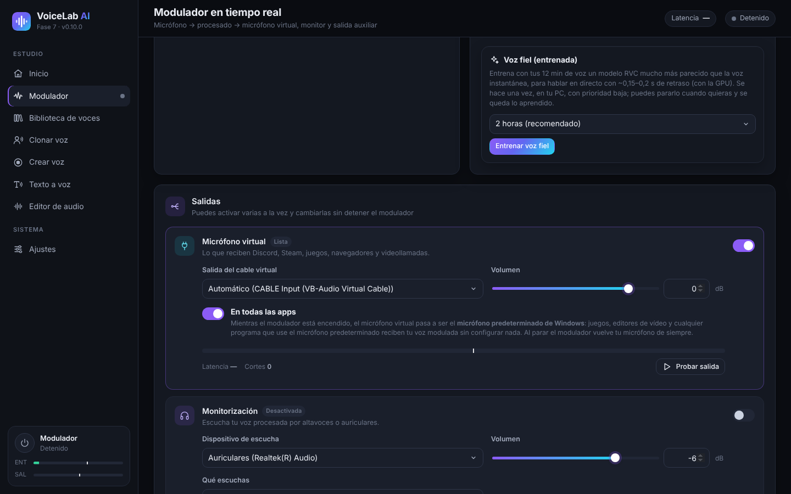

La voz fiel es un modelo RVC entrenado con tu audio, en tu PC. Se parece mucho más a la voz original y en directo tiene poco retraso (unos 0,15–0,2 s con tarjeta gráfica).

1. Activa un perfil de IA instantánea creado con **1 minuto de voz o más** (mejor 10 minutos o más). Si tu perfil se creó con menos, vuelve a crearlo en **Clonar voz** con un audio más largo.
2. En la tarjeta **Voz fiel (entrenada)**, elige la duración: 30 min (prueba rápida), 1 hora, **2 horas (recomendado)** o 4 horas (máxima). Más tiempo = más parecido.
3. Pulsa **Entrenar voz fiel**. La primera vez se descargan PyTorch (unos 250 MB) y los modelos base (unos 0,2 GB).
4. Verás el progreso, la fase y el tiempo restante. El entrenamiento usa la CPU con prioridad baja, así que puedes seguir usando el PC.
5. **Parar y usar lo aprendido** detiene el entrenamiento y crea la voz con lo aprendido hasta ese momento. Si cierras la app, se guarda y luego aparece **Continuar el entrenamiento**.
6. Al terminar se crea un perfil nuevo llamado «*nombre* (fiel)». Pulsa **Usar la voz fiel** para activarlo. Con **Seguir entrenando** puedes mejorarlo más tarde.

**Ajuste de tono**: la voz fiel sigue la entonación de tu voz. Si la voz original es más aguda o más grave que la tuya, usa **Ajuste de tono para esta voz** (de −24 a +24 semitonos) en la tarjeta del perfil. Como referencia, de voz masculina a femenina suele ir bien entre +8 y +12, y de femenina a masculina entre −8 y −12.

### 6.5 Importar un modelo RVC

Si ya tienes un modelo RVC en formato `.onnx`:

1. Instala el motor de IA y la **Base para conversión RVC** en *Ajustes*.
2. Ve a **Biblioteca de voces → Importar modelo RVC**, escribe un nombre y elige el archivo.
3. Actívalo en el modulador. En la tarjeta del perfil tienes el **Ajuste de tono**.

Solo se admiten modelos `.onnx`. Los `.pth` hay que convertirlos antes con la herramienta de exportación de RVC.

## 7. Texto a voz

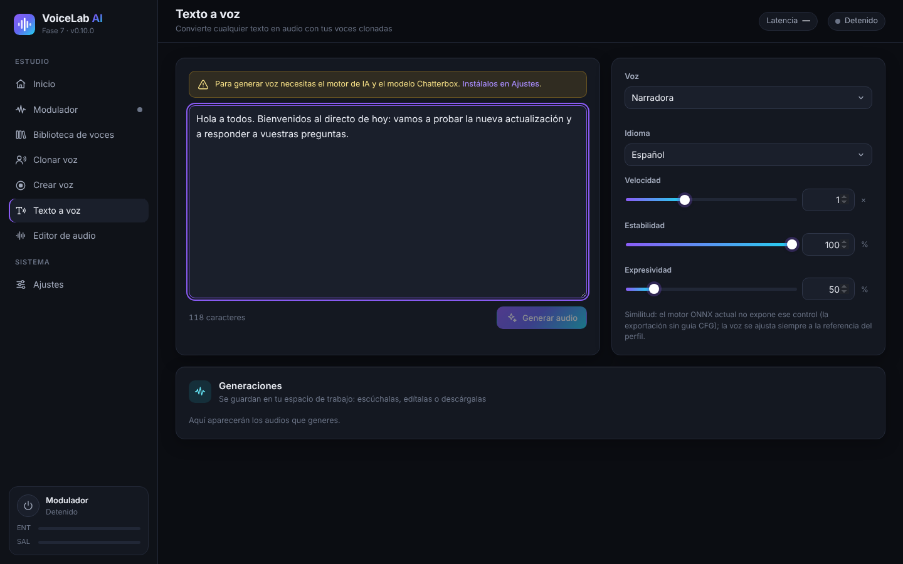

1. Instala el motor de IA y el modelo **Chatterbox Multilingual** (unos 3,2 GB) en *Ajustes → Motor de IA y modelos*.
2. Ve a **Texto a voz** y escribe o pega el texto.
3. Elige la **Voz** (cualquier perfil clonado) y el **Idioma**. Hay 23 idiomas, entre ellos español, inglés, francés, italiano, portugués, ruso, chino y japonés.
4. Ajusta:
   - **Velocidad**.
   - **Estabilidad**: más alta = más regular; más baja = más variada.
   - **Expresividad**: más emoción y énfasis.
5. Pulsa **Generar audio**. La primera generación tarda más (el modelo se carga en 1–4 minutos). **Cancelar** la detiene.
6. El resultado aparece en **Generaciones**: puedes escucharlo, abrirlo en el editor o descargarlo en WAV, MP3, FLAC u OGG.

El texto a voz se ejecuta en la CPU por defecto. En *Ajustes* puedes probar la GPU; si falla, la app vuelve sola a la CPU.

## 8. Editor de audio

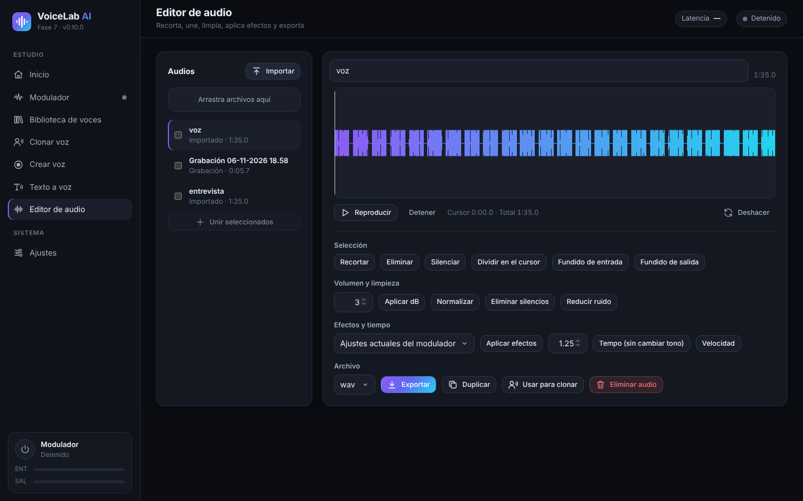

- **Audios**: importa archivos (o arrástralos), y verás también tus grabaciones y generaciones. Marca varios y pulsa **Unir seleccionados** para juntarlos.
- **Onda**: arrastra para seleccionar. Tienes **Reproducir**, **Detener** y **Deshacer**.
- **Selección**: Recortar, Eliminar, Silenciar, Dividir en el cursor, Fundido de entrada y Fundido de salida.
- **Volumen y limpieza**: Aplicar dB, Normalizar, Eliminar silencios y Reducir ruido.
- **Efectos y tiempo**:
  - **Aplicar efectos**: usa los ajustes actuales del modulador o un perfil guardado.
  - **Tempo**: cambia la velocidad sin cambiar el tono.
  - **Velocidad**: cambia velocidad y tono a la vez.
- **Archivo**: elige el formato (WAV, MP3, FLAC u OGG) y pulsa **Exportar**. También puedes **Duplicar**, **Usar para clonar** o **Eliminar audio**.

## 9. Biblioteca de voces

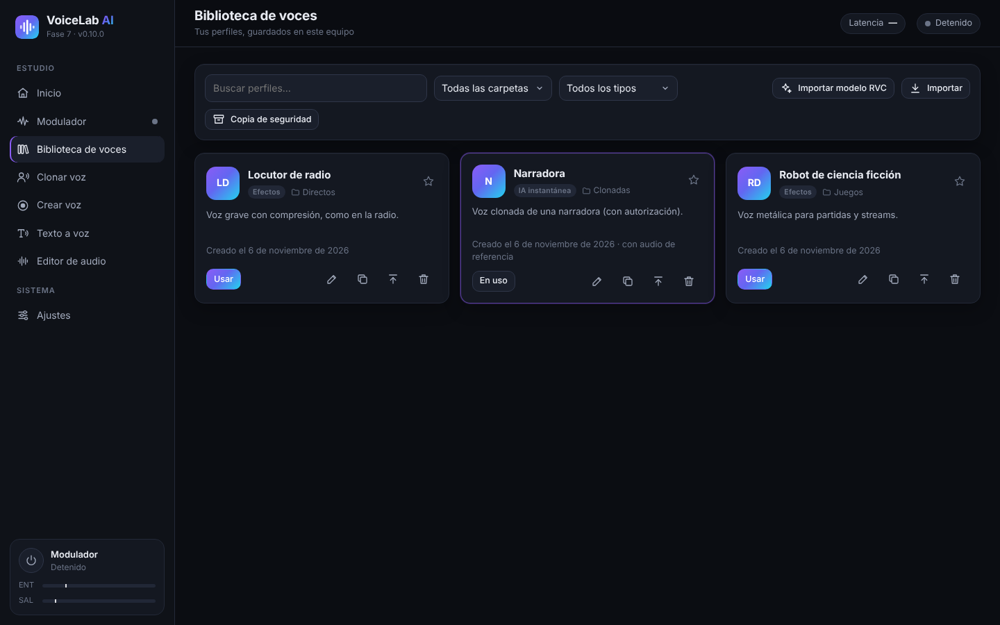

- **Busca** por nombre y **filtra** por carpeta o por tipo: Efectos, IA instantánea o IA entrenada (RVC).
- Cada tarjeta muestra el tipo, la carpeta y la descripción del perfil. La estrella lo marca como favorito.
- Botones de cada tarjeta:
  - **Usar**: activa el perfil en el modulador.
  - **Editar**: cambia el nombre, la carpeta o la descripción.
  - **Duplicar**.
  - **Exportar**: crea un archivo `.vlprofile` para pasarlo a otro PC.
  - **Eliminar**.
- **Importar** añade perfiles exportados (`.vlprofile`). **Importar modelo RVC** añade modelos `.onnx`.
- **Copia de seguridad** guarda todos tus perfiles en un único archivo.

## 10. Ajustes

### 10.1 Dispositivos de audio

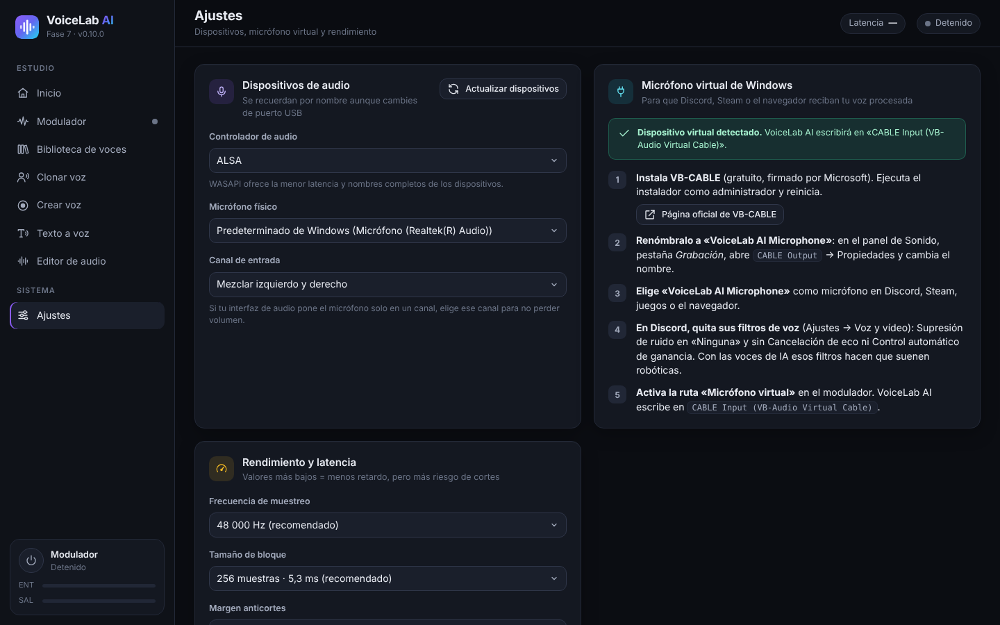

- **Controlador de audio**: en Windows, **WASAPI** ofrece la menor latencia.
- **Micrófono físico**: el micrófono real que escucha VoiceLab. Se recuerda por su nombre, aunque cambies de puerto USB.
- **Canal de entrada**: si tu interfaz de audio pone el micrófono solo en un canal, elige ese canal.
- **Actualizar dispositivos**: vuelve a buscar los dispositivos si conectas algo nuevo.
- La tarjeta **Micrófono virtual de Windows** repite los pasos de instalación de VB-CABLE y te dice si lo detecta.

### 10.2 Rendimiento y latencia

- **Frecuencia de muestreo**: 48 000 Hz (recomendado) o 44 100 Hz.
- **Tamaño de bloque**: más pequeño = menos retraso, pero más riesgo de cortes. 256 muestras (5,3 ms) va bien en casi todos los equipos.
- **Margen anticortes**: súbelo si oyes chasquidos.

### 10.3 Motor de IA y modelos

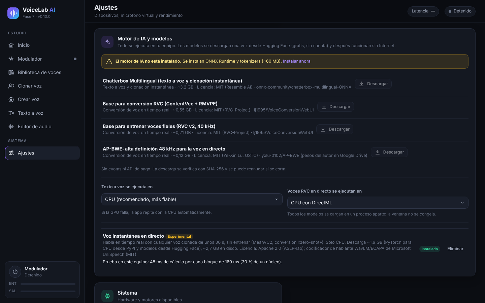

Los modelos se descargan una vez desde Hugging Face (gratis y sin cuenta) y luego funcionan sin Internet. Cada descarga se verifica y se puede reanudar si se corta.

| Componente | Tamaño | Para qué |
|---|---|---|
| Motor de IA (ONNX Runtime y tokenizers) | ~60 MB | Necesario para todo lo de IA |
| Chatterbox Multilingual | ~3,2 GB | Texto a voz y clonación instantánea |
| Base para conversión RVC (ContentVec + RMVPE) | ~0,55 GB | Voces RVC en directo (importadas o entrenadas) |
| Base para entrenar voces fieles (RVC v2, 40 kHz) | ~0,21 GB | Entrenar voz fiel |
| AP-BWE (alta definición) | ~0,12 GB | Opcional para la voz instantánea en modo Calidad |
| Voz instantánea en directo (MeanVC2 + PyTorch para CPU) | ~1,9 GB de descarga | Hablar en directo con voces instantáneas |

También eliges dónde se ejecuta cada cosa:

- **Texto a voz se ejecuta en**: CPU (recomendado) o GPU.
- **Voces RVC en directo se ejecutan en**: GPU con DirectML (recomendado si tienes tarjeta gráfica) o CPU.

## 11. Usar tu voz en Discord, juegos, OBS y editores de vídeo

Con **En todas las apps** activado (ver [5.1](#51-salidas)), cualquier programa que use el micrófono predeterminado de Windows ya recibe tu voz modulada. Algunos programas necesitan un paso más:

- **Discord**:
  1. En *Ajustes de usuario → Voz y vídeo*, pon como **Dispositivo de entrada** «CABLE Output» (o «VoiceLab AI Microphone») o «Predeterminado».
  2. Pon **Supresión de ruido** en **Ninguna**.
  3. Desactiva **Cancelación de eco**, **Control automático de ganancia** y el **procesamiento de voz avanzado**. Con las voces de IA esos filtros hacen que suenen robóticas.
- **Juegos**: casi todos usan el micrófono predeterminado. Si un juego solo mira el micrófono al arrancar, ábrelo con el modulador ya encendido.
- **OBS Studio**: añade una fuente **Captura de entrada de audio** con «CABLE Output», o usa «Predeterminado».
- **Editores de vídeo** (DaVinci Resolve, Premiere, CapCut…): para grabar una voz en off con efectos, elige «CABLE Output» o el micrófono predeterminado como entrada de grabación.
- **Navegador y videollamadas** (Meet, Teams, Zoom): elige «CABLE Output» o «Predeterminado» en la configuración de audio de cada servicio.

## 12. Solución de problemas

| Problema | Qué hacer |
|---|---|
| Los demás no me oyen | Comprueba que el modulador esté **Activo** y que la salida **Micrófono virtual** esté encendida. En el otro programa, elige «CABLE Output» o «Predeterminado». |
| «No se detecta el micrófono virtual» | Instala VB-CABLE como administrador y reinicia el PC. Luego pulsa **Actualizar dispositivos** en *Ajustes*. |
| La voz de IA suena robótica en Discord | Quita los filtros de voz de Discord (ver [11](#11-usar-tu-voz-en-discord-juegos-obs-y-editores-de-vídeo)). |
| Cortes, chasquidos o «el procesador no llega a tiempo» | Usa el modo **Calidad** sin alta definición y cierra programas pesados. Sube el **Margen anticortes** o el **Tamaño de bloque**. |
| Mucho retraso | Usa el modo **Baja latencia** si tu CPU lo aguanta, o una **voz fiel** con la GPU. La latencia real aparece en el modulador. |
| Pitido o acople | Usa auriculares para la monitorización, no altavoces. |
| Se oye ruido de fondo | Activa la **Puerta de ruido** y la **Reducción de ruido**, o **Limpiar mi voz antes de convertir** en las voces de IA. |
| El texto a voz tarda la primera vez | Es normal: el modelo se carga en 1–4 minutos. Las siguientes generaciones son más rápidas. |
| Un programa sigue con el micrófono de antes | Algunos programas solo leen el micrófono al abrirse: ciérralo y ábrelo con el modulador encendido. |
| Necesito los registros para pedir ayuda | Están en `%APPDATA%\VoiceLabAI\logs` (`voicelab.log`, `voz-instantanea.log` y `entrenamiento.log`). |

## 13. Privacidad y uso responsable

- **Todo se procesa en tu PC.** Tu voz, tus perfiles y tus grabaciones no se envían a ningún servidor. Internet solo se usa para descargar la app y los modelos.
- **Clona solo tu propia voz o voces de personas que te hayan dado permiso.** La app pide confirmarlo al crear cada perfil.
- No uses voces clonadas para engañar, suplantar a nadie ni cometer fraudes. En muchos países es ilegal.
- Los modelos de IA tienen sus propias licencias (MIT y Apache 2.0). Las tienes en *Ajustes → Motor de IA y modelos* y en el [README](../../README.md).

---

Atajo: **Ctrl + M** enciende y apaga el modulador. Datos de la app: `%APPDATA%\VoiceLabAI`.
