# Manuel d'utilisation de VoiceLab AI

[Español](es.md) · [English](en.md) · **Français** · [Italiano](it.md) · [Português](pt.md) · [Русский](ru.md) · [中文](zh.md) · [日本語](ja.md)

VoiceLab AI est un studio vocal pour Windows : modifiez votre voix en temps réel, clonez des voix grâce à l'intelligence artificielle et transformez du texte en parole. Tout fonctionne sur votre ordinateur, sans abonnement ni service dans le cloud.

> Ce manuel correspond à la version 0.11. Les captures utilisent des profils et des périphériques d'exemple.
>
> **L'interface est disponible en 8 langues** (Español, English, Français, Italiano, Português, Русский, 中文, 日本語). Elle suit automatiquement la langue de Windows et vous pouvez la changer dans **Réglages → Langue de l'interface**. Ce manuel utilise les noms français des boutons et des options.

## Sommaire

1. [Ce que vous pouvez faire](#1-ce-que-vous-pouvez-faire)
2. [Configuration requise](#2-configuration-requise)
3. [Installation](#3-installation)
4. [Écran d'accueil](#4-écran-daccueil)
5. [Modulateur en temps réel](#5-modulateur-en-temps-réel)
6. [Voix par intelligence artificielle](#6-voix-par-intelligence-artificielle)
7. [Synthèse vocale](#7-synthèse-vocale)
8. [Éditeur audio](#8-éditeur-audio)
9. [Bibliothèque de voix](#9-bibliothèque-de-voix)
10. [Réglages](#10-réglages)
11. [Utiliser votre voix dans Discord, les jeux, OBS et les logiciels de montage](#11-utiliser-votre-voix-dans-discord-les-jeux-obs-et-les-logiciels-de-montage)
12. [Résolution des problèmes](#12-résolution-des-problèmes)
13. [Confidentialité et usage responsable](#13-confidentialité-et-usage-responsable)

---

## 1. Ce que vous pouvez faire

- **Modifier votre voix en direct** avec des effets (hauteur, formants, robot, radio, écho, réverbération…) et l'envoyer à n'importe quel logiciel via un micro virtuel.
- **Cloner une voix** à partir d'un fichier audio ou vidéo, puis l'utiliser pour lire des textes (synthèse vocale) ou pour parler en direct.
- **Entraîner une « voix fidèle »** : un modèle RVC beaucoup plus ressemblant, pour parler en direct avec peu de latence.
- **Enregistrer et éditer de l'audio** : couper, assembler, réduire le bruit, appliquer des effets et exporter en WAV, MP3, FLAC ou OGG.
- **Organiser vos voix** dans une bibliothèque avec dossiers, favoris, export et sauvegardes.

## 2. Configuration requise

| | Minimum | Recommandé |
|---|---|---|
| Système | Windows 10 64 bits | Windows 11 |
| Processeur | 4 cœurs | 8 cœurs (pour la voix instantanée et l'entraînement) |
| Mémoire | 8 Go | 16 Go ou plus |
| Disque | 1 Go pour l'application | +8 Go si vous installez tous les modèles d'IA |
| Carte graphique | Non nécessaire | Compatible DirectX 12 (AMD, NVIDIA ou Intel) pour les voix RVC en direct |
| Micro virtuel | [VB-CABLE](https://vb-audio.com/Cable/) (gratuit) | — |

Internet n'est nécessaire que pour télécharger l'application et, une seule fois, les modèles d'IA choisis.

## 3. Installation

### 3.1 Installer l'application

1. Téléchargez `VoiceLabAI-Setup-x.y.z.exe` depuis la page des [versions (Releases)](https://github.com/demfisalvarez/VoiceLab-AI/releases/latest).
2. Lancez-le. Si Windows affiche « Windows a protégé votre ordinateur », cliquez sur **l'installateur n'est pas signé par un certificat commercial**.
3. Suivez l'assistant. L'installation se fait pour votre utilisateur uniquement, sans droits d'administrateur.
4. Ouvrez **VoiceLab AI** depuis le menu Démarrer ou le bureau.

Pour la désinstaller : *Paramètres Windows → Applications → VoiceLab AI → Désinstaller*. Vos profils et réglages sont enregistrés dans `%APPDATA%\VoiceLabAI`.

### 3.2 Installer le micro virtuel (VB-CABLE)

Le micro virtuel permet à Discord, aux jeux ou au navigateur « d'entendre » votre voix modifiée.

1. Téléchargez VB-CABLE depuis sa [page officielle](https://vb-audio.com/Cable/) (gratuit, signé par Microsoft).
2. Décompressez l'archive, faites un clic droit sur `VBCABLE_Setup_x64.exe` → **Exécuter en tant qu'administrateur** → **Install Driver**.
3. Redémarrez l'ordinateur.
4. Facultatif : renommez-le pour mieux le repérer. Dans **Réglages → Ouvrir le panneau Son**, onglet **Enregistrement**, ouvrez **CABLE Output → Propriétés** et renommez-le « VoiceLab AI Microphone ».

### 3.3 Premier lancement

À l'ouverture, l'écran **Accueil** s'affiche. La carte **Configuration initiale** vérifie votre micro et le micro virtuel, et indique ce qu'il manque.

## 4. Écran d'accueil

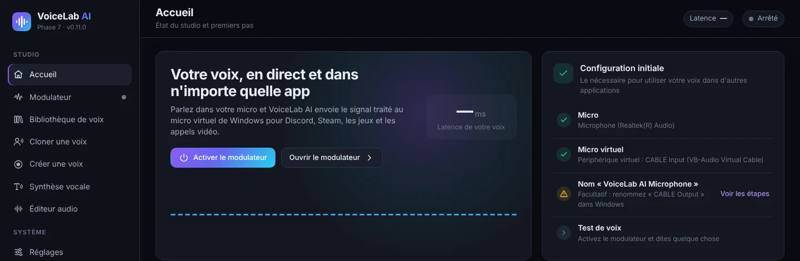

- **Activer le modulateur** l'allume sans quitter cet écran. Vous pouvez aussi utiliser **Ctrl + M** à tout moment.
- **Ouvrir le modulateur** affiche le panneau complet.
- **Configuration initiale** liste ce qui est nécessaire : micro, micro virtuel, nom du périphérique et test de voix. Un cercle vert indique que l'étape est prête.

En bas de la barre latérale, vous voyez toujours l'état du modulateur et les vumètres d'entrée (**ENT**) et de sortie (**SOR**).

## 5. Modulateur en temps réel

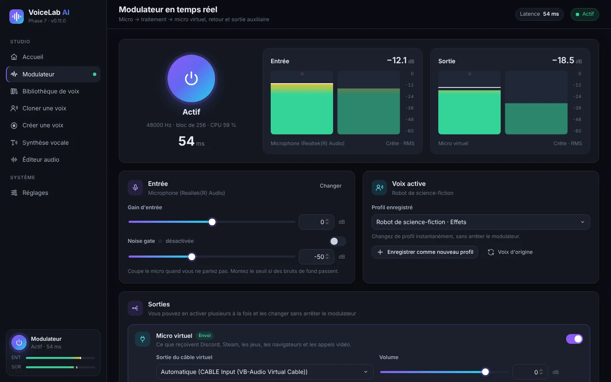

1. Appuyez sur le grand **bouton marche**. Il passe à **Actif** et affiche la fréquence d'échantillonnage, la taille de bloc, l'utilisation du processeur et la **latence** (le retard de votre voix, en millisecondes).
2. Les vumètres **Entrée** et **Sortie** montrent le niveau de votre micro et de la voix traitée (crête et RMS). L'idéal est de parler avec la barre entre −24 et −12 dB.
3. Dans la carte **Entrée** :
   - **Changer** ouvre la liste des micros.
   - **Gain d'entrée** augmente ou baisse le volume du micro avant les effets.
   - **Noise gate** coupe le micro quand vous ne parlez pas. Activez-la et montez le seuil si des bruits de fond passent (clavier, ventilateur).
4. Dans la carte **Voix active**, vous choisissez la voix utilisée :
   - **Profil enregistré** change de profil instantanément, sans arrêter le modulateur.
   - **Enregistrer comme nouveau profil** enregistre les effets actuels en profil.
   - **Enregistrer les modifications du profil** met à jour le profil en cours.
   - **Voix d'origine** retire tous les effets.

### 5.1 Sorties

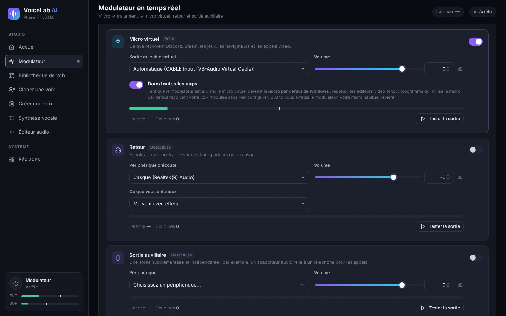

Vous pouvez activer plusieurs sorties à la fois et les modifier sans arrêter le modulateur.

- **Micro virtuel** envoie votre voix traitée vers VB-CABLE. C'est ce que reçoivent Discord, Steam, les jeux, les navigateurs et les appels vidéo. En mode **Automatique**, VoiceLab choisit « CABLE Input » tout seul.
- **Dans toutes les apps**, activé par défaut : tant que le modulateur est allumé, le micro virtuel devient le **micro par défaut de Windows**. Tout logiciel qui utilise le micro par défaut (jeux, logiciels de montage, navigateur…) reçoit alors votre voix modulée sans aucun réglage. VoiceLab continue d'écouter votre vrai micro. Quand vous arrêtez le modulateur ou fermez l'application, Windows revient à votre micro habituel.
- **Retour** vous permet de vous écouter au casque. Dans **Ce que vous entendez**, choisissez « Ma voix avec effets » ou « Mon micro d'origine (sans effets) ». Utilisez un casque : avec des haut-parleurs, un larsen (sifflement) peut se produire, et l'application vous prévient avant de l'activer.
- **Sortie auxiliaire** est une sortie supplémentaire et indépendante, par exemple un adaptateur audio relié à un téléphone pour passer des appels.
- Chaque sortie a son **Volume**, un vumètre, sa latence, un compteur de **Coupures** et un bouton **Tester la sortie** qui joue un son de test.

### 5.2 Effets et préréglages

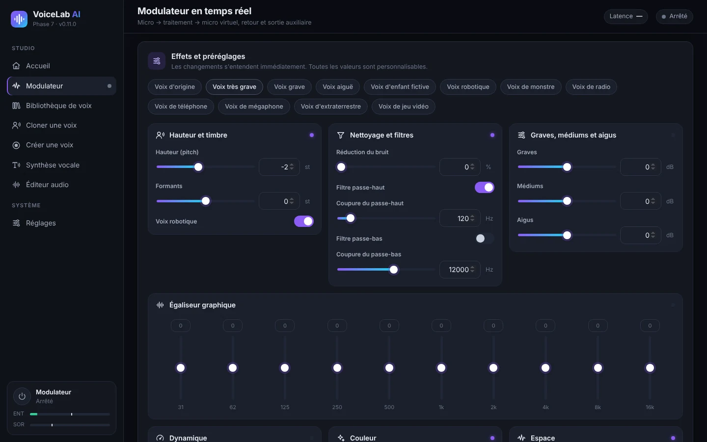

En haut se trouvent les **préréglages** : voix originale, très grave, grave, aiguë, voix d'enfant fictive, robot, monstre, radio, téléphone, mégaphone, extraterrestre et jeu vidéo. Les changements s'entendent immédiatement et toutes les valeurs sont réglables :

| Groupe | Réglages |
|---|---|
| Hauteur et timbre | **Hauteur (pitch)** en demi-tons, **Formants** (voix plus « grande » ou plus « petite ») et **Voix robotique** |
| Nettoyage et filtres | Réduction du bruit, filtre passe-haut et filtre passe-bas |
| Graves, médiums et aigus | Égaliseur simple à trois bandes |
| Égaliseur graphique | 10 bandes, de 31 Hz à 16 kHz |
| Dynamique | Compresseur (seuil, ratio, compensation), limiteur et gain de sortie |
| Couleur | Saturation, distorsion, lo-fi 8 bits et modulation en anneau |
| Espace | Chorus, écho et réverbération |

Astuce : pour une voix plus grave mais naturelle, baissez le **Hauteur** et un peu les **Formants**. Si vous baissez seulement la hauteur, la voix sonne comme un dessin animé.

## 6. Voix par intelligence artificielle

Il existe trois types de voix d'IA :

| Type | Ce qu'il faut | Usage | Ressemblance |
|---|---|---|---|
| **IA instantanée** | 10 à 30 s de voix | Synthèse vocale et parole en direct (0,25 à 0,45 s de latence) | Bonne |
| **Voix fidèle (entraînée)** | Au moins 1 min de voix (idéalement 10 min ou plus) et 30 min à 4 h d'entraînement | Parler en direct avec peu de latence | Très élevée |
| **Modèle RVC importé** | Un fichier `.onnx` que vous avez déjà | Parler en direct | Dépend du modèle |

Avant de les utiliser, installez le moteur d'IA et les modèles dans **Réglages → Moteur d'IA et modèles**. Voir [10.3](#103-moteur-dia-et-modèles).

### 6.1 Cloner une voix

1. Allez dans **Cloner une voix** et faites glisser un fichier audio ou vidéo, ou cliquez sur **choisissez-le sur votre ordinateur**. Formats acceptés : MP3, WAV, FLAC, M4A, AAC, OGG, MP4, MKV, MOV et WEBM. L'audio des vidéos est extrait automatiquement. Vous pouvez aussi choisir un audio déjà présent dans VoiceLab.

   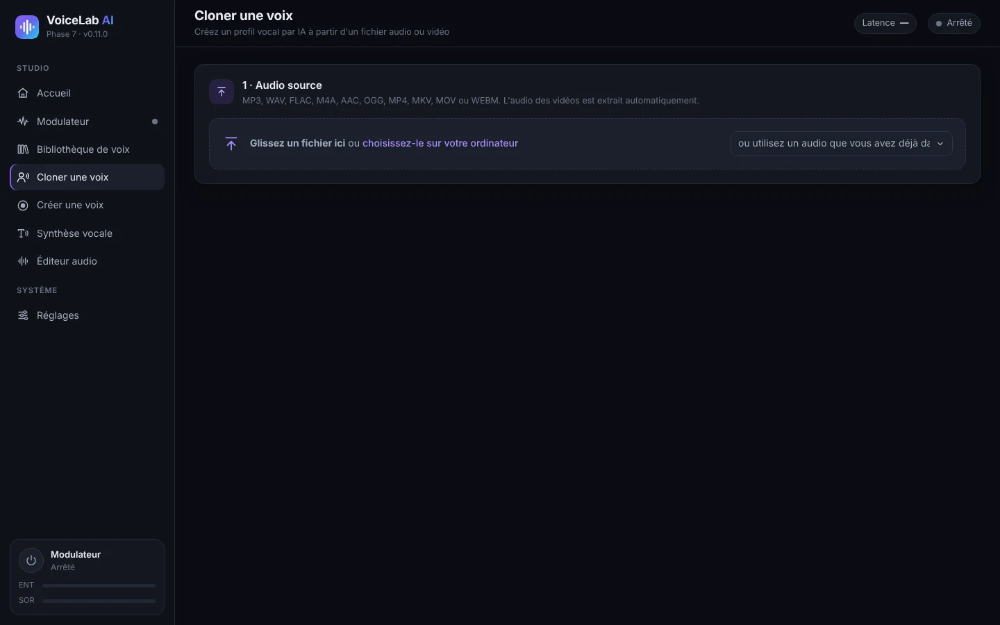

2. **Choisissez le passage avec la voix** : faites glisser sur la forme d'onde pour sélectionner. Avec **Écouter la sélection**, vérifiez qu'une seule personne parle. Pour une voix instantanée, 10 à 30 secondes claires suffisent. Si vous voulez ensuite **entraîner une voix fidèle**, sélectionnez toute la voix utile (au moins 1 minute, idéalement 10 minutes ou plus).

   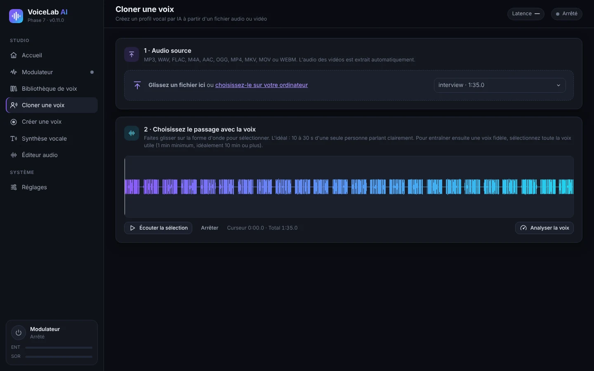

3. Cliquez sur **Analyser la voix**. Vous verrez les secondes de voix utile, le rapport signal/bruit, la hauteur moyenne et le niveau. Une barre indique ce que cela permet : 10 s pour une voix instantanée, 5 min pour une voix fidèle et 10 min pour une voix fidèle idéale.
4. **Crear el perfil** (Créer le profil) : saisissez un nom et la langue de la voix et, si vous le souhaitez, un dossier et une description. Laissez coché **Supprimer le bruit de fond et les longs silences**.
5. Indiquez si **C'est ma propre voix** ou si **J'ai l'autorisation de la personne**. C'est obligatoire.
6. Cliquez sur **Créer le profil vocal**.

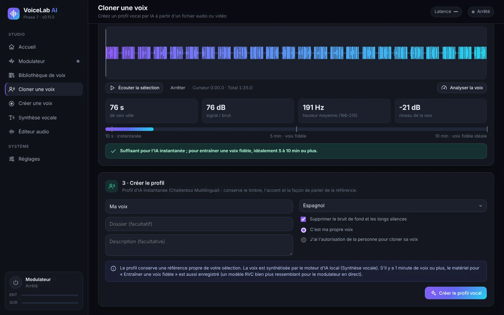

Le profil conserve une référence propre. Si la sélection contient 1 minute de voix ou plus, il conserve aussi le matériel pour entraîner une voix fidèle.

### 6.2 Enregistrer votre voix (Créer une voix)

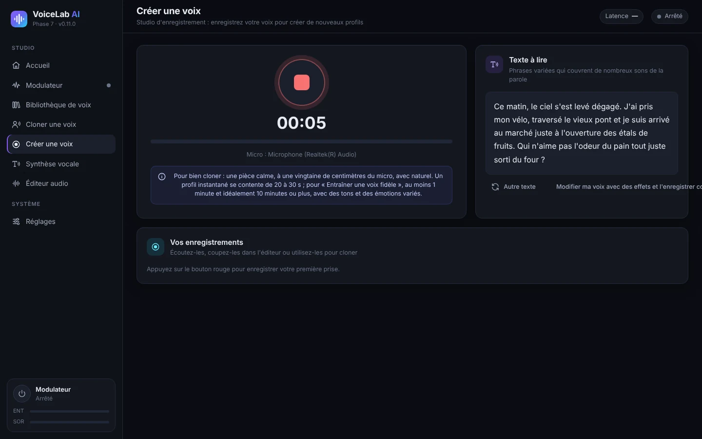

1. Allez dans **Créer une voix** et appuyez sur le **bouton rouge** pour enregistrer. Appuyez de nouveau pour arrêter.
2. Lisez les phrases de **Texte à lire**. Elles couvrent tous les sons de l'espagnol. **Autre texte** affiche d'autres phrases.
3. Vos prises apparaissent dans **Vos enregistrements**. De là, vous pouvez les écouter, les ouvrir dans l'éditeur ou les utiliser pour cloner.
4. **Modifier ma voix avec des effets et l'enregistrer comme profil** vous emmène au modulateur avec votre enregistrement.

Pour bien enregistrer : une pièce calme, à une main du micro, en parlant naturellement avec des tons et des émotions variés.

### 6.3 Parler en direct avec une voix instantanée

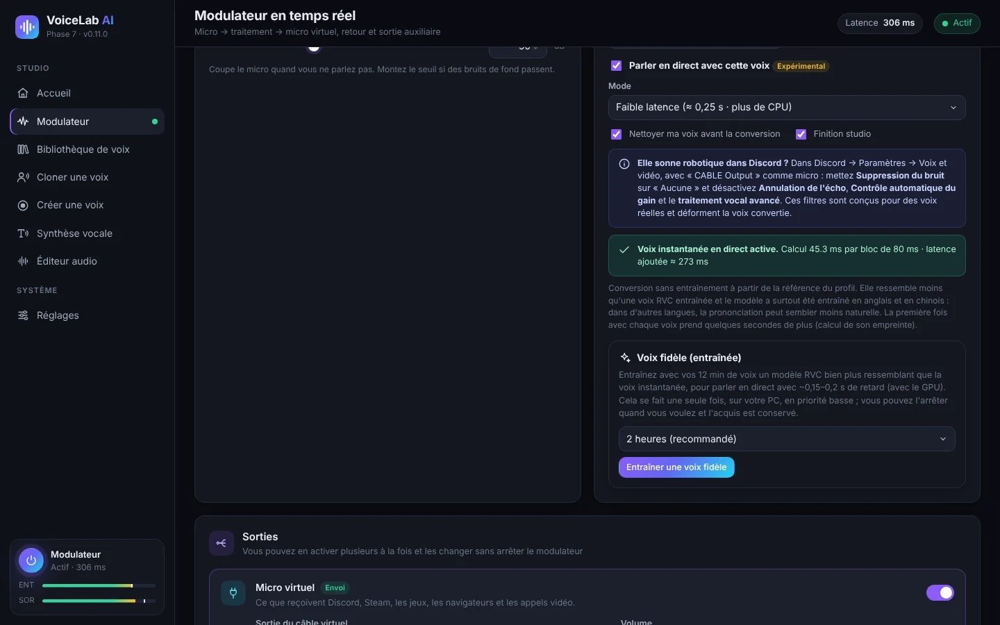

1. Dans le modulateur, choisissez un profil « IA instantanée » dans **Profil enregistré**.
2. La première fois, cliquez sur **Installer la voix en direct**. Le téléchargement fait environ 1,9 Go et occupe environ 2,7 Go sur le disque. Ensuite, l'application mesure la vitesse de votre PC et choisit le meilleur mode.
3. Cochez **Parler en direct avec cette voix** et allumez le modulateur. La première fois avec chaque voix, cela prend quelques secondes de plus (calcul de l'empreinte vocale).
4. **Mode** :
   - **Faible latence** (≈ 0,25 s) : moins de retard, mais environ trois fois plus de processeur.
   - **Qualité** (≈ 0,45 s) : voix plus ressemblante et moins de processeur.
5. Options :
   - **Nettoyer ma voix avant la conversion** enlève le bruit du micro avant l'IA.
   - **Finition studio** ajoute un de-esser, de la compression et un niveau automatique.
   - **Haute définition 48 kHz** ne fonctionne qu'en mode Qualité et si votre processeur suit. C'est un téléchargement facultatif de 119 Mo.
6. La ligne d'état verte affiche le temps de calcul par bloc et la **latence ajoutée** réelle. Si **« Le processeur n'arrive pas à suivre »** s'affiche, passez en mode Qualité, désactivez la haute définition ou fermez les logiciels lourds.

La voix instantanée ne demande aucun entraînement, mais elle ressemble moins à l'original qu'une voix fidèle. Le modèle a surtout été entraîné en anglais et en chinois : dans d'autres langues, la prononciation peut sembler moins naturelle.

### 6.4 Entraîner une voix fidèle (RVC)

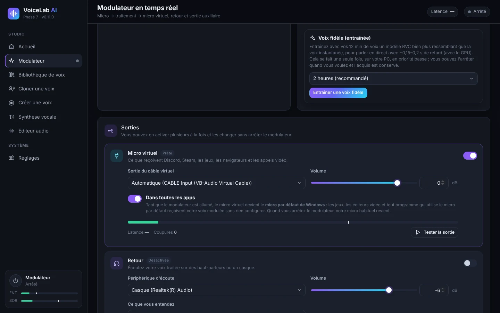

La voix fidèle est un modèle RVC entraîné avec votre audio, sur votre PC. Elle ressemble beaucoup plus à la voix d'origine et a peu de latence en direct (environ 0,15 à 0,2 s avec une carte graphique).

1. Activez un profil d'IA instantanée créé avec **1 minute de voix ou plus** (idéalement 10 minutes ou plus). Si votre profil a été créé avec moins, recréez-le dans **Cloner une voix** avec un audio plus long.
2. Dans la carte **Voix fidèle (entraînée)**, choisissez la durée : 30 min (test rapide), 1 heure, **2 heures** (recommandé) ou 4 heures (maximum). Plus de temps = plus de ressemblance.
3. Cliquez sur **Entraîner une voix fidèle**. La première fois, PyTorch (environ 250 Mo) et les modèles de base (environ 0,2 Go) sont téléchargés.
4. Vous verrez la progression, l'étape en cours et le temps restant. L'entraînement utilise le processeur en priorité basse : vous pouvez continuer à utiliser votre PC.
5. **Arrêter et utiliser l'acquis** arrête l'entraînement et crée la voix avec ce qui a été appris jusque-là. Si vous fermez l'application, la progression est enregistrée et **Reprendre l'entraînement** apparaîtra.
6. À la fin, un nouveau profil « *nom* (fiel) » est créé. Cliquez sur **Utiliser la voix fidèle** pour l'activer. Vous pourrez l'améliorer plus tard avec **Continuer l'entraînement**.

**Réglage de hauteur** : la voix fidèle suit l'intonation de votre voix. Si la voix d'origine est plus aiguë ou plus grave que la vôtre, utilisez **Réglage de hauteur pour cette voix**, de −24 à +24 demi-tons, dans la carte du profil. À titre indicatif, d'une voix d'homme à une voix de femme, entre +8 et +12 donne de bons résultats ; d'une voix de femme à une voix d'homme, entre −8 et −12.

### 6.5 Importer un modèle RVC

Si vous avez déjà un modèle RVC au format `.onnx` :

1. Installez le moteur d'IA et la **Base de conversion RVC** dans *Réglages*.
2. Allez dans **Bibliothèque de voix → Importer un modèle RVC**, saisissez un nom et choisissez le fichier.
3. Activez-le dans le modulateur. La carte du profil propose l'**Réglage de hauteur**.

Seuls les modèles `.onnx` sont acceptés. Les fichiers `.pth` doivent d'abord être convertis avec l'outil d'export de RVC.

## 7. Synthèse vocale

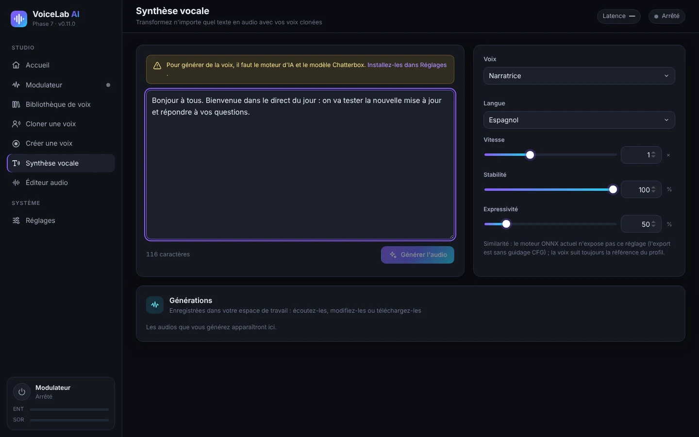

1. Installez le moteur d'IA et le modèle **environ 3** (2 Go) dans *Réglages → Moteur d'IA et modèles*.
2. Allez dans **Synthèse vocale** et saisissez ou collez votre texte.
3. Choisissez la **Voix**, n'importe quel profil cloné, et l'**Langue**. Il y a 23 langues, dont l'espagnol, l'anglais, le français, l'italien, le portugais, le russe, le chinois et le japonais.
4. Réglez :
   - **Vitesse**.
   - **Stabilité** : plus haute = plus régulière, plus basse = plus variée.
   - **Expressivité** : plus d'émotion et d'emphase.
5. Cliquez sur **Générer l'audio**. La première génération est plus longue (le modèle se charge en 1 à 4 minutes). **Annuler** l'interrompt.
6. Le résultat apparaît dans **Générations** : vous pouvez l'écouter, l'ouvrir dans l'éditeur ou le télécharger en WAV, MP3, FLAC ou OGG.

La synthèse vocale utilise le processeur par défaut. Vous pouvez essayer la carte graphique dans *Réglages* ; en cas d'échec, l'application revient automatiquement au processeur.

## 8. Éditeur audio

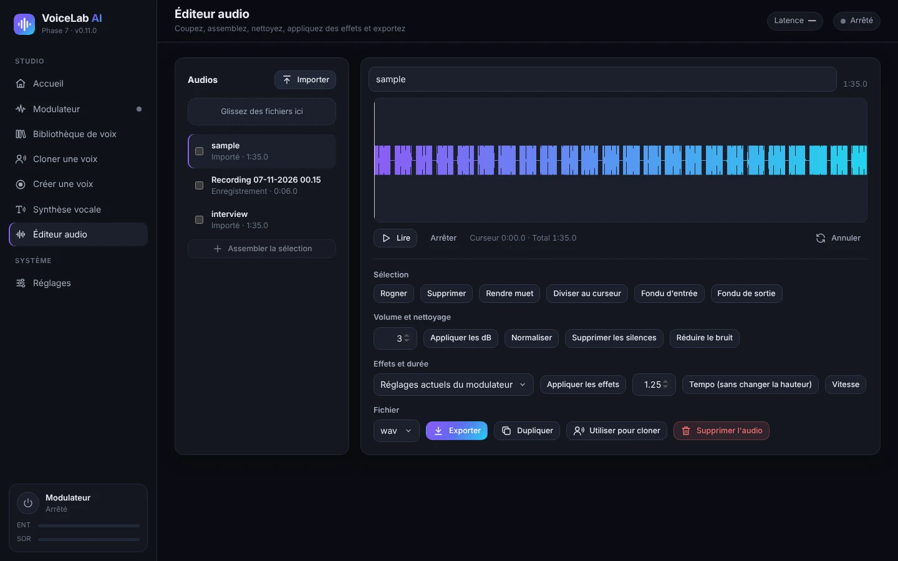

- **Audios** : importez des fichiers (ou faites-les glisser) ; vos enregistrements et générations y apparaissent aussi. Cochez-en plusieurs et cliquez sur **Assembler la sélection** pour les réunir.
- **Forme d'onde** : faites glisser pour sélectionner. Vous disposez de **Lire**, **Arrêter** et **Annuler**.
- **Sélection** : couper, supprimer, rendre muet, diviser au curseur, fondu d'entrée et fondu de sortie.
- **Volume et nettoyage** : appliquer des dB, normaliser, supprimer les silences et réduire le bruit.
- **Effets et durée** :
  - **Appliquer les effets** utilise les réglages actuels du modulateur ou un profil enregistré.
  - **Tempo** change la vitesse sans changer la hauteur.
  - **Vitesse** change la vitesse et la hauteur ensemble.
- **Fichier** : choisissez le format (WAV, MP3, FLAC ou OGG) et cliquez sur **Exporter**. Vous pouvez aussi **Dupliquer**, **Utiliser pour cloner** ou **Supprimer l'audio**.

## 9. Bibliothèque de voix

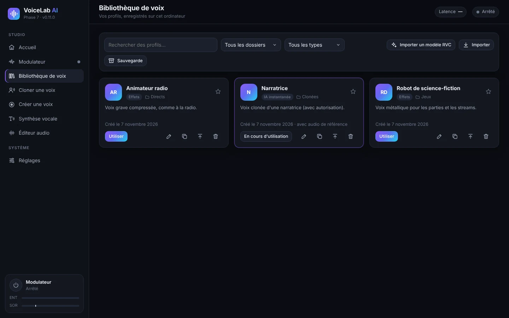

- **Recherchez** par nom et **filtrez** par dossier ou par type : effets, IA instantanée ou IA entraînée (RVC).
- Chaque carte affiche le type, le dossier et la description du profil. L'étoile le marque comme favori.
- Boutons de chaque carte :
  - **Utiliser** active le profil dans le modulateur.
  - **Modifier** change le nom, le dossier ou la description.
  - **Dupliquer**.
  - **Exporter** crée un fichier `.vlprofile` pour le transférer sur un autre PC.
  - **Supprimer**.
- **Importer** ajoute des profils exportés (`.vlprofile`). **Importer un modèle RVC** ajoute des modèles `.onnx`.
- **Sauvegarde** enregistre tous vos profils dans un seul fichier.

## 10. Réglages

### 10.1 Périphériques audio

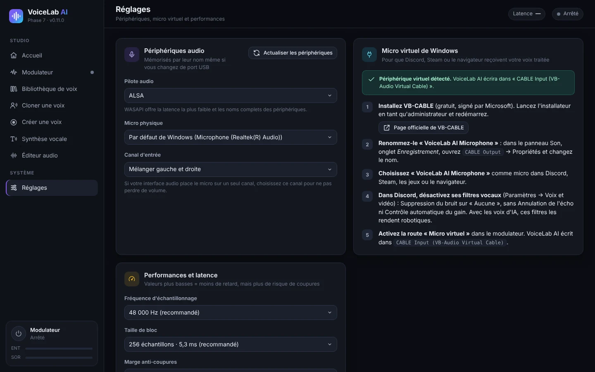

- **Pilote audio** : sous Windows, **WASAPI** offre la plus faible latence.
- **Micro physique** est le vrai micro qu'écoute VoiceLab. Il est mémorisé par son nom, même si vous changez de port USB.
- **Canal d'entrée** : si votre interface audio place le micro sur un seul canal, choisissez ce canal.
- **Actualiser les périphériques** relance la recherche si vous branchez quelque chose de nouveau.
- La carte **Micro virtuel de Windows** reprend les étapes d'installation de VB-CABLE et indique s'il est détecté.

### 10.2 Performances et latence

- **Fréquence d'échantillonnage** : 48 000 Hz (recommandé) ou 44 100 Hz.
- **Taille de bloc** : plus petit = moins de latence, mais plus de risque de coupures. 256 échantillons (5,3 ms) conviennent à presque tous les ordinateurs.
- **Marge anti-coupures** : augmentez-la si vous entendez des clics.

### 10.3 Moteur d'IA et modèles

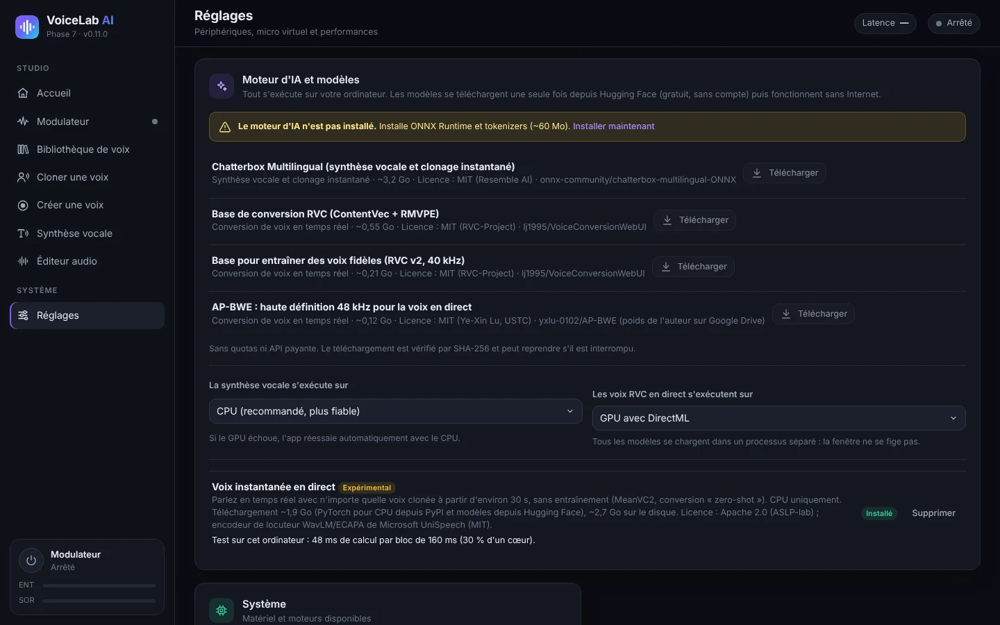

Les modèles se téléchargent une fois depuis Hugging Face (gratuit, sans compte) puis fonctionnent hors ligne. Chaque téléchargement est vérifié et peut reprendre s'il est interrompu.

| Composant | Taille | Usage |
|---|---|---|
| Moteur d'IA (ONNX Runtime et tokenizers) | ~60 Mo | Indispensable pour toute l'IA |
| Chatterbox Multilingual | ~3,2 Go | Synthèse vocale et clonage instantané |
| Base de conversion RVC (ContentVec + RMVPE) | ~0,55 Go | Voix RVC en direct (importées ou entraînées) |
| Base d'entraînement des voix fidèles (RVC v2, 40 kHz) | ~0,21 Go | Entraîner une voix fidèle |
| AP-BWE (haute définition) | ~0,12 Go | Facultatif, voix instantanée en mode Qualité |
| Voix instantanée en direct (MeanVC2 + PyTorch pour processeur) | ~1,9 Go à télécharger | Parler en direct avec des voix instantanées |

Vous choisissez aussi où chaque partie s'exécute :

- **La synthèse vocale s'exécute sur** : processeur (recommandé) ou carte graphique.
- **Les voix RVC en direct s'exécutent sur** : carte graphique avec DirectML (recommandé si vous en avez une) ou processeur.

### 10.4 Langue de l'interface

L'app est disponible en espagnol, anglais, français, italien, portugais, russe, chinois et japonais. Dans **Système → Langue de l'interface**, **Automatique** utilise la langue de Windows (l'anglais si elle ne fait pas partie des huit). Quand vous la changez, la fenêtre se recharge aussitôt ; le modulateur et vos profils ne sont pas touchés. L'installateur s'affiche aussi dans la langue de Windows.

## 11. Utiliser votre voix dans Discord, les jeux, OBS et les logiciels de montage

Avec **Dans toutes les apps** activé (voir [5.1](#51-sorties)), tout logiciel qui utilise le micro par défaut de Windows reçoit déjà votre voix modulée. Certains logiciels demandent une étape de plus :

- **Discord** :
  1. Dans *Paramètres utilisateur → Voix et vidéo*, choisissez comme **périphérique d'entrée** « CABLE Output » (ou « VoiceLab AI Microphone ») ou « Par défaut ».
  2. Mettez la **suppression du bruit** sur **Aucune**.
  3. Désactivez l'**annulation de l'écho**, le **contrôle automatique du gain** et la **détection avancée de la voix**. Avec les voix d'IA, ces filtres les rendent robotiques.
- **Jeux** : presque tous utilisent le micro par défaut. Si un jeu ne lit le micro qu'au démarrage, lancez-le avec le modulateur déjà allumé.
- **OBS Studio** : ajoutez une source **Capture d'entrée audio** avec « CABLE Output », ou utilisez « Par défaut ».
- **Logiciels de montage** (DaVinci Resolve, Premiere, CapCut…) : pour enregistrer une voix off avec effets, choisissez « CABLE Output » ou le micro par défaut comme entrée d'enregistrement.
- **Meet** (Teams, Zoom) : choisissez « CABLE Output » ou « Par défaut » dans les réglages audio de chaque service.

## 12. Résolution des problèmes

| Problème | Solution |
|---|---|
| Personne ne m'entend | Vérifiez que le modulateur est **Actif** et que la sortie **Micro virtuel** est allumée. Dans l'autre logiciel, choisissez « CABLE Output » ou « Par défaut ». |
| « Micro virtuel non détecté » | Installez VB-CABLE en tant qu'administrateur et redémarrez le PC. Cliquez ensuite sur **Actualiser les périphériques** dans *Réglages*. |
| La voix d'IA sonne robotique dans Discord | Désactivez les filtres vocaux de Discord (voir [11](#11-utiliser-votre-voix-dans-discord-les-jeux-obs-et-les-logiciels-de-montage)). |
| Coupures, clics ou « Le processeur n'arrive pas à suivre » | Utilisez le mode **Qualité** sans haute définition et fermez les logiciels lourds. Augmentez la **Marge anti-coupures** ou la **Taille de bloc**. |
| Trop de latence | Utilisez **Faible latence** si votre processeur suit, ou une **voix fidèle** sur la carte graphique. La latence réelle s'affiche dans le modulateur. |
| Sifflement ou larsen | Utilisez un casque pour le retour, pas des haut-parleurs. |
| Bruit de fond | Activez la **Noise gate** et la **Réduction du bruit**, ou **Nettoyer ma voix avant la conversion** pour les voix d'IA. |
| La synthèse vocale est lente la première fois | C'est normal : le modèle se charge en 1 à 4 minutes. Les générations suivantes sont plus rapides. |
| Un logiciel garde l'ancien micro | Certains logiciels ne lisent le micro qu'à l'ouverture : fermez-le et rouvrez-le avec le modulateur allumé. |
| J'ai besoin des journaux pour demander de l'aide | Ils se trouvent dans `%APPDATA%\VoiceLabAI\logs` (`voicelab.log`, `voz-instantanea.log` et `entrenamiento.log`). |

## 13. Confidentialité et usage responsable

- **Tout est traité sur votre PC.** Votre voix, vos profils et vos enregistrements ne sont envoyés à aucun serveur. Internet ne sert qu'à télécharger l'application et les modèles.
- **Ne clonez que votre propre voix ou celle de personnes qui vous ont donné leur accord.** L'application demande de le confirmer pour chaque profil.
- N'utilisez pas de voix clonées pour tromper, usurper l'identité de quelqu'un ou commettre une fraude. C'est illégal dans de nombreux pays.
- Les modèles d'IA ont leurs propres licences (MIT et Apache 2.0). Elles figurent dans *Réglages → Moteur d'IA et modèles* et dans le [README](../../README.md).

---

Raccourci : **Ctrl + M** allume et éteint le modulateur. Données de l'application : `%APPDATA%\VoiceLabAI`.
