# Manuale di VoiceLab AI

[Español](es.md) · [English](en.md) · [Français](fr.md) · **Italiano** · [Português](pt.md) · [Русский](ru.md) · [中文](zh.md) · [日本語](ja.md)

VoiceLab AI è uno studio vocale per Windows: cambia la tua voce in tempo reale, clona voci con l'intelligenza artificiale e trasforma il testo in voce. Tutto funziona sul tuo computer, senza abbonamenti né servizi cloud.

> Questo manuale si riferisce alla versione 0.11. Le schermate usano profili e dispositivi di esempio.
>
> **L'interfaccia è disponibile in 8 lingue** (Español, English, Français, Italiano, Português, Русский, 中文, 日本語). Segue automaticamente la lingua di Windows e puoi cambiarla in **Impostazioni → Lingua dell'interfaccia**. Questo manuale usa i nomi italiani di pulsanti e opzioni.

## Indice

1. [Cosa puoi fare](#1-cosa-puoi-fare)
2. [Requisiti](#2-requisiti)
3. [Installazione](#3-installazione)
4. [Schermata iniziale](#4-schermata-iniziale)
5. [Modulatore in tempo reale](#5-modulatore-in-tempo-reale)
6. [Voci con intelligenza artificiale](#6-voci-con-intelligenza-artificiale)
7. [Sintesi vocale](#7-sintesi-vocale)
8. [Editor audio](#8-editor-audio)
9. [Libreria delle voci](#9-libreria-delle-voci)
10. [Impostazioni](#10-impostazioni)
11. [Usare la tua voce su Discord, nei giochi, in OBS e negli editor video](#11-usare-la-tua-voce-su-discord-nei-giochi-in-obs-e-negli-editor-video)
12. [Risoluzione dei problemi](#12-risoluzione-dei-problemi)
13. [Privacy e uso responsabile](#13-privacy-e-uso-responsabile)

---

## 1. Cosa puoi fare

- **Modificare la voce in diretta** con effetti (tono, formanti, robot, radio, eco, riverbero…) e inviarla a qualsiasi programma tramite un microfono virtuale.
- **Clonare una voce** da un file audio o video e usarla per leggere testi (sintesi vocale) o per parlare in diretta.
- **Addestrare una «voce fedele»**: un modello RVC molto più somigliante, per parlare in diretta con poco ritardo.
- **Registrare e modificare l'audio**: tagliare, unire, ridurre il rumore, applicare effetti ed esportare in WAV, MP3, FLAC o OGG.
- **Organizzare le voci** in una libreria con cartelle, preferiti, esportazione e backup.

## 2. Requisiti

| | Minimo | Consigliato |
|---|---|---|
| Sistema | Windows 10 a 64 bit | Windows 11 |
| Processore | 4 core | 8 core (per la voce istantanea e l'addestramento) |
| Memoria | 8 GB | 16 GB o più |
| Disco | 1 GB per l'app | +8 GB se installi tutti i modelli di IA |
| Scheda video | Non necessaria | Compatibile DirectX 12 (AMD, NVIDIA o Intel) per le voci RVC in diretta |
| Microfono virtuale | [VB-CABLE](https://vb-audio.com/Cable/) (gratuito) | — |

Internet serve solo per scaricare l'app e, una volta, i modelli di IA che scegli.

## 3. Installazione

### 3.1 Installare l'app

1. Scarica `VoiceLabAI-Setup-x.y.z.exe` dalla pagina delle [versioni (Releases)](https://github.com/demfisalvarez/VoiceLab-AI/releases/latest).
2. Avvialo. Se Windows mostra «PC protetto da Windows», fai clic su **Ulteriori informazioni → Esegui comunque** (il programma di installazione non è firmato con un certificato commerciale).
3. Segui la procedura guidata. Si installa solo per il tuo utente e non richiede permessi di amministratore.
4. Apri **VoiceLab AI** dal menu Start o dal desktop.

Per disinstallarla: *Impostazioni di Windows → App → VoiceLab AI → Disinstalla*. Profili e impostazioni sono salvati in `%APPDATA%\VoiceLabAI`.

### 3.2 Installare il microfono virtuale (VB-CABLE)

Il microfono virtuale permette a Discord, ai giochi o al browser di «sentire» la tua voce modificata.

1. Scarica VB-CABLE dalla [pagina ufficiale](https://vb-audio.com/Cable/) (gratuito, firmato da Microsoft).
2. Estrai l'archivio, fai clic destro su `VBCABLE_Setup_x64.exe` → **Esegui come amministratore** → **Install Driver**.
3. Riavvia il computer.
4. Facoltativo: rinominalo per riconoscerlo meglio. In **Impostazioni → Apri pannello Audio**, scheda **Registrazione**, apri **CABLE Output → Proprietà** e rinominalo «VoiceLab AI Microphone».

### 3.3 Primo avvio

All'apertura vedrai la schermata **Home**. La scheda **Configurazione iniziale** controlla il microfono e il microfono virtuale e ti indica cosa manca.

## 4. Schermata iniziale

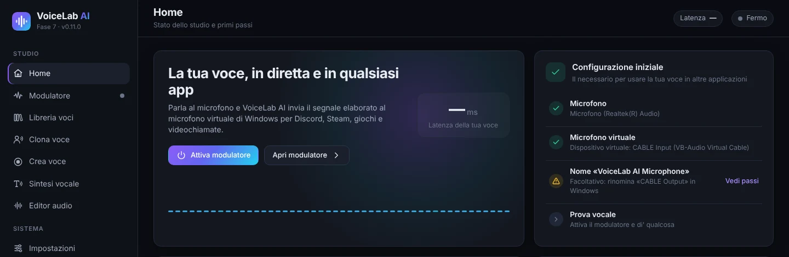

- **Attiva modulatore** lo accende senza lasciare questa schermata. Puoi anche usare **Ctrl + M** in qualsiasi momento.
- **Apri modulatore** porta al pannello completo.
- **Configurazione iniziale** elenca ciò che serve: microfono, microfono virtuale, nome del dispositivo e prova della voce. Un cerchio verde indica che il passaggio è pronto.

In fondo alla barra laterale vedi sempre lo stato del modulatore e gli indicatori di ingresso (**ING**) e di uscita (**USC**).

## 5. Modulatore in tempo reale

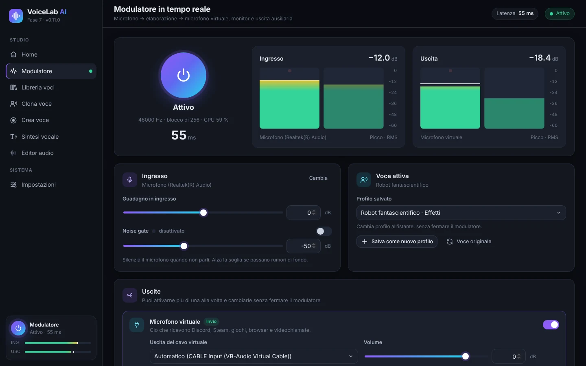

1. Premi il grande **pulsante di accensione**. Diventa **Attivo** e mostra la frequenza di campionamento, la dimensione del blocco, l'uso della CPU e la **latenza** (il ritardo della voce, in millisecondi).
2. Gli indicatori **Ingresso** e **Uscita** mostrano il livello del microfono e della voce elaborata (picco e RMS). L'ideale è parlare con la barra tra −24 e −12 dB.
3. Nella scheda **Ingresso**:
   - **Cambia** apre l'elenco dei microfoni.
   - **Guadagno in ingresso** alza o abbassa il volume del microfono prima degli effetti.
   - **Noise gate** silenzia il microfono quando non parli. Attivala e alza la soglia se passano rumori di fondo (tastiera, ventola).
4. Nella scheda **Voce attiva** scegli la voce in uso:
   - **Profilo salvato** cambia profilo all'istante, senza fermare il modulatore.
   - **Salva come nuovo profilo** salva gli effetti attuali come profilo.
   - **Salva le modifiche al profilo** aggiorna il profilo in uso.
   - **Voce originale** toglie tutti gli effetti.

### 5.1 Uscite

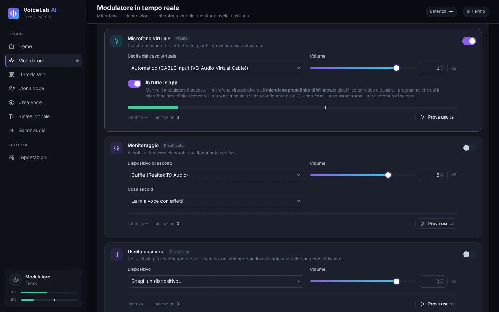

Puoi attivare più uscite contemporaneamente e cambiarle senza fermare il modulatore.

- **Microfono virtuale** invia la voce elaborata a VB-CABLE. È ciò che ricevono Discord, Steam, i giochi, i browser e le videochiamate. Con **Automatico**, VoiceLab sceglie da solo «CABLE Input».
- **In tutte le app**, attivo per impostazione predefinita: mentre il modulatore è acceso, il microfono virtuale diventa il **microfono predefinito di Windows**. Così qualsiasi programma che usa il microfono predefinito (giochi, editor video, browser…) riceve la voce modulata senza configurare nulla. VoiceLab continua ad ascoltare il tuo microfono reale. Quando fermi il modulatore o chiudi l'app, Windows torna al microfono di sempre.
- **Monitoraggio** ti permette di ascoltarti in cuffia. In **Cosa ascolti** scegli «La mia voce con effetti» o «Il mio microfono originale (senza effetti)». Usa le cuffie: con gli altoparlanti si può creare il feedback (fischio), e l'app ti avvisa prima di attivarlo.
- **Uscita ausiliaria** è un'uscita in più e indipendente, ad esempio un adattatore audio collegato a un telefono per le chiamate.
- Ogni uscita ha il suo **Volume**, un indicatore, la sua latenza, un contatore di **Interruzioni** e il pulsante **Prova uscita**, che riproduce un suono di prova.

### 5.2 Effetti e preset

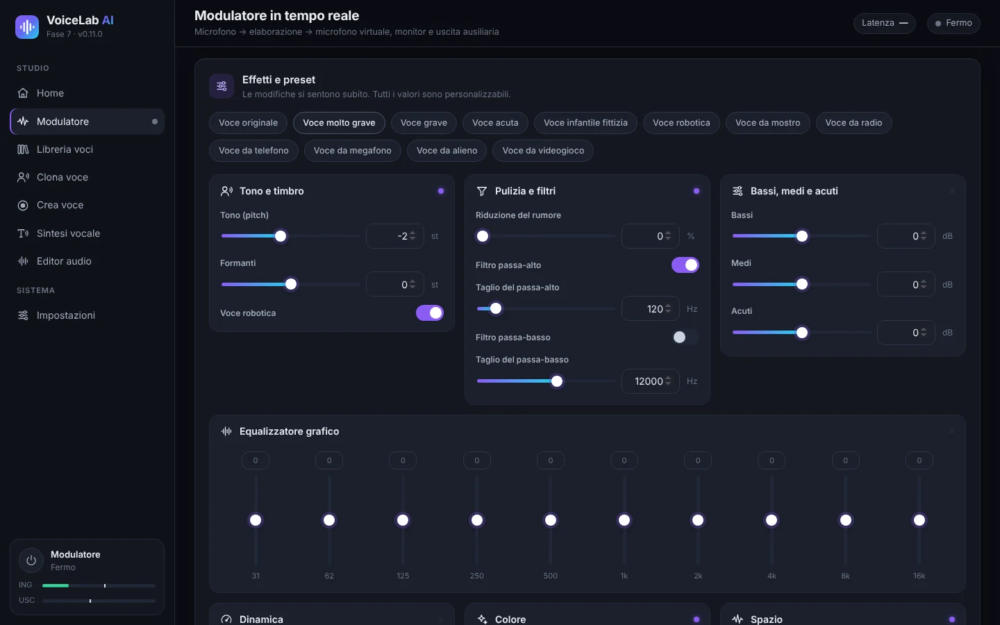

In alto ci sono i **preset**: voce originale, molto grave, grave, acuta, voce infantile di fantasia, robot, mostro, radio, telefono, megafono, alieno e videogioco. Le modifiche si sentono subito e tutti i valori sono regolabili:

| Gruppo | Controlli |
|---|---|
| Tono e timbro | **Tono (pitch)** in semitoni, **Formanti** (quanto la voce suona «grande» o «piccola») e **Voce robotica** |
| Pulizia e filtri | Riduzione del rumore, filtro passa-alto e filtro passa-basso |
| Bassi, medi e acuti | Equalizzatore semplice a tre bande |
| Equalizzatore grafico | 10 bande, da 31 Hz a 16 kHz |
| Dinamica | Compressore (soglia, rapporto, compensazione), limitatore e guadagno di uscita |
| Colore | Saturazione, distorsione, lo-fi a 8 bit e modulazione ad anello |
| Spazio | Chorus, eco e riverbero |

Consiglio: per una voce più grave ma naturale, abbassa il **Tono** e abbassa un po' i **Formanti**. Se abbassi solo il tono, la voce sembra quella di un cartone animato.

## 6. Voci con intelligenza artificiale

Esistono tre tipi di voci di IA:

| Tipo | Cosa serve | A cosa serve | Somiglianza |
|---|---|---|---|
| **IA istantanea** | 10–30 s di voce | Sintesi vocale e parlare in diretta (ritardo da 0,25 a 0,45 s) | Buona |
| **Voce fedele (addestrata)** | Almeno 1 min di voce (meglio 10 min o più) e da 30 min a 4 h di addestramento | Parlare in diretta con poco ritardo | Molto alta |
| **Modello RVC importato** | Un file `.onnx` che hai già | Parlare in diretta | Dipende dal modello |

Prima di usarle, installa il motore di IA e i modelli in **Impostazioni → Motore di IA e modelli**. Vedi [10.3](#103-motore-di-ia-e-modelli).

### 6.1 Clonare una voce

1. Vai su **Clona voce** e trascina un file audio o video, oppure fai clic su **sceglilo dal tuo computer**. Formati supportati: MP3, WAV, FLAC, M4A, AAC, OGG, MP4, MKV, MOV e WEBM. L'audio dei video viene estratto automaticamente. Puoi anche scegliere un audio già presente in VoiceLab.

   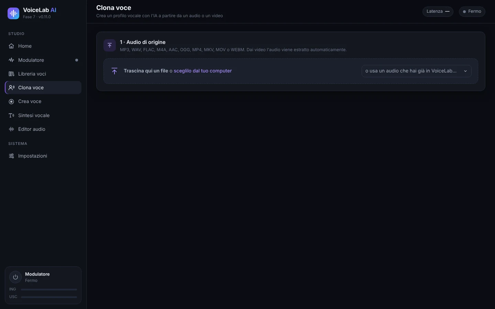

2. **Scegli il frammento con la voce**: trascina sulla forma d'onda per selezionare. Con **Ascolta la selezione** verifichi che parli una sola persona. Per la voce istantanea l'ideale sono 10–30 secondi chiari. Se poi vuoi **addestrare una voce fedele**, seleziona tutta la voce utile (almeno 1 minuto, meglio 10 minuti o più).

   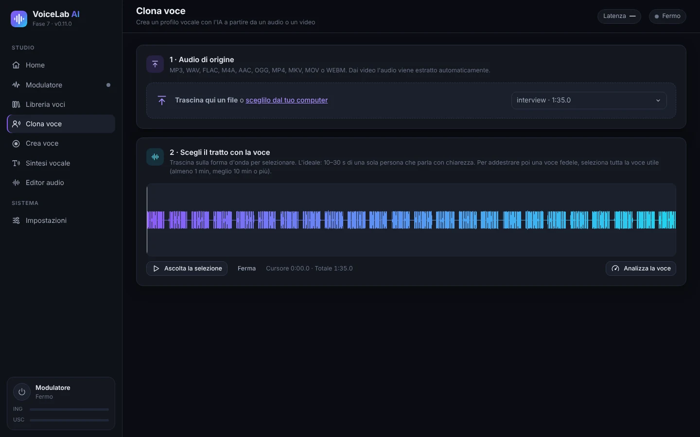

3. Fai clic su **Analizza la voce**. Vedrai i secondi di voce utile, il rapporto segnale/rumore, il tono medio e il livello. Una barra indica a cosa basta: 10 s per la voce istantanea, 5 min per una voce fedele e 10 min per una voce fedele ideale.
4. **Crear el perfil** (Crea il profilo): scrivi un nome e la lingua della voce e, se vuoi, una cartella e una descrizione. Lascia selezionato **Rimuovi rumore di fondo e silenzi lunghi**.
5. Indica se **È la mia voce** o se **Ho l'autorizzazione della persona**. È obbligatorio.
6. Fai clic su **Crea profilo vocale**.

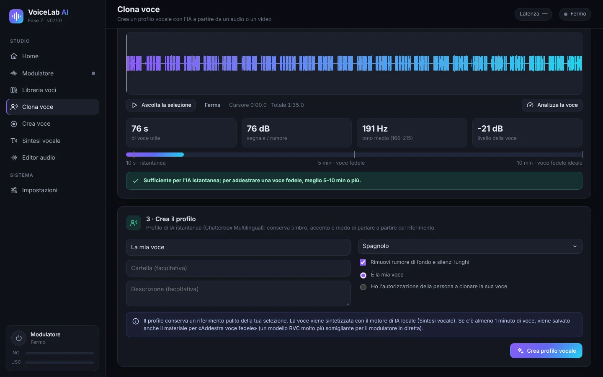

Il profilo conserva un riferimento pulito. Se la selezione ha 1 minuto di voce o più, conserva anche il materiale per addestrare la voce fedele.

### 6.2 Registrare la tua voce (Crea voce)

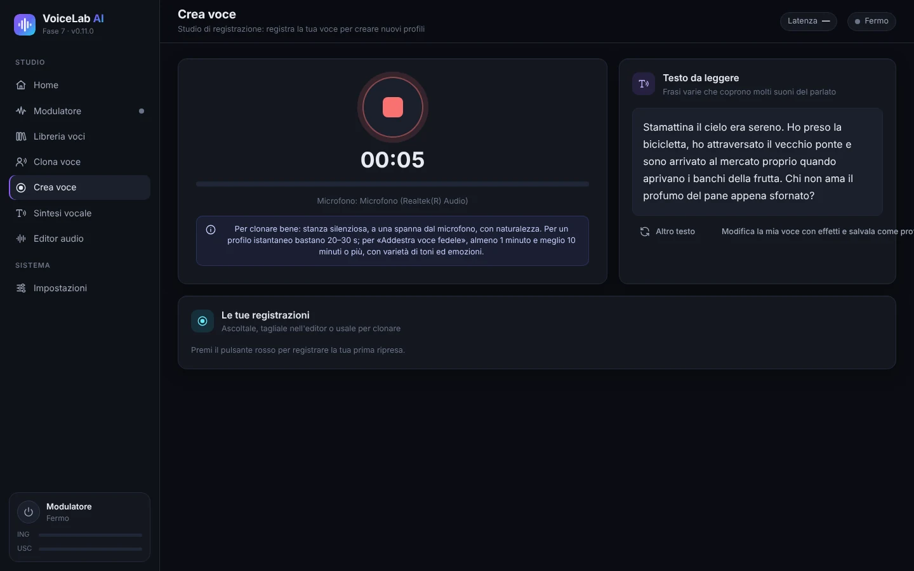

1. Vai su **Crea voce** e premi il **pulsante rosso** per registrare. Premilo di nuovo per fermarti.
2. Leggi le frasi di **Testo da leggere**: coprono tutti i suoni dello spagnolo. **Altro testo** mostra altre frasi.
3. Le registrazioni appaiono in **Le tue registrazioni**. Da lì puoi ascoltarle, aprirle nell'editor o usarle per clonare.
4. **Modifica la mia voce con effetti e salvala come profilo** ti porta al modulatore con la registrazione.

Per registrare bene: stanza silenziosa, a un palmo dal microfono, parlando con naturalezza e con varietà di toni ed emozioni.

### 6.3 Parlare in diretta con una voce istantanea

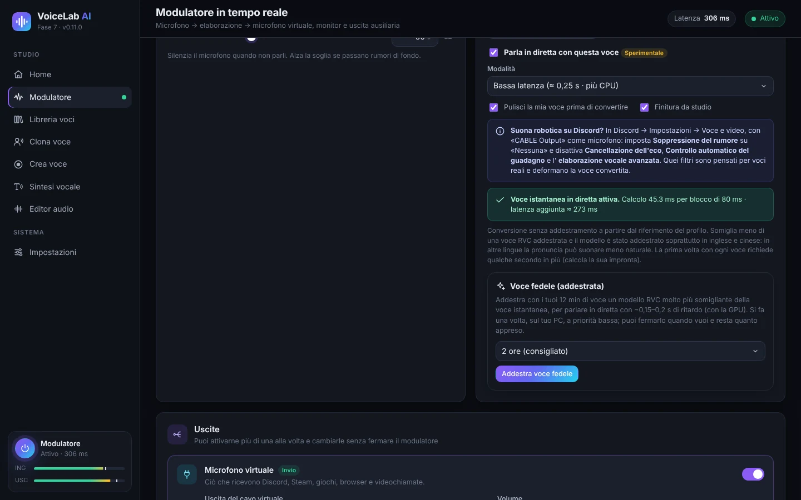

1. Nel modulatore, scegli in **Profilo salvato** un profilo di tipo «IA istantanea».
2. La prima volta, fai clic su **Installa la voce in diretta**. Scarica circa 1,9 GB e occupa circa 2,7 GB. Alla fine, l'app misura la velocità del PC e sceglie la modalità migliore.
3. Seleziona **Parla in diretta con questa voce** e accendi il modulatore. La prima volta con ogni voce servono alcuni secondi in più (calcola l'impronta vocale).
4. **Modalità**:
   - **Bassa latenza** (≈ 0,25 s): meno ritardo, ma usa circa tre volte più CPU.
   - **Qualità** (≈ 0,45 s): voce più somigliante e meno CPU.
5. Opzioni:
   - **Pulisci la mia voce prima di convertire** toglie il rumore del microfono prima dell'IA.
   - **Finitura da studio** aggiunge de-esser, compressione e livello automatico.
   - **Alta definizione 48 kHz** funziona solo in modalità Qualità e se la CPU regge. È un download facoltativo di 119 MB.
6. La riga di stato verde mostra il tempo di calcolo per blocco e la **latenza aggiunta** reale. Se appare **Il processore non riesce a stare al passo**, passa a Qualità, disattiva l'alta definizione o chiudi i programmi pesanti.

La voce istantanea non richiede addestramento, ma somiglia meno all'originale rispetto a una voce fedele. Il modello è stato addestrato soprattutto in inglese e cinese: in altre lingue la pronuncia può sembrare meno naturale.

### 6.4 Addestrare una voce fedele (RVC)

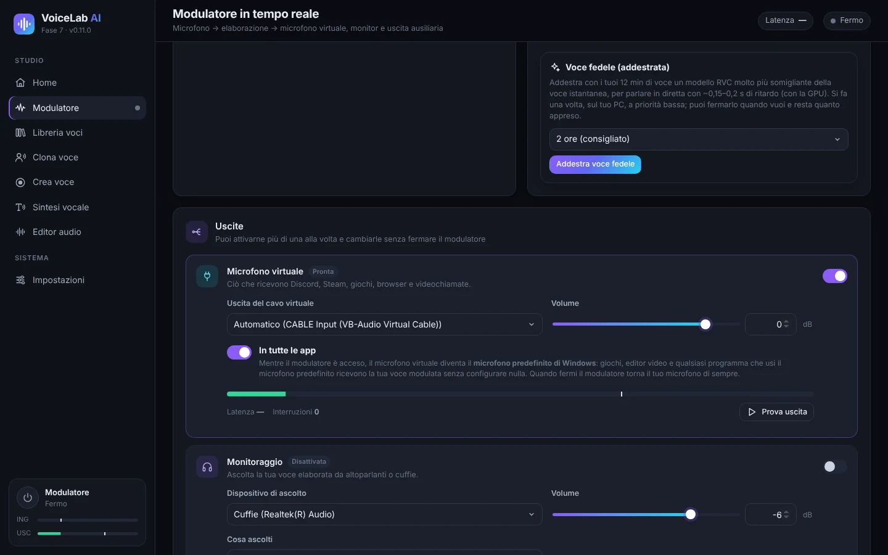

La voce fedele è un modello RVC addestrato con il tuo audio, sul tuo PC. Somiglia molto di più alla voce originale e in diretta ha poco ritardo (circa 0,15–0,2 s con una scheda video).

1. Attiva un profilo di IA istantanea creato con **1 minuto di voce o più** (meglio 10 minuti o più). Se il profilo è stato creato con meno, ricrealo in **Clona voce** con un audio più lungo.
2. Nella scheda **Voce fedele (addestrata)**, scegli la durata: 30 min (prova rapida), 1 ora, **2 ore** (consigliato) o 4 ore (massima). Più tempo = più somiglianza.
3. Fai clic su **Addestra voce fedele**. La prima volta vengono scaricati PyTorch (circa 250 MB) e i modelli di base (circa 0,2 GB).
4. Vedrai l'avanzamento, la fase e il tempo rimanente. L'addestramento usa la CPU con priorità bassa, quindi puoi continuare a usare il PC.
5. **Ferma e usa quanto appreso** interrompe l'addestramento e crea la voce con ciò che ha imparato fin lì. Se chiudi l'app, i progressi vengono salvati e in seguito appare **Riprendi l'addestramento**.
6. Alla fine viene creato un nuovo profilo «*nome* (fiel)». Fai clic su **Usa la voce fedele** per attivarlo. Puoi migliorarlo più avanti con **Continua ad addestrare**.

**Regolazione del tono**: la voce fedele segue l'intonazione della tua voce. Se la voce originale è più acuta o più grave della tua, usa **Regolazione dell'intonazione per questa voce**, da −24 a +24 semitoni, nella scheda del profilo. Come riferimento, da voce maschile a femminile di solito vanno bene tra +8 e +12; da femminile a maschile tra −8 e −12.

### 6.5 Importare un modello RVC

Se hai già un modello RVC in formato `.onnx`:

1. Installa il motore di IA e la **Base per la conversione RVC** in *Impostazioni*.
2. Vai su **Libreria voci → Importa modello RVC**, scrivi un nome e scegli il file.
3. Attivalo nel modulatore. La scheda del profilo ha l'**Regolazione del tono**.

Sono supportati solo i modelli `.onnx`. I `.pth` vanno prima convertiti con lo strumento di esportazione di RVC.

## 7. Sintesi vocale

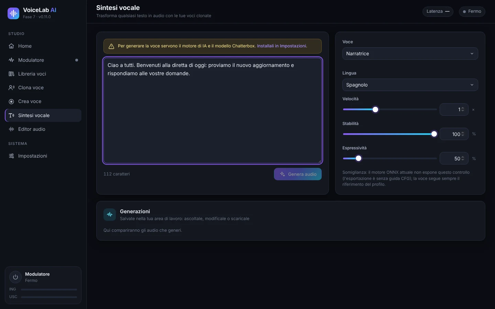

1. Installa il motore di IA e il modello **circa 3** (2 GB) in *Impostazioni → Motore di IA e modelli*.
2. Vai su **Sintesi vocale** e scrivi o incolla il testo.
3. Scegli la **Voce**, cioè qualsiasi profilo clonato, e l'**Lingua**. Ci sono 23 lingue, tra cui spagnolo, inglese, francese, italiano, portoghese, russo, cinese e giapponese.
4. Regola:
   - **Velocità**.
   - **Stabilità**: più alta = più regolare, più bassa = più varia.
   - **Espressività**: più emozione ed enfasi.
5. Fai clic su **Genera audio**. La prima generazione richiede più tempo (il modello si carica in 1–4 minuti). **Annulla** la interrompe.
6. Il risultato appare in **Generazioni**: puoi ascoltarlo, aprirlo nell'editor o scaricarlo in WAV, MP3, FLAC o OGG.

La sintesi vocale usa la CPU per impostazione predefinita. In *Impostazioni* puoi provare la GPU; se non funziona, l'app torna da sola alla CPU.

## 8. Editor audio

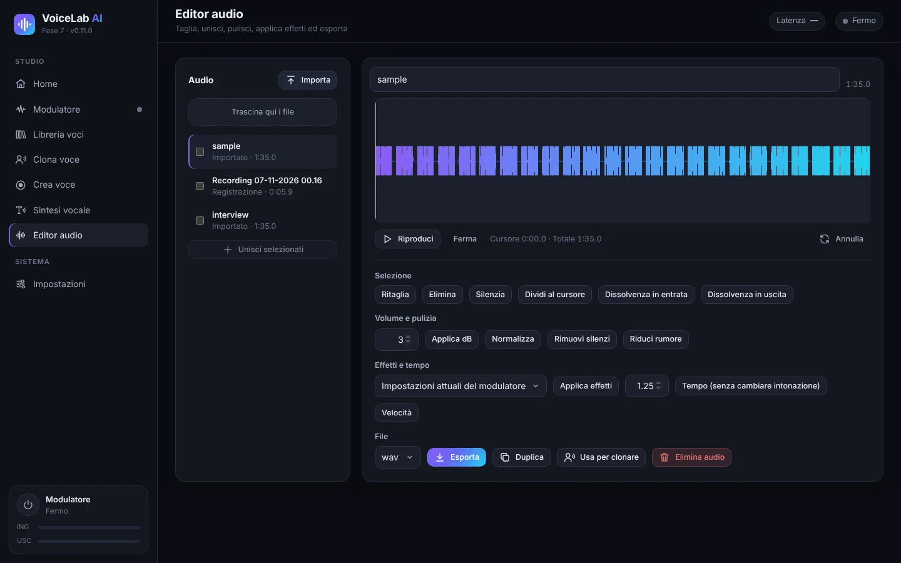

- **Audio**: importa file (o trascinali); qui compaiono anche registrazioni e generazioni. Selezionane più di uno e fai clic su **Unisci selezionati** per unirli.
- **Forma d'onda**: trascina per selezionare. Hai **Riproduci**, **Ferma** e **Annulla**.
- **Selezione**: taglia, elimina, silenzia, dividi al cursore, dissolvenza in entrata e in uscita.
- **Volume e pulizia**: applica dB, normalizza, elimina silenzi e riduci rumore.
- **Effetti e tempo**:
  - **Applica effetti** usa le impostazioni attuali del modulatore o un profilo salvato.
  - **Tempo** cambia la velocità senza cambiare il tono.
  - **Velocità** cambia velocità e tono insieme.
- **File**: scegli il formato (WAV, MP3, FLAC o OGG) e fai clic su **Esporta**. Puoi anche **Duplica**, **Usa per clonare** o **Elimina audio**.

## 9. Libreria delle voci

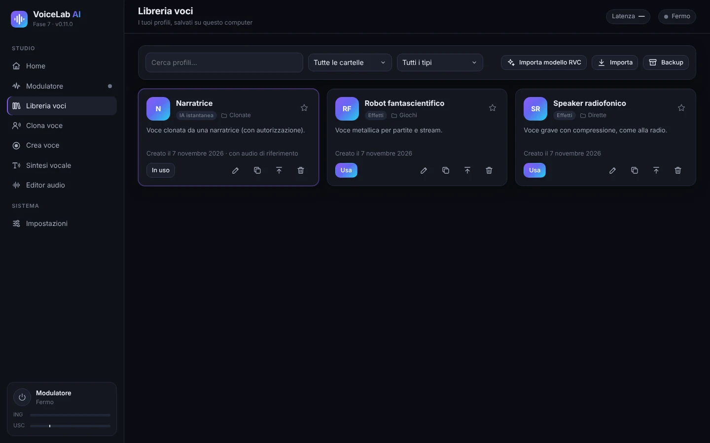

- **Cerca** per nome e **filtra** per cartella o per tipo: effetti, IA istantanea o IA addestrata (RVC).
- Ogni scheda mostra tipo, cartella e descrizione del profilo. La stella lo segna come preferito.
- Pulsanti di ogni scheda:
  - **Usa** attiva il profilo nel modulatore.
  - **Modifica** cambia nome, cartella o descrizione.
  - **Duplica**.
  - **Esporta** crea un file `.vlprofile` per passarlo a un altro PC.
  - **Elimina**.
- **Importa** aggiunge profili esportati (`.vlprofile`). **Importa modello RVC** aggiunge modelli `.onnx`.
- **Backup** salva tutti i profili in un unico file.

## 10. Impostazioni

### 10.1 Dispositivi audio

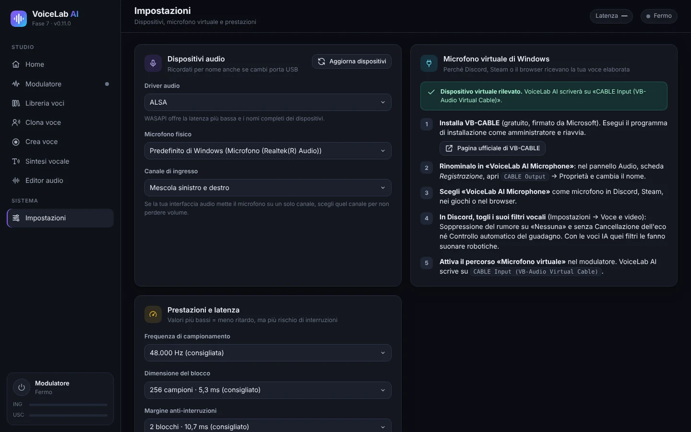

- **Driver audio**: su Windows, **WASAPI** offre la latenza più bassa.
- **Microfono fisico** è il microfono reale che VoiceLab ascolta. Viene ricordato per nome, anche se cambi porta USB.
- **Canale di ingresso**: se l'interfaccia audio mette il microfono su un solo canale, scegli quel canale.
- **Aggiorna dispositivi** cerca di nuovo i dispositivi se colleghi qualcosa di nuovo.
- La scheda **Microfono virtuale di Windows** ripete i passaggi di installazione di VB-CABLE e ti dice se viene rilevato.

### 10.2 Prestazioni e latenza

- **Frequenza di campionamento**: 48.000 Hz (consigliato) o 44.100 Hz.
- **Dimensione del blocco**: più piccolo = meno ritardo, ma più rischio di interruzioni. 256 campioni (5,3 ms) vanno bene su quasi tutti i computer.
- **Margine anti-interruzioni**: alzalo se senti dei clic.

### 10.3 Motore di IA e modelli

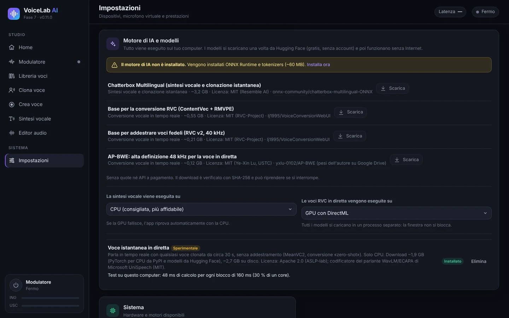

I modelli si scaricano una volta da Hugging Face (gratis e senza account) e poi funzionano senza Internet. Ogni download viene verificato e può riprendere se si interrompe.

| Componente | Dimensione | A cosa serve |
|---|---|---|
| Motore di IA (ONNX Runtime e tokenizers) | ~60 MB | Necessario per tutte le funzioni di IA |
| Chatterbox Multilingual | ~3,2 GB | Sintesi vocale e clonazione istantanea |
| Base per la conversione RVC (ContentVec + RMVPE) | ~0,55 GB | Voci RVC in diretta (importate o addestrate) |
| Base per addestrare voci fedeli (RVC v2, 40 kHz) | ~0,21 GB | Addestrare una voce fedele |
| AP-BWE (alta definizione) | ~0,12 GB | Facoltativo, voce istantanea in modalità Qualità |
| Voce istantanea in diretta (MeanVC2 + PyTorch per CPU) | ~1,9 GB da scaricare | Parlare in diretta con voci istantanee |

Scegli anche dove viene eseguita ogni parte:

- **La sintesi vocale viene eseguita su**: CPU (consigliato) o GPU.
- **Le voci RVC in diretta vengono eseguite su**: GPU con DirectML (consigliato se hai una scheda video) o CPU.

### 10.4 Lingua dell'interfaccia

L'app è disponibile in spagnolo, inglese, francese, italiano, portoghese, russo, cinese e giapponese. In **Sistema → Lingua dell'interfaccia**, **Automatico** usa la lingua di Windows (l'inglese se non è tra le otto). Quando la cambi, la finestra si ricarica subito; il modulatore e i tuoi profili non vengono toccati. Anche il programma di installazione usa la lingua di Windows.

## 11. Usare la tua voce su Discord, nei giochi, in OBS e negli editor video

Con **In tutte le app** attivo (vedi [5.1](#51-uscite)), qualsiasi programma che usa il microfono predefinito di Windows riceve già la voce modulata. Alcuni programmi richiedono un passaggio in più:

- **Discord**:
  1. In *Impostazioni utente → Voce e video*, imposta come **dispositivo di ingresso** «CABLE Output» (o «VoiceLab AI Microphone») oppure «Predefinito».
  2. Imposta la **soppressione del rumore** su **Nessuna**.
  3. Disattiva la **cancellazione dell'eco**, il **controllo automatico del guadagno** e il **rilevamento avanzato della voce**. Con le voci di IA questi filtri le fanno sembrare robotiche.
- **Giochi**: quasi tutti usano il microfono predefinito. Se un gioco legge il microfono solo all'avvio, aprilo con il modulatore già acceso.
- **OBS Studio**: aggiungi una fonte **Cattura ingresso audio** con «CABLE Output», oppure usa «Predefinito».
- **Editor video** (DaVinci Resolve, Premiere, CapCut…): per registrare una voce fuori campo con effetti, scegli «CABLE Output» o il microfono predefinito come ingresso di registrazione.
- **Browser e videochiamate** (Meet, Teams, Zoom): scegli «CABLE Output» o «Predefinito» nelle impostazioni audio di ciascun servizio.

## 12. Risoluzione dei problemi

| Problema | Cosa fare |
|---|---|
| Gli altri non mi sentono | Controlla che il modulatore sia **Attivo** e che l'uscita **Microfono virtuale** sia accesa. Nell'altro programma scegli «CABLE Output» o «Predefinito». |
| «Microfono virtuale non rilevato» | Installa VB-CABLE come amministratore e riavvia il PC. Poi fai clic su **Aggiorna dispositivi** in *Impostazioni*. |
| La voce di IA sembra robotica su Discord | Disattiva i filtri vocali di Discord (vedi [11](#11-usare-la-tua-voce-su-discord-nei-giochi-in-obs-e-negli-editor-video)). |
| Interruzioni, clic o «Il processore non ce la fa» | Usa la modalità **Qualità** senza alta definizione e chiudi i programmi pesanti. Alza il **Margine anti-interruzioni** o la **Dimensione del blocco**. |
| Troppo ritardo | Usa **Bassa latenza** se la CPU regge, oppure una **voce fedele** con la GPU. La latenza reale appare nel modulatore. |
| Fischio o feedback | Usa le cuffie per il monitoraggio, non gli altoparlanti. |
| Si sente rumore di fondo | Attiva la **Noise gate** e la **Riduzione del rumore**, oppure **Pulisci la mia voce prima di convertire** per le voci di IA. |
| La sintesi vocale è lenta la prima volta | È normale: il modello si carica in 1–4 minuti. Le generazioni successive sono più veloci. |
| Un programma usa ancora il vecchio microfono | Alcuni programmi leggono il microfono solo all'apertura: chiudilo e riaprilo con il modulatore acceso. |
| Mi servono i log per chiedere aiuto | Si trovano in `%APPDATA%\VoiceLabAI\logs` (`voicelab.log`, `voz-instantanea.log` e `entrenamiento.log`). |

## 13. Privacy e uso responsabile

- **Tutto viene elaborato sul tuo PC.** Voce, profili e registrazioni non vengono inviati a nessun server. Internet serve solo per scaricare l'app e i modelli.
- **Clona solo la tua voce o quella di persone che ti hanno dato il permesso.** L'app chiede di confermarlo per ogni profilo.
- Non usare voci clonate per ingannare, impersonare qualcuno o commettere frodi. In molti paesi è illegale.
- I modelli di IA hanno le proprie licenze (MIT e Apache 2.0). Le trovi in *Impostazioni → Motore di IA e modelli* e nel [README](../../README.md).

---

Scorciatoia: **Ctrl + M** accende e spegne il modulatore. Dati dell'app: `%APPDATA%\VoiceLabAI`.
