# VoiceLab AI ユーザーマニュアル

[Español](es.md) · [English](en.md) · [Français](fr.md) · [Italiano](it.md) · [Português](pt.md) · [Русский](ru.md) · [中文](zh.md) · **日本語**

VoiceLab AI は Windows 用のボイススタジオです。リアルタイムで声を変えたり、AI で声をクローンしたり、テキストを音声に変換したりできます。すべてお使いのパソコン上で動作し、サブスクリプションやクラウドサービスは不要です。

> このマニュアルはバージョン 0.11 に対応しています。画面写真はサンプルのプロフィールとデバイスを使っています。
>
> **画面は 8 言語に対応しています**（Español, English, Français, Italiano, Português, Русский, 中文, 日本語）。Windows の言語に自動で合わせます。**設定 → インターフェースの言語** で変更できます。このマニュアルでは日本語画面のボタン名・項目名を使っています。

## 目次

1. [できること](#1-できること)
2. [動作環境](#2-動作環境)
3. [インストール](#3-インストール)
4. [ホーム画面](#4-ホーム画面)
5. [リアルタイム・ボイスチェンジャー](#5-リアルタイムボイスチェンジャー)
6. [AI ボイス](#6-ai-ボイス)
7. [テキスト読み上げ](#7-テキスト読み上げ)
8. [オーディオエディター](#8-オーディオエディター)
9. [ボイスライブラリ](#9-ボイスライブラリ)
10. [設定](#10-設定)
11. [Discord・ゲーム・OBS・動画編集ソフトで使う](#11-discordゲームobs動画編集ソフトで使う)
12. [トラブルシューティング](#12-トラブルシューティング)
13. [プライバシーと責任ある利用](#13-プライバシーと責任ある利用)

---

## 1. できること

- **声をライブで変える**：エフェクト（ピッチ、フォルマント、ロボット、ラジオ、エコー、リバーブなど）をかけ、仮想マイク経由でどのソフトにも送れます。
- **声をクローンする**：音声や動画から声をクローンし、テキストの読み上げやライブでの会話に使えます。
- **「忠実な声」を学習する**：元の声にずっと近い RVC モデルを作り、少ない遅延でライブ会話ができます。
- **録音と編集**：カット、結合、ノイズ除去、エフェクトをかけて、WAV・MP3・FLAC・OGG で書き出せます。
- **声を整理する**：フォルダー、お気に入り、エクスポート、バックアップに対応したライブラリで管理できます。

## 2. 動作環境

| | 最低 | 推奨 |
|---|---|---|
| OS | Windows 10（64 ビット） | Windows 11 |
| CPU | 4 コア | 8 コア（インスタントボイスと学習用） |
| メモリ | 8 GB | 16 GB 以上 |
| ディスク | アプリ本体に 1 GB | AI モデルをすべて入れる場合はさらに 8 GB |
| グラフィックボード | 不要 | DirectX 12 対応（AMD・NVIDIA・Intel）。RVC ボイスのライブ使用向け |
| 仮想マイク | [VB-CABLE](https://vb-audio.com/Cable/)（無料） | — |

インターネットが必要なのは、アプリのダウンロードと、選んだ AI モデルの初回ダウンロードのときだけです。

## 3. インストール

### 3.1 アプリのインストール

1. [リリース（Releases）](https://github.com/demfisalvarez/VoiceLab-AI/releases/latest)ページから `VoiceLabAI-Setup-x.y.z.exe` をダウンロードします。
2. 実行します。「Windows によって PC が保護されました」と表示されたら、**詳細情報 → 実行** をクリックします（インストーラーは商用証明書で署名されていません）。
3. ウィザードに従います。お使いのユーザーだけにインストールされ、管理者権限は不要です。
4. スタートメニューまたはデスクトップから **VoiceLab AI** を開きます。

アンインストール：*Windows の設定 → アプリ → VoiceLab AI → アンインストール*。プロフィールと設定は `%APPDATA%\VoiceLabAI` に保存されています。

### 3.2 仮想マイクのインストール（VB-CABLE）

仮想マイクがあると、Discord・ゲーム・ブラウザーが変えた声を「聞ける」ようになります。

1. [VB-CABLE 公式ページ](https://vb-audio.com/Cable/)からダウンロードします（無料、Microsoft の署名付き）。
2. 展開し、`VBCABLE_Setup_x64.exe` を右クリック → **管理者として実行** → **Install Driver** をクリックします。
3. パソコンを再起動します。
4. 任意：見分けやすいように名前を変えます。**設定 → サウンドパネルを開く**の**録音**タブで **CABLE Output → プロパティ** を開き、「VoiceLab AI Microphone」に変更します。

### 3.3 初回起動

アプリを開くと **ホーム**画面が表示されます。**初期設定**カードがマイクと仮想マイクを確認し、足りないものを教えてくれます。

## 4. ホーム画面

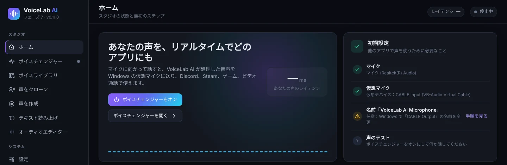

- **ボイスチェンジャーをオン**：この画面のままボイスチェンジャーを起動します。いつでも **Ctrl + M** でも切り替えられます。
- **ボイスチェンジャーを開く**：詳細パネルに移動します。
- **初期設定**：必要なもの（マイク、仮想マイク、デバイス名、音声テスト）の一覧です。緑の丸は完了を示します。

サイドバーの下部には、ボイスチェンジャーの状態と入力（**入力**）・出力（**出力**）のメーターが常に表示されます。

## 5. リアルタイム・ボイスチェンジャー

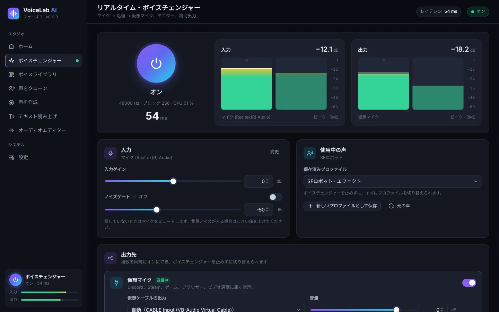

1. 大きな**電源ボタン**を押します。**オン**になり、サンプリングレート、ブロックサイズ、CPU 使用率、**レイテンシ**（声の遅れ、ミリ秒）が表示されます。
2. **入力**と **出力**のメーターは、マイクと処理後の声のレベル（ピークと RMS）を示します。話すときはバーが −24〜−12 dB に収まるのが理想です。
3. **入力**カード：
   - **変更**：マイクの一覧を開きます。
   - **入力ゲイン**：エフェクトの前にマイク音量を上げ下げします。
   - **ノイズゲート**：話していないときにマイクを無音にします。キーボードやファンの音が入る場合はオンにしてしきい値を上げます。
4. **使用中の声**カードで使う声を選びます：
   - **保存済みプロファイル**：ボイスチェンジャーを止めずに即座に切り替えます。
   - **新しいプロファイルとして保存**：今のエフェクトをプロフィールとして保存します。
   - **プロファイルへの変更を保存**：使用中のプロフィールを更新します。
   - **元の声**：すべてのエフェクトを外します。

### 5.1 出力

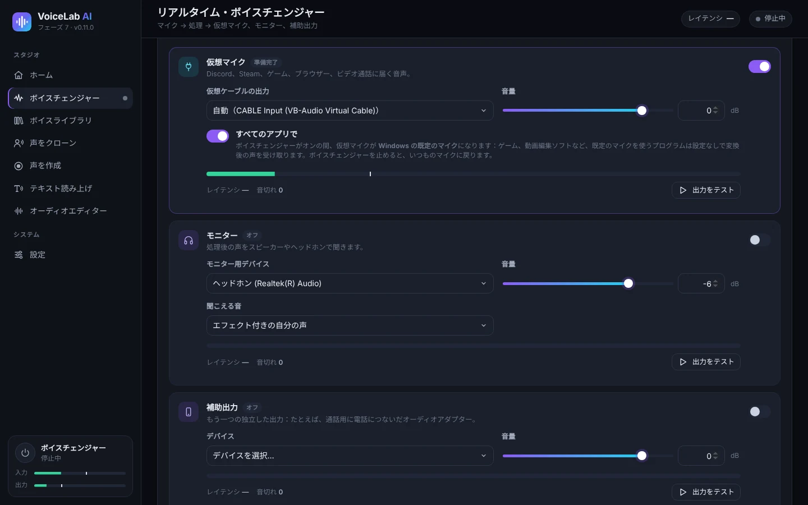

複数の出力を同時にオンにでき、ボイスチェンジャーを止めずに変更できます。

- **仮想マイク**：処理した声を VB-CABLE に送ります。Discord、Steam、ゲーム、ブラウザー、ビデオ通話はここから声を受け取ります。**自動**なら VoiceLab が「CABLE Input」を自動で選びます。
- **すべてのアプリで**：初期設定でオン。ボイスチェンジャーの動作中は、仮想マイクが **Windows の既定のマイク**になります。既定のマイクを使うソフト（ゲーム、動画編集ソフト、ブラウザーなど）は、設定なしで変えた声を受け取れます。VoiceLab は引き続き本物のマイクを聞いています。ボイスチェンジャーを止めるかアプリを閉じると、Windows はいつものマイクに戻ります。
- **モニター**：ヘッドホンで自分の声を聞けます。**聞こえる音**で「エフェクト付きの自分の声」か「元のマイク（エフェクトなし）」を選びます。スピーカーだとハウリング（キーンという音）が起きることがあるので、ヘッドホンを使ってください。オンにする前にアプリが警告します。
- **補助出力**：もう 1 つの独立した出力です。たとえば電話用にスマートフォンにつないだオーディオアダプターなど。
- 各出力には **音量**、メーター、レイテンシ、**音切れ**回数、テスト音を鳴らす **出力をテスト**ボタンがあります。

### 5.2 エフェクトとプリセット

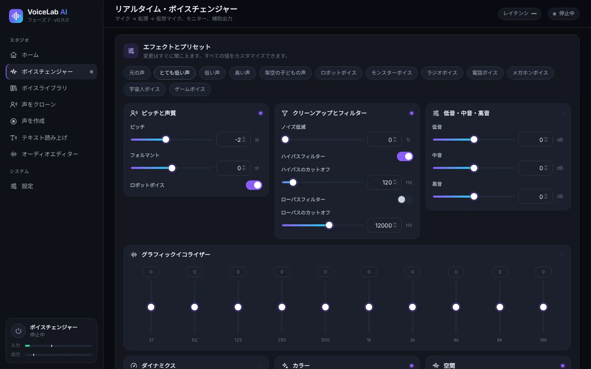

上部には**プリセット**があります：元の声、とても低い声、低い声、高い声、架空の子どもの声、ロボット、モンスター、ラジオ、電話、メガホン、宇宙人、ゲーム風。変更はすぐに反映され、すべての値を調整できます：

| グループ | 項目 |
|---|---|
| ピッチと声質 | **ピッチ**、**フォルマント**（声が「大きく」聞こえるか「小さく」聞こえるか）、**ロボットボイス** |
| クリーンアップとフィルター | ノイズ除去、ハイパスフィルター、ローパスフィルター |
| 低音・中音・高音 | シンプルな 3 バンドイコライザー |
| グラフィックイコライザー | 31 Hz〜16 kHz の 10 バンド |
| ダイナミクス | コンプレッサー（しきい値、レシオ、メイクアップ）、リミッター、出力ゲイン |
| カラー | サチュレーション、ディストーション、8 ビット Lo-Fi、リングモジュレーション |
| 空間 | コーラス、エコー、リバーブ |

ヒント：自然に低い声にしたいときは、**ピッチ**を下げ、**フォルマント**も少し下げます。ピッチだけを下げるとアニメのような声になります。

## 6. AI ボイス

AI ボイスには 3 種類あります：

| 種類 | 必要なもの | 用途 | 似ている度合い |
|---|---|---|---|
| **インスタントAI** | 10〜30 秒の声 | テキスト読み上げとライブ会話（遅延 0.25〜0.45 秒） | 良い |
| **忠実な声（学習済み）** | 1 分以上の声（10 分以上が理想）と 30 分〜4 時間の学習 | 少ない遅延でのライブ会話 | とても高い |
| **インポートした RVC モデル** | 手持ちの `.onnx` ファイル | ライブ会話 | モデルによる |

使う前に **設定 → AIエンジンとモデル**で AI エンジンとモデルをインストールしてください（[10.3](#103-ai-エンジンとモデル) 参照）。

### 6.1 声をクローンする

1. **声をクローン**を開き、音声または動画ファイルをドラッグするか、**PCから選択**をクリックします。対応形式は MP3、WAV、FLAC、M4A、AAC、OGG、MP4、MKV、MOV、WEBM。動画からは音声が自動で取り出されます。VoiceLab にすでにある音声も選べます。

   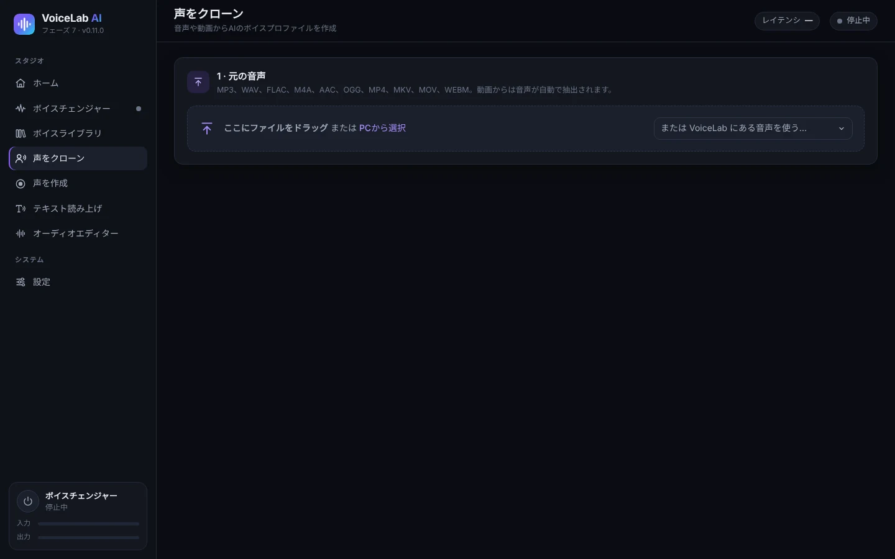

2. **声の部分を選ぶ**：波形の上をドラッグして選択します。**選択範囲を再生**で、話しているのが 1 人だけか確認します。インスタントボイスには、はっきりした 10〜30 秒が最適です。あとで**忠実な声を学習**したい場合は、使える声をすべて選びます（最低 1 分、10 分以上が理想）。

   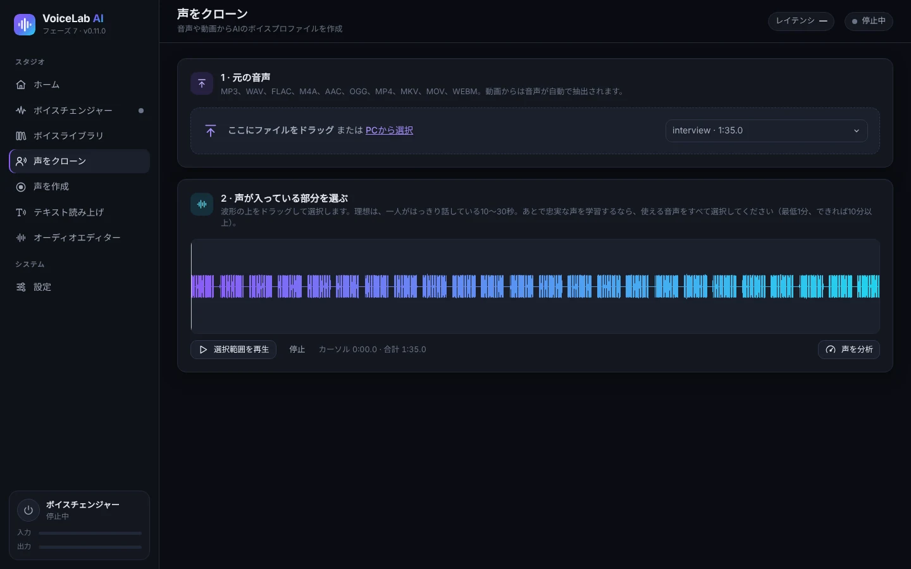

3. **声を分析**をクリックします。使える声の秒数、S/N 比、平均ピッチ、レベルが表示されます。バーは何に足りるかを示します：10 秒でインスタントボイス、5 分で忠実な声、10 分で理想的な忠実な声。
4. **Crear el perfil**（プロフィールを作成）：名前と声の言語を入力し、必要ならフォルダーと説明も入力します。**背景ノイズと長い無音を除去**はチェックしたままにします。
5. **これは自分の声です**または **本人の許可を得ています**を選びます。必須です。
6. **ボイスプロファイルを作成**をクリックします。

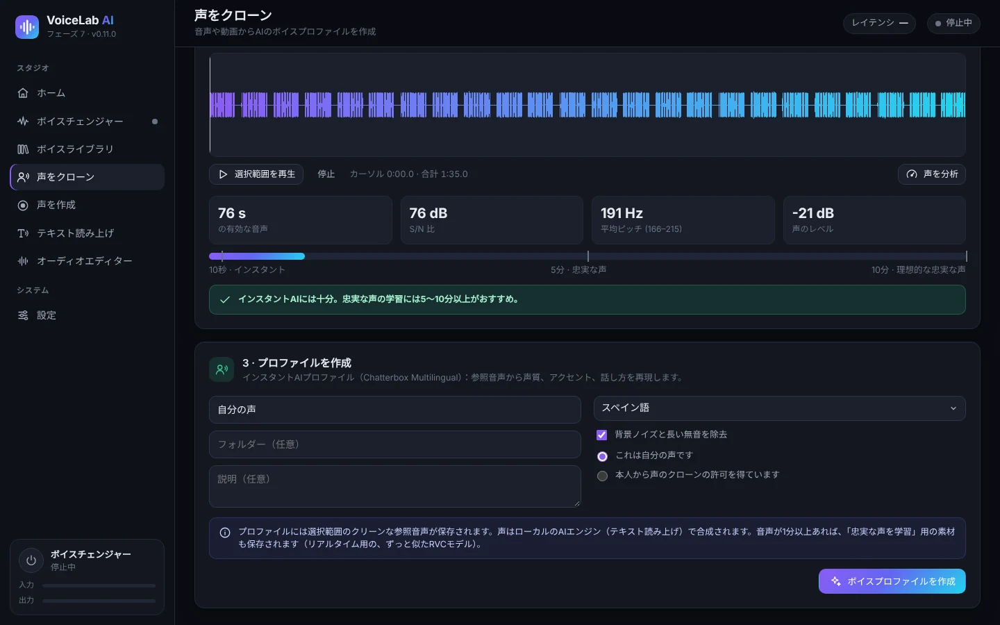

プロフィールにはきれいな参照音声が保存されます。選択範囲に 1 分以上の声があれば、忠実な声の学習用素材も保存されます。

### 6.2 自分の声を録音する（声を作成）

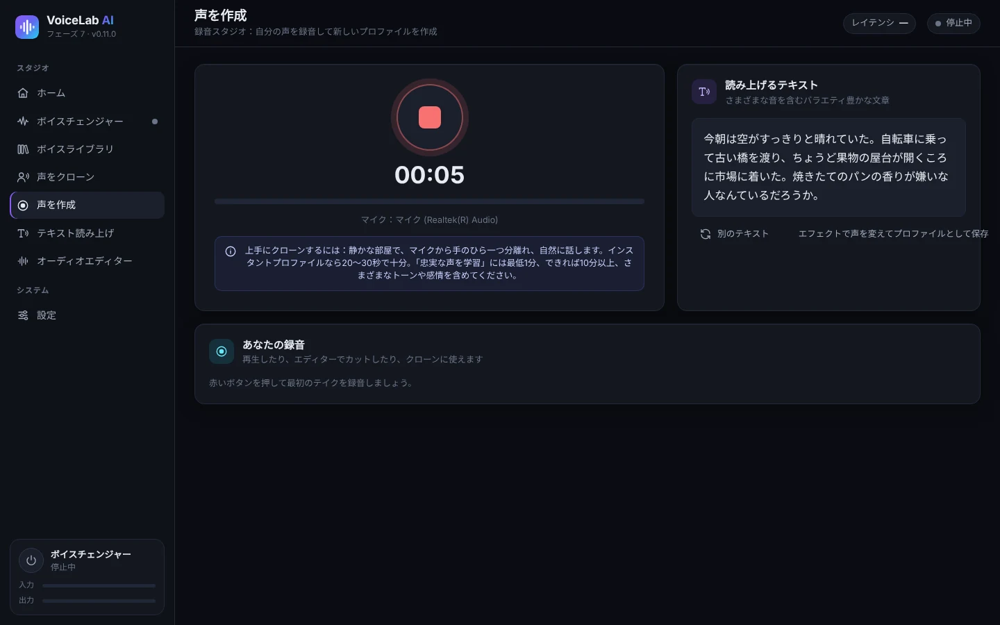

1. **声を作成**を開き、**赤いボタン**を押して録音を始めます。もう一度押すと止まります。
2. **読み上げるテキスト**の文を読みます。スペイン語のすべての音をカバーしています。**別のテキスト**で別の文が表示されます。
3. 録音は **あなたの録音**に表示されます。そこから再生したり、エディターで開いたり、クローンに使ったりできます。
4. **エフェクトで声を変えてプロファイルとして保存**を押すと、録音を持ってボイスチェンジャーに移動します。

上手に録音するコツ：静かな部屋で、マイクから手のひら 1 つ分ほど離れ、自然に、さまざまな抑揚や感情を込めて話します。

### 6.3 インスタントボイスでライブ会話する

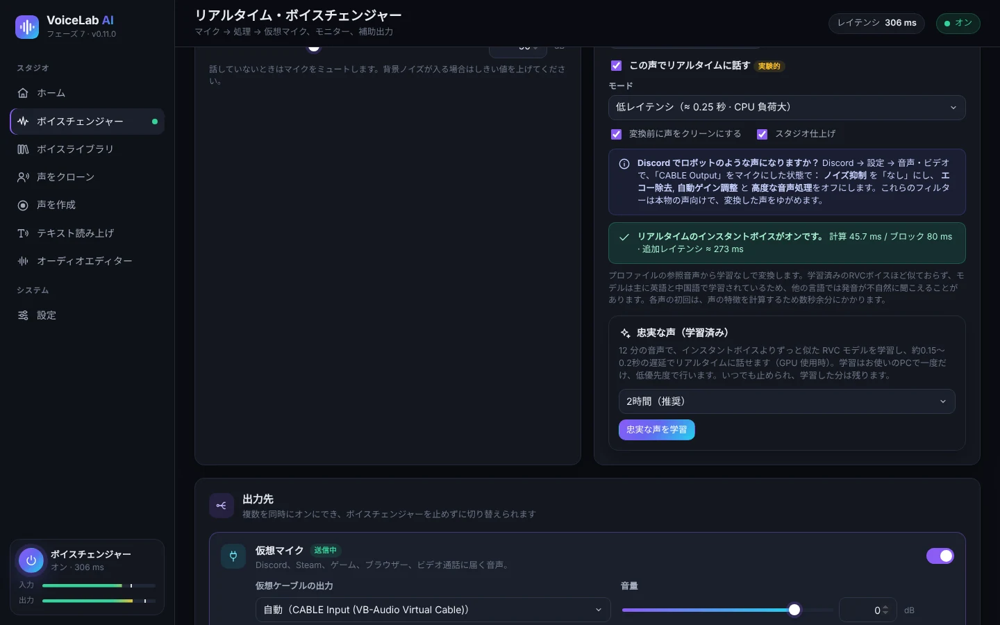

1. ボイスチェンジャーの **保存済みプロファイル**で、「インスタントAI」のプロフィールを選びます。
2. 初回は **リアルタイムボイスをインストール**をクリックします。ダウンロードは約 1.9 GB、ディスク使用量は約 2.7 GB です。終わるとアプリがパソコンの速度を測り、最適なモードを選びます。
3. **この声でリアルタイムに話す**にチェックを入れ、ボイスチェンジャーをオンにします。声ごとに初回は数秒長くかかります（声の特徴を計算するため）。
4. **モード**：
   - **低遅延**（約 0.25 秒）：遅延は少ないが、CPU を約 3 倍使います。
   - **品質**（約 0.45 秒）：より似た声になり、CPU の負荷も軽めです。
5. オプション：
   - **変換前に声をクリーンにする**：AI の前にマイクのノイズを除去します。
   - **スタジオ仕上げ**：ディエッサー、コンプレッション、自動レベル調整をかけます。
   - **高解像度 48 kHz**：品質モードで、CPU に余裕がある場合のみ使えます。119 MB の追加ダウンロード（任意）です。
6. 緑のステータス行に、ブロックごとの計算時間と実際の **追加された遅延**が表示されます。**「プロセッサーが間に合っていません」**と表示されたら、品質モードに切り替える、高音質をオフにする、重いソフトを閉じる、のいずれかを試してください。

インスタントボイスは学習不要ですが、忠実な声ほどは似ません。モデルは主に英語と中国語で学習されているため、他の言語では発音が不自然に聞こえることがあります。

### 6.4 忠実な声を学習する（RVC）

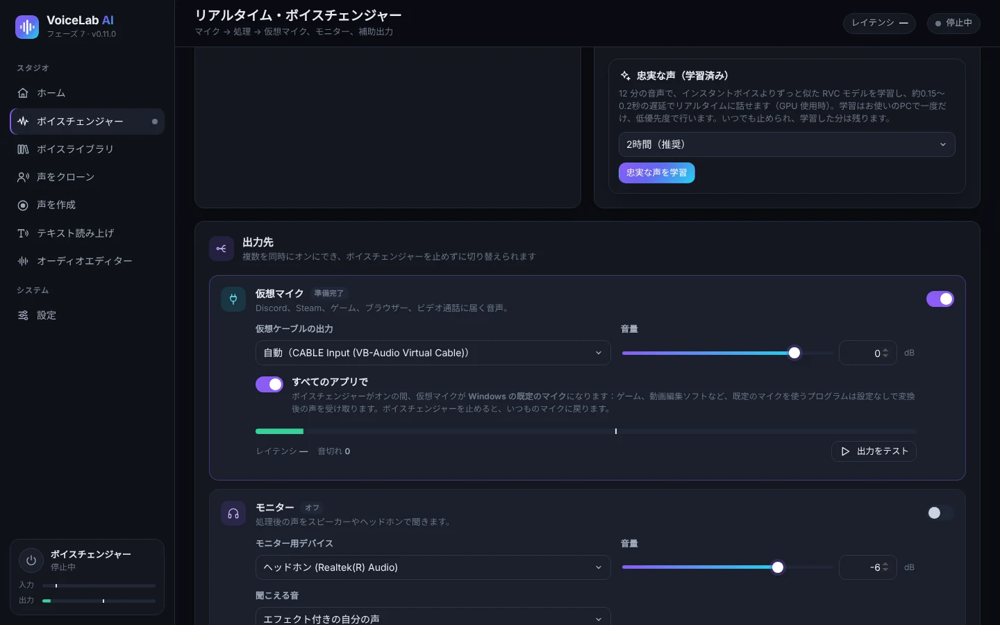

忠実な声は、あなたの音声を使ってあなたのパソコンで学習する RVC モデルです。元の声にずっと近く、ライブでの遅延も少なくなります（グラフィックボード使用時で約 0.15〜0.2 秒）。

1. **1 分以上の声**（10 分以上が理想）で作ったインスタント AI のプロフィールを有効にします。短い音声で作ったプロフィールの場合は、**声をクローン**で長い音声を使って作り直してください。
2. **忠実な声（学習済み）**カードで学習時間を選びます：30 分（お試し）、1 時間、**2 時間・推奨**、4 時間（最高）。長いほど似てきます。
3. **忠実な声を学習**をクリックします。初回は PyTorch（約 250 MB）とベースモデル（約 0.2 GB）がダウンロードされます。
4. 進行状況、現在の段階、残り時間が表示されます。学習は CPU を低い優先度で使うので、その間もパソコンを使えます。
5. **停止して学習結果を使う**を押すと学習を止め、そこまでの内容で声を作ります。アプリを閉じても進行状況は保存され、あとで **学習を再開**が表示されます。
6. 完了すると「*名前* (fiel)」という新しいプロフィールが作られます。**忠実な声を使う**で有効にします。あとから **学習を続ける**で改善することもできます。

**ピッチ調整**：忠実な声はあなた自身の声の抑揚に従います。元の声があなたより高い・低い場合は、プロフィールカードの **この声のピッチ調整**を使います。目安として、男性から女性の声は +8〜+12、女性から男性の声は −8〜−12 がよく合います。

### 6.5 RVC モデルをインポートする

`.onnx` 形式の RVC モデルを持っている場合：

1. *設定*で AI エンジンと **RVC 変換ベース**をインストールします。
2. **ボイスライブラリ → RVCモデルをインポート**を開き、名前を入力してファイルを選びます。
3. ボイスチェンジャーで有効にします。プロフィールカードに **ピッチ調整**があります。

対応しているのは `.onnx` モデルのみです。`.pth` は先に RVC のエクスポートツールで変換してください。

## 7. テキスト読み上げ

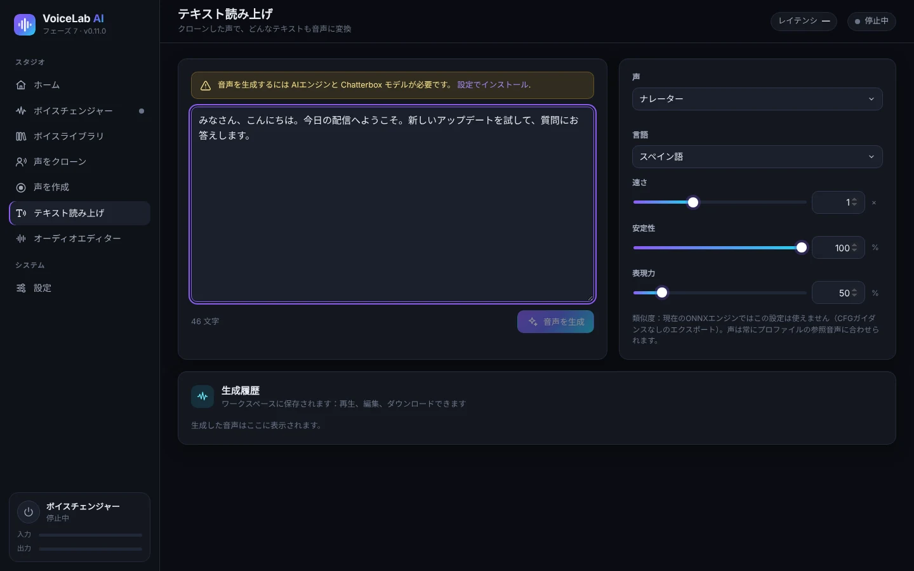

1. *設定 → AIエンジンとモデル*で AI エンジンと **Chatterbox Multilingual** モデル（約 3.2 GB）をインストールします。
2. **テキスト読み上げ**を開き、テキストを入力または貼り付けます。
3. **声**（クローンしたプロフィールならどれでも可）と **言語**を選びます。スペイン語、英語、フランス語、イタリア語、ポルトガル語、ロシア語、中国語、日本語など 23 言語に対応しています。
4. 調整項目：
   - **速さ**。
   - **安定性**：高いほど一定、低いほど変化に富みます。
   - **表現力**：感情や強調が増します。
5. **音声を生成**をクリックします。初回はモデルの読み込みに 1〜4 分かかります。**キャンセル**で中止できます。
6. 結果は **生成履歴**に表示されます。再生したり、エディターで開いたり、WAV・MP3・FLAC・OGG でダウンロードしたりできます。

テキスト読み上げは初期設定では CPU で動作します。*設定*で GPU を試すこともでき、失敗した場合は自動で CPU に戻ります。

## 8. オーディオエディター

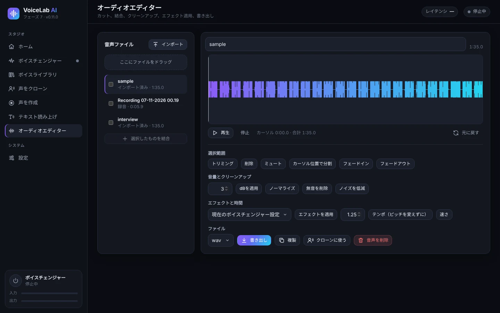

- **音声ファイル**：ファイルを読み込みます（ドラッグも可）。録音や生成した音声もここに表示されます。複数にチェックを入れて **選択したものを結合**を押すとつなげられます。
- **波形**：ドラッグして選択します。**再生**、**停止**、**元に戻す**があります。
- **選択範囲**：トリミング、削除、無音化、カーソル位置で分割、フェードイン、フェードアウト。
- **音量とクリーンアップ**：dB 指定で調整、ノーマライズ、無音の削除、ノイズ除去。
- **エフェクトと時間**：
  - **エフェクトを適用**：ボイスチェンジャーの現在の設定、または保存したプロフィールを使います。
  - **テンポ**：ピッチを変えずに速さを変えます。
  - **速さ**：速さとピッチを一緒に変えます。
- **ファイル**：形式（WAV・MP3・FLAC・OGG）を選んで **書き出し**をクリックします。**複製**、**クローンに使う**、**音声を削除**もできます。

## 9. ボイスライブラリ

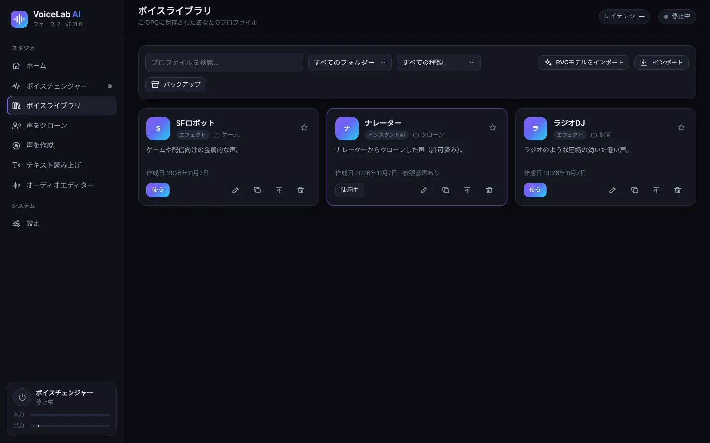

- 名前で**検索**し、フォルダーや種類（エフェクト、インスタント AI、学習済み AI（RVC））で**絞り込み**ます。
- 各カードにはプロフィールの種類、フォルダー、説明が表示されます。星を付けるとお気に入りになります。
- カードのボタン：
  - **使う**：ボイスチェンジャーでそのプロフィールを有効にします。
  - **編集**：名前、フォルダー、説明を変更します。
  - **複製**。
  - **エクスポート**：別のパソコンに移せる `.vlprofile` ファイルを作ります。
  - **削除**。
- **インポート**でエクスポートしたプロフィール（`.vlprofile`）を追加できます。**RVCモデルをインポート**では `.onnx` モデルを追加できます。
- **バックアップ**はすべてのプロフィールを 1 つのファイルに保存します。

## 10. 設定

### 10.1 オーディオデバイス

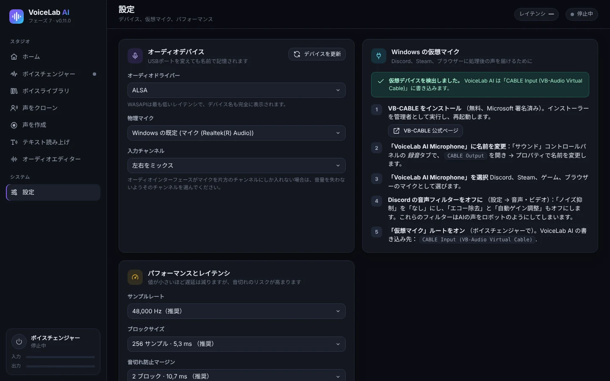

- **オーディオドライバー**：Windows では **WASAPI** が最も遅延が少なくなります。
- **物理マイク**：VoiceLab が聞く本物のマイクです。名前で記憶されるので、USB ポートを変えても大丈夫です。
- **入力チャンネル**：オーディオインターフェースがマイクを片方のチャンネルだけに入れている場合は、そのチャンネルを選びます。
- **デバイスを更新**：新しい機器をつないだときに再検索します。
- **Windows の仮想マイク**カードには VB-CABLE のインストール手順が表示され、検出されているかどうかもわかります。

### 10.2 パフォーマンスと遅延

- **サンプルレート**：48,000 Hz（推奨）または 44,100 Hz。
- **ブロックサイズ**：小さいほど遅延は減りますが、音切れのリスクが上がります。256 サンプル（5.3 ミリ秒）ならほとんどのパソコンで問題ありません。
- **音切れ防止マージン**：プチプチ音が聞こえる場合は上げてください。

### 10.3 AI エンジンとモデル

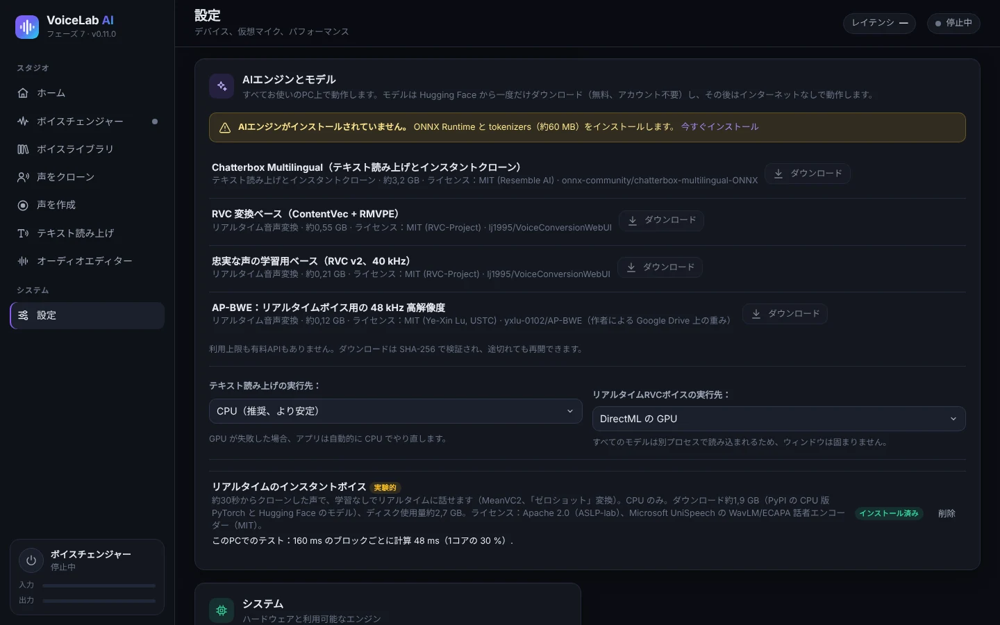

モデルは Hugging Face から一度だけダウンロードします（無料、アカウント不要）。その後はオフラインで動作します。ダウンロードはすべて検証され、途中で切れても再開できます。

| コンポーネント | サイズ | 用途 |
|---|---|---|
| AI エンジン（ONNX Runtime と tokenizers） | 約 60 MB | AI 機能すべてに必要 |
| Chatterbox Multilingual | 約 3.2 GB | テキスト読み上げとインスタントクローン |
| RVC 変換ベース（ContentVec + RMVPE） | 約 0.55 GB | RVC ボイスのライブ使用（インポートまたは学習したもの） |
| 忠実な声学習用ベース（RVC v2、40 kHz） | 約 0.21 GB | 忠実な声の学習 |
| AP-BWE（高音質） | 約 0.12 GB | 任意。品質モードのインスタントボイス用 |
| ライブ用インスタントボイス（MeanVC2 + CPU 版 PyTorch） | ダウンロード約 1.9 GB | インスタントボイスでのライブ会話 |

各機能をどこで動かすかも選べます：

- **テキスト読み上げの実行先：**：CPU（推奨）または GPU。
- **リアルタイムRVCボイスの実行先：**：DirectML を使う GPU（グラフィックボードがあれば推奨）または CPU。

### 10.4 インターフェースの言語

アプリはスペイン語、英語、フランス語、イタリア語、ポルトガル語、ロシア語、中国語、日本語に対応しています。**システム → インターフェースの言語** で **自動** を選ぶと Windows の言語を使います（8言語に含まれない場合は英語）。変更するとウィンドウがすぐに再読み込みされます。ボイスチェンジャーやプロファイルには影響しません。インストーラーも Windows の言語で表示されます。

## 11. Discord・ゲーム・OBS・動画編集ソフトで使う

**すべてのアプリで**がオンなら（[5.1](#51-出力) 参照）、Windows の既定のマイクを使うソフトはそのまま変えた声を受け取ります。一部のソフトはもう 1 手順必要です：

- **Discord**：
  1. *ユーザー設定 → 音声・ビデオ* で、**入力デバイス**を「CABLE Output」（または「VoiceLab AI Microphone」）か「既定」にします。
  2. **ノイズ抑制**を**なし**にします。
  3. **エコー除去**、**自動ゲイン調整**、**高度な音声検出**をオフにします。これらのフィルターがあると AI ボイスがロボットのように聞こえます。
- **ゲーム**：ほとんどが既定のマイクを使います。起動時にしかマイクを確認しないゲームは、ボイスチェンジャーをオンにしてから起動してください。
- **OBS Studio**：「CABLE Output」を指定した**音声入力キャプチャ**ソースを追加するか、「既定」を使います。
- **動画編集ソフト**（DaVinci Resolve、Premiere、CapCut など）：エフェクト付きのナレーションを録るときは、録音入力に「CABLE Output」または既定のマイクを選びます。
- **ブラウザーとビデオ通話**（Meet、Teams、Zoom）：各サービスの音声設定で「CABLE Output」または「既定」を選びます。

## 12. トラブルシューティング

| 問題 | 対処法 |
|---|---|
| 相手に声が聞こえない | ボイスチェンジャーが **オン**で、**仮想マイク**の出力がオンになっているか確認します。相手側のソフトで「CABLE Output」か「既定」を選びます。 |
| 「仮想マイクが見つかりません」 | VB-CABLE を管理者として実行してインストールし、パソコンを再起動します。その後 *設定*で **デバイスを更新**をクリックします。 |
| Discord で AI ボイスがロボットのように聞こえる | Discord の音声フィルターをオフにします（[11](#11-discordゲームobs動画編集ソフトで使う) 参照）。 |
| 音切れ、プチプチ音、「プロセッサーが間に合っていません」 | 高音質なしの **品質**モードを使い、重いソフトを閉じます。**音切れ防止マージン**か **ブロックサイズ**を上げます。 |
| 遅延が大きい | CPU に余裕があれば **低遅延**を使うか、GPU で**忠実な声**を使います。実際の遅延はボイスチェンジャーに表示されます。 |
| キーンという音やハウリング | モニターにはスピーカーではなくヘッドホンを使ってください。 |
| 背景ノイズが聞こえる | **ノイズゲート**と **ノイズ低減**をオンにするか、AI ボイスでは **変換前に声をクリーンにする**をオンにします。 |
| 初回のテキスト読み上げが遅い | 正常です。モデルの読み込みに 1〜4 分かかります。2 回目以降は速くなります。 |
| ソフトが前のマイクのまま | 起動時にしかマイクを読み込まないソフトがあります。ボイスチェンジャーをオンにした状態で、そのソフトを開き直してください。 |
| サポートを頼むためにログが必要 | `%APPDATA%\VoiceLabAI\logs` にあります（`voicelab.log`、`voz-instantanea.log`、`entrenamiento.log`）。 |

## 13. プライバシーと責任ある利用

- **すべての処理はあなたのパソコン上で行われます**。声、プロフィール、録音がサーバーに送られることはありません。インターネットはアプリとモデルのダウンロードにのみ使います。
- **クローンしてよいのは、自分の声か、許可をもらった人の声だけです**。アプリはプロフィールを作るたびに確認を求めます。
- クローンした声を、人をだます、なりすます、詐欺をはたらく目的で使わないでください。多くの国で違法です。
- AI モデルにはそれぞれのライセンス（MIT、Apache 2.0）があります。*設定 → AIエンジンとモデル*と [README](../../README.md) で確認できます。

---

ショートカット：**Ctrl + M** でボイスチェンジャーのオン・オフ。アプリのデータ：`%APPDATA%\VoiceLabAI`。
