# Manual do VoiceLab AI

[Español](es.md) · [English](en.md) · [Français](fr.md) · [Italiano](it.md) · **Português** · [Русский](ru.md) · [中文](zh.md) · [日本語](ja.md)

O VoiceLab AI é um estúdio de voz para Windows: muda a tua voz em tempo real, clona vozes com inteligência artificial e transforma texto em fala. Tudo funciona no teu computador, sem assinaturas nem serviços na nuvem.

> Este manual corresponde à versão 0.11. As capturas de tela usam perfis e dispositivos de exemplo.
>
> **A interface está disponível em 8 idiomas** (Español, English, Français, Italiano, Português, Русский, 中文, 日本語). Ela segue automaticamente o idioma do Windows e pode ser trocada em **Configurações → Idioma da interface**. Este manual usa os nomes em português dos botões e opções.

## Índice

1. [O que podes fazer](#1-o-que-podes-fazer)
2. [Requisitos](#2-requisitos)
3. [Instalação](#3-instalação)
4. [Ecrã inicial](#4-tela-inicial)
5. [Modulador em tempo real](#5-modulador-em-tempo-real)
6. [Vozes com inteligência artificial](#6-vozes-com-inteligência-artificial)
7. [Texto para fala](#7-texto-para-fala)
8. [Editor de áudio](#8-editor-de-áudio)
9. [Biblioteca de vozes](#9-biblioteca-de-vozes)
10. [Configurações](#10-configurações)
11. [Usar a tua voz no Discord, em jogos, no OBS e em editores de vídeo](#11-usar-a-tua-voz-no-discord-em-jogos-no-obs-e-em-editores-de-vídeo)
12. [Resolução de problemas](#12-resolução-de-problemas)
13. [Privacidade e uso responsável](#13-privacidade-e-uso-responsável)

---

## 1. O que podes fazer

- **Modular a tua voz em direto** com efeitos (tom, formantes, robô, rádio, eco, reverberação…) e enviá-la para qualquer programa através de um microfone virtual.
- **Clonar uma voz** a partir de um áudio ou vídeo e usá-la para ler textos (texto para fala) ou para falar em direto.
- **Treinar uma «voz fiel»**: um modelo RVC muito mais parecido, para falar em direto com pouco atraso.
- **Gravar e editar áudio**: cortar, juntar, limpar ruído, aplicar efeitos e exportar para WAV, MP3, FLAC ou OGG.
- **Organizar as tuas vozes** numa biblioteca com pastas, favoritos, exportação e cópias de segurança.

## 2. Requisitos

| | Mínimo | Recomendado |
|---|---|---|
| Sistema | Windows 10 de 64 bits | Windows 11 |
| Processador | 4 núcleos | 8 núcleos (para a voz instantânea e o treino) |
| Memória | 8 GB | 16 GB ou mais |
| Disco | 1 GB para a aplicação | +8 GB se instalares todos os modelos de IA |
| Placa gráfica | Não é necessária | Compatível com DirectX 12 (AMD, NVIDIA ou Intel) para as vozes RVC em direto |
| Microfone virtual | [VB-CABLE](https://vb-audio.com/Cable/) (gratuito) | — |

Só precisas de Internet para descarregar a aplicação e, uma vez, os modelos de IA que escolheres.

## 3. Instalação

### 3.1 Instalar a aplicação

1. Descarrega `VoiceLabAI-Setup-x.y.z.exe` da página de [versões (Releases)](https://github.com/demfisalvarez/VoiceLab-AI/releases/latest).
2. Abre-o. Se o Windows mostrar «O Windows protegeu o seu PC», clica em **Mais informações → Executar mesmo assim** (o instalador não está assinado com um certificado comercial).
3. Segue o assistente. Instala-se só para o teu usuário e não pede permissões de administrador.
4. Abre o **VoiceLab AI** a partir do menu Iniciar ou do ambiente de trabalho.

Para desinstalar: *Configurações do Windows → Aplicações → VoiceLab AI → Desinstalar*. Os teus perfis e configurações ficam guardados em `%APPDATA%\VoiceLabAI`.

### 3.2 Instalar o microfone virtual (VB-CABLE)

O microfone virtual é o que permite que o Discord, os jogos ou o navegador «ouçam» a tua voz modificada.

1. Descarrega o VB-CABLE da [página oficial](https://vb-audio.com/Cable/) (gratuito, assinado pela Microsoft).
2. Descomprime o arquivo, clica com o botão direito em `VBCABLE_Setup_x64.exe` → **Executar como administrador** → **Install Driver**.
3. Reinicia o computador.
4. Opcional: muda-lhe o nome para o reconheceres melhor. Em **Configurações → Abrir painel Som**, separador **Gravação**, abre **CABLE Output → Propriedades** e muda o nome para «VoiceLab AI Microphone».

### 3.3 Primeiro arranque

Ao abrir a aplicação verás o tela **Início**. O cartão **Configuração inicial** verifica o teu microfone e o microfone virtual, e indica o que falta.

## 4. Ecrã inicial

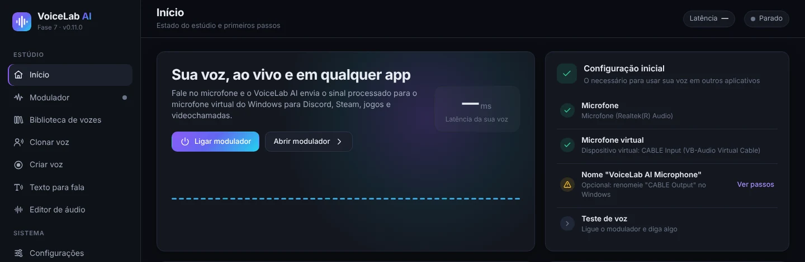

- **Ligar modulador** liga o modulador sem sair deste tela. Também podes usar **Ctrl + M** a qualquer momento.
- **Abrir modulador** leva-te ao painel completo.
- **Configuração inicial** é uma lista do que é necessário: microfone, microfone virtual, nome do dispositivo e teste de voz. Um círculo verde significa que esse passo está pronto.

Na parte de baixo da barra lateral vês sempre o estado do modulador e os medidores de entrada (**ENT**) e saída (**SAÍ**).

## 5. Modulador em tempo real

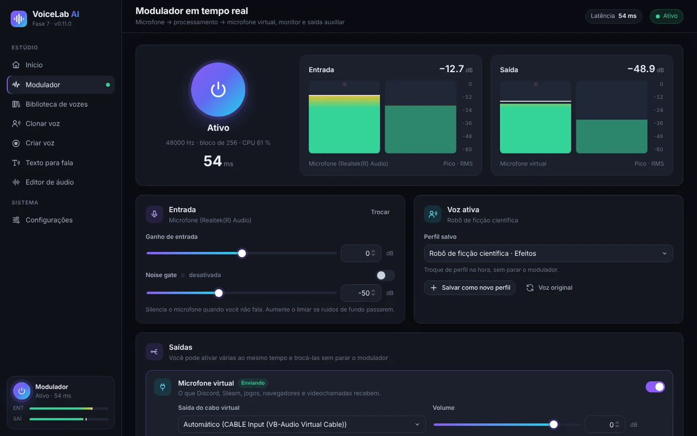

1. Carrega no grande **botão de ligar**. Passa a **Ativo** e mostra a frequência de amostragem, o tamanho do bloco, o uso de CPU e a **latência** (o atraso da tua voz, em milissegundos).
2. Os medidores **Entrada** e **Saída** mostram o nível do teu microfone e da voz processada (pico e RMS). O ideal é falares com a barra entre −24 e −12 dB.
3. No cartão **Entrada**:
   - **Trocar** abre a lista de microfones.
   - **Ganho de entrada** sobe ou desce o volume do microfone antes dos efeitos.
   - **Noise gate** silencia o microfone quando não falas. Ativa-a e sobe o limiar se se ouvirem ruídos de fundo (teclado, ventoinha).
4. No cartão **Voz ativa** escolhes a voz em uso:
   - **Perfil salvo** muda de perfil no momento, sem parar o modulador.
   - **Salvar como novo perfil** guarda os efeitos atuais como um perfil.
   - **Salvar alterações no perfil** atualiza o perfil em uso.
   - **Voz original** retira todos os efeitos.

### 5.1 Saídas

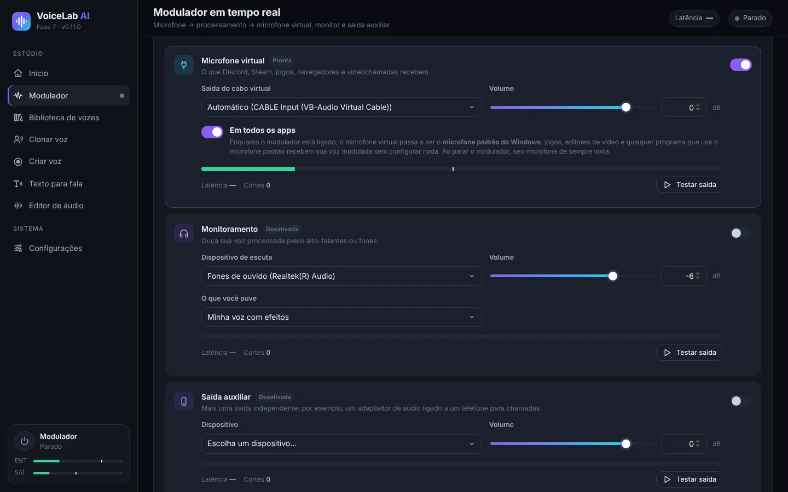

Podes ativar várias saídas ao mesmo tempo e alterá-las sem parar o modulador.

- **Microfone virtual** envia a voz processada para o VB-CABLE. É o que recebem o Discord, o Steam, os jogos, os navegadores e as videochamadas. Com **Automático**, o VoiceLab escolhe «CABLE Input» sozinho.
- **Em todos os apps**, ativado por defeito: enquanto o modulador está ligado, o microfone virtual passa a ser o **microfone predefinido do Windows**. Assim, qualquer programa que use o microfone predefinido (jogos, editores de vídeo, o navegador…) recebe a tua voz modulada sem configurar nada. O VoiceLab continua a ouvir o teu microfone real. Ao parar o modulador ou fechar a aplicação, o Windows volta ao teu microfone de sempre.
- **Monitoramento** permite ouvires-te nos auscultadores. Em **O que você ouve** escolhe «Minha voz com efeitos» ou «Meu microfone original (sem efeitos)». Usa auscultadores: com colunas pode haver microfonia (apito), e a aplicação avisa-te antes de a ativar.
- **Saída auxiliar** é uma saída a mais e independente, por exemplo um adaptador de áudio ligado a um telemóvel para chamadas.
- Cada saída tem o seu **Volume**, um medidor, a sua latência, um contador de **Cortes** e o botão **Testar saída**, que reproduz um som de teste.

### 5.2 Efeitos e preconfigurações

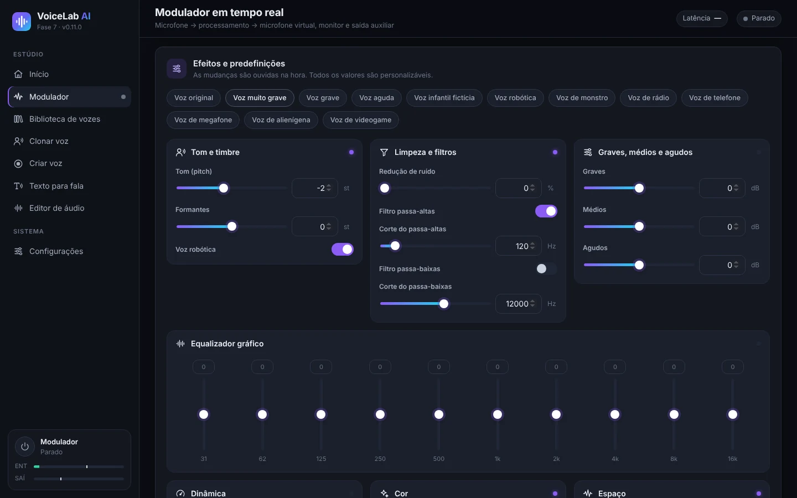

Em cima estão as **preconfigurações**: voz original, muito grave, grave, aguda, voz infantil fictícia, robô, monstro, rádio, telefone, megafone, extraterrestre e videojogo. As alterações ouvem-se de imediato e todos os valores são ajustáveis:

| Grupo | Controlos |
|---|---|
| Tom e timbre | **Tom (pitch)** em semitons, **Formantes** e **Voz robótica** |
| Limpeza e filtros | Redução de ruído, filtro passa-altas e filtro passa-baixas |
| Graves, médios e agudos | Equalizador simples de três bandas |
| Equalizador gráfico | 10 bandas, de 31 Hz a 16 kHz |
| Dinâmica | Compressor (limiar, rácio, compensação), limitador e ganho de saída |
| Cor | Saturação, distorção, lo-fi de 8 bits e modulação em anel |
| Espaço | Chorus, eco e reverberação |

Dica: para uma voz mais grave mas natural, baixa o **Tom** e baixa um pouco os **Formantes**. Se baixares só o tom, a voz soa a desenho animado.

## 6. Vozes com inteligência artificial

Há três tipos de vozes de IA:

| Tipo | O que precisas | Para que serve | Semelhança |
|---|---|---|---|
| **IA instantânea** | 10–30 s de voz | Texto para fala e falar em direto (atraso de 0,25 a 0,45 s) | Boa |
| **Voz fiel (treinada)** | Pelo menos 1 min de voz (melhor 10 min ou mais) e um treino de 30 min a 4 h | Falar em direto com pouco atraso | Muito alta |
| **Modelo RVC importado** | Um arquivo `.onnx` que já tenhas | Falar em direto | Depende do modelo |

Antes de as usares, instala o motor de IA e os modelos em **Configurações → Motor de IA e modelos**. Vê [10.3](#103-motor-de-ia-e-modelos).

### 6.1 Clonar uma voz

1. Vai a **Clonar voz** e arrasta um arquivo de áudio ou vídeo, ou clica em **escolha-o no seu computador**. Formatos aceites: MP3, WAV, FLAC, M4A, AAC, OGG, MP4, MKV, MOV e WEBM. O áudio dos vídeos é extraído automaticamente. Também podes escolher um áudio que já esteja no VoiceLab.

   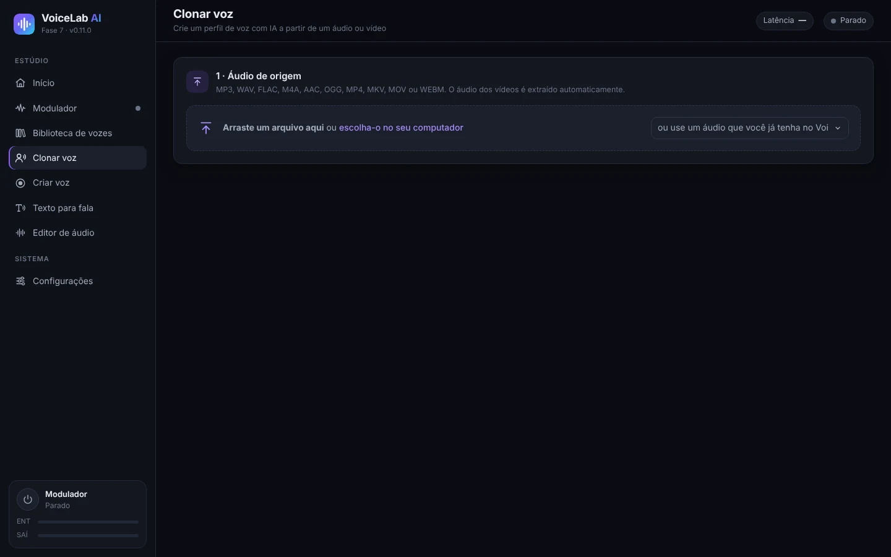

2. **Escolhe o fragmento com a voz**: arrasta sobre a onda para selecionar. Com **Ouvir seleção** confirmas que só fala uma pessoa. Para a voz instantânea, o ideal são 10–30 segundos claros. Se depois quiseres **treinar uma voz fiel**, seleciona toda a voz útil (pelo menos 1 minuto, melhor 10 minutos ou mais).

   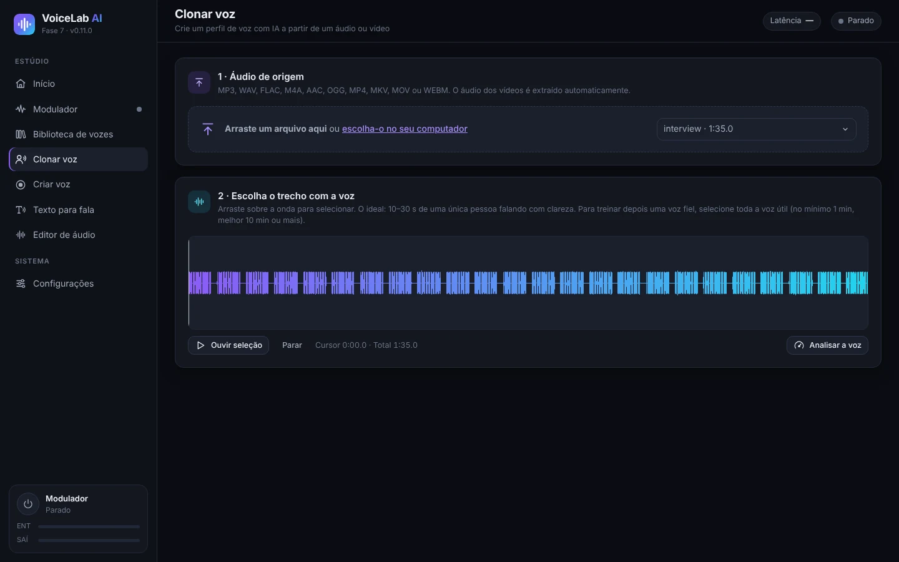

3. Clica em **Analisar a voz**. Verás os segundos de voz útil, a relação sinal/ruído, o tom médio e o nível. Uma barra indica para que chega: 10 s para a voz instantânea, 5 min para uma voz fiel e 10 min para uma voz fiel ideal.
4. **Crear el perfil** (Criar o perfil): escreve um nome e o idioma da voz e, se quiseres, uma pasta e uma descrição. Deixa marcado **Remover ruído de fundo e silêncios longos**.
5. Indica se **É a minha própria voz** ou se **Tenho autorização da pessoa**. É obrigatório.
6. Clica em **Criar perfil de voz**.

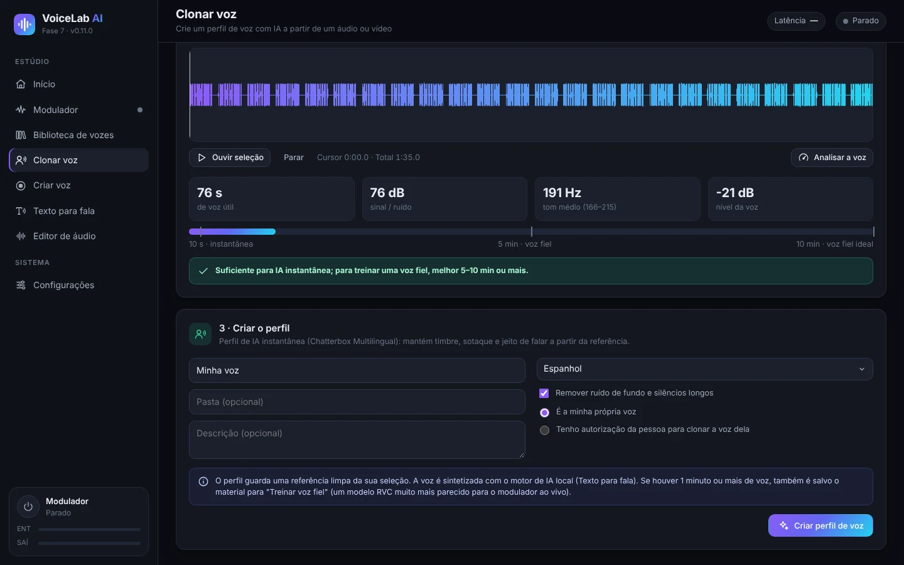

O perfil guarda uma referência limpa. Se a seleção tiver 1 minuto de voz ou mais, guarda também o material para treinar a voz fiel.

### 6.2 Gravar a tua voz (Criar voz)

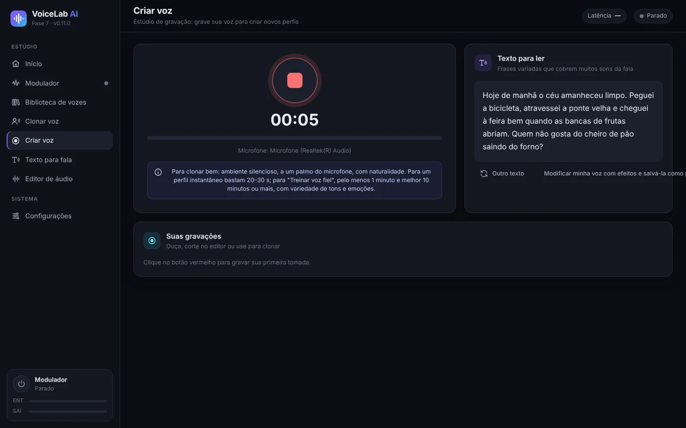

1. Vai a **Criar voz** e carrega no **botão vermelho** para gravar. Carrega outra vez para parar.
2. Lê as frases de **Texto para ler**: cobrem todos os sons do espanhol. **Outro texto** mostra outras frases.
3. As gravações aparecem em **Suas gravações**. Daí podes ouvi-las, abri-las no editor ou usá-las para clonar.
4. **Modificar minha voz com efeitos e salvá-la como perfil** leva-te ao modulador com a tua gravação.

Para gravar bem: divisão silenciosa, a um palmo do microfone, a falar com naturalidade e com variedade de tons e emoções.

### 6.3 Falar em direto com uma voz instantânea

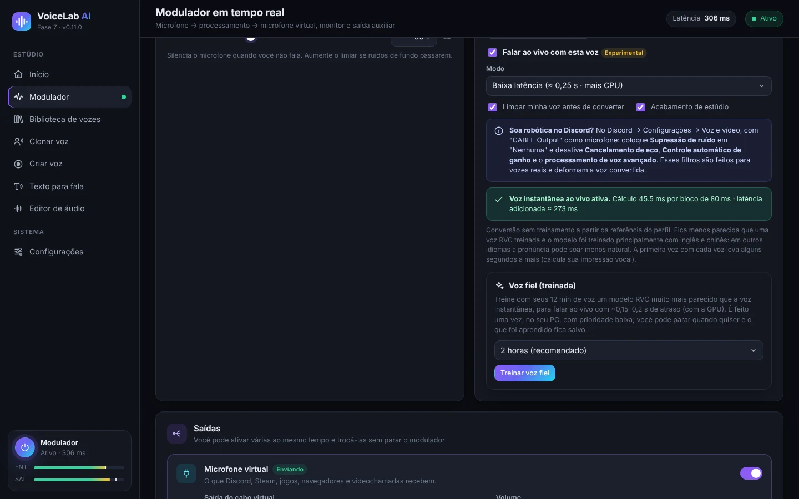

1. No modulador, escolhe em **Perfil salvo** um perfil do tipo «IA instantânea».
2. Da primeira vez, clica em **Instalar a voz ao vivo**. Descarrega cerca de 1,9 GB e ocupa cerca de 2,7 GB. No fim, a aplicação mede a velocidade do teu PC e escolhe o melhor modo.
3. Marca **Falar ao vivo com esta voz** e liga o modulador. Da primeira vez com cada voz demora uns segundos a mais (calcula a impressão vocal).
4. **Modo**:
   - **Baixa latência** (≈ 0,25 s): menos atraso, mas usa cerca de três vezes mais CPU.
   - **Qualidade** (≈ 0,45 s): a voz fica mais parecida e gasta menos CPU.
5. Opções:
   - **Limpar minha voz antes de converter** tira o ruído do microfone antes da IA.
   - **Acabamento de estúdio** aplica de-esser, compressão e nível automático.
   - **Alta definição 48 kHz** só funciona no modo Qualidade e se a tua CPU aguentar. É uma descarga opcional de 119 MB.
6. A linha de estado verde mostra o tempo de cálculo por bloco e a **latência adicionada** real. Se aparecer **O processador não consegue acompanhar**, muda para Qualidade, desativa a alta definição ou fecha programas pesados.

A voz instantânea não precisa de treino, mas parece-se menos com a original do que uma voz fiel. O modelo foi treinado sobretudo em inglês e chinês, por isso noutros idiomas a pronúncia pode soar menos natural.

### 6.4 Treinar uma voz fiel (RVC)

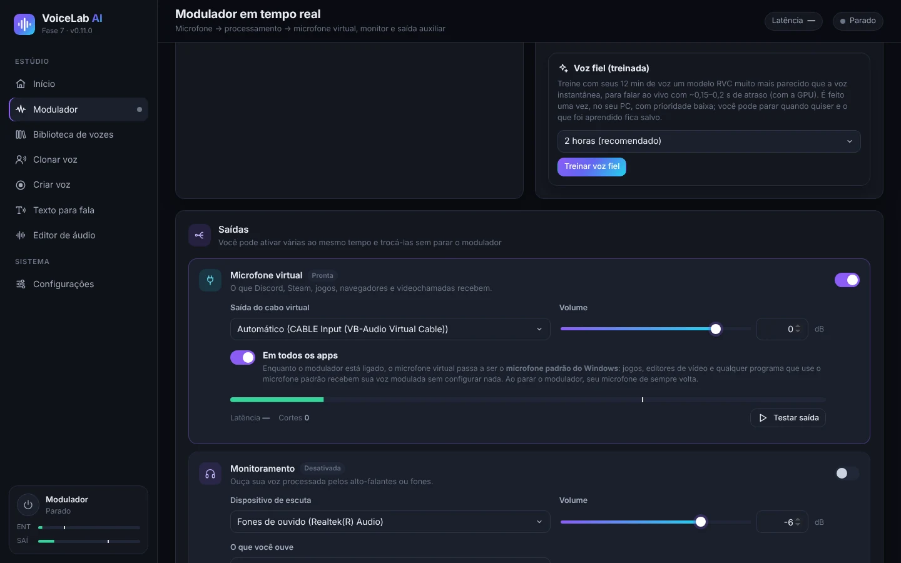

A voz fiel é um modelo RVC treinado com o teu áudio, no teu PC. Parece-se muito mais com a voz original e em direto tem pouco atraso (cerca de 0,15–0,2 s com placa gráfica).

1. Ativa um perfil de IA instantânea criado com **1 minuto de voz ou mais** (melhor 10 minutos ou mais). Se o teu perfil foi criado com menos, cria-o de novo em **Clonar voz** com um áudio mais longo.
2. No cartão **Voz fiel (treinada)**, escolhe a duração: 30 min (teste rápido), 1 hora, **2 horas (recomendado)** ou 4 horas (máxima). Mais tempo = mais parecida.
3. Clica em **Treinar voz fiel**. Da primeira vez são descarregados o PyTorch (cerca de 250 MB) e os modelos base (cerca de 0,2 GB).
4. Verás o progresso, a fase e o tempo restante. O treino usa a CPU com prioridade baixa, por isso podes continuar a usar o PC.
5. **Parar e usar o que aprendeu** termina o treino e cria a voz com o que aprendeu até esse momento. Se fechares a aplicação, o progresso fica guardado e depois aparece **Retomar o treinamento**.
6. No fim é criado um perfil novo chamado «*nome* (fiel)». Clica em **Usar a voz fiel** para o ativar. Com **Continuar treinando** podes melhorá-lo mais tarde.

**Ajuste de tom**: a voz fiel segue a entoação da tua voz. Se a voz original for mais aguda ou mais grave do que a tua, usa **Ajuste de tom para esta voz**, de −24 a +24 semitons, no cartão do perfil. Como referência, de voz masculina para feminina costuma resultar entre +8 e +12, e de feminina para masculina entre −8 e −12.

### 6.5 Importar um modelo RVC

Se já tens um modelo RVC no formato `.onnx`:

1. Instala o motor de IA e a **Base para conversão RVC** em *Configurações*.
2. Vai a **Biblioteca de vozes → Importar modelo RVC**, escreve um nome e escolhe o arquivo.
3. Ativa-o no modulador. No cartão do perfil tens o **Ajuste de tom**.

Só são aceites modelos `.onnx`. Os `.pth` têm de ser convertidos antes com a ferramenta de exportação do RVC.

## 7. Texto para fala

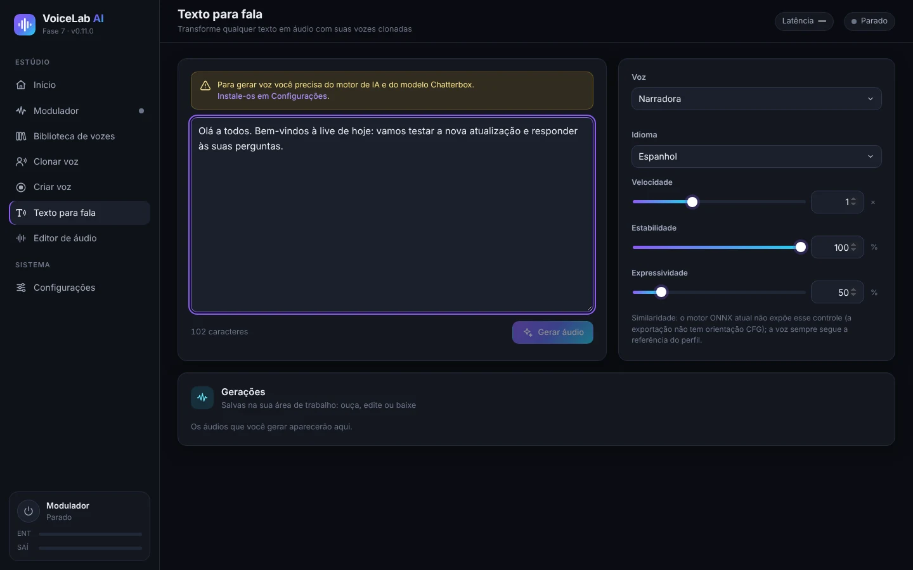

1. Instala o motor de IA e o modelo **cerca de 3** (2 GB) em *Configurações → Motor de IA e modelos*.
2. Vai a **Texto para fala** e escreve ou cola o texto.
3. Escolhe a **Voz**, que pode ser qualquer perfil clonado, e o **Idioma**. Há 23 idiomas, entre eles espanhol, inglês, francês, italiano, português, russo, chinês e japonês.
4. Ajusta:
   - **Velocidade**.
   - **Estabilidade**: mais alta = mais regular, mais baixa = mais variada.
   - **Expressividade**: mais emoção e ênfase.
5. Clica em **Gerar áudio**. A primeira geração demora mais (o modelo carrega em 1–4 minutos). **Cancelar** interrompe-a.
6. O resultado aparece em **Gerações**: podes ouvi-lo, abri-lo no editor ou descarregá-lo em WAV, MP3, FLAC ou OGG.

O texto para fala usa a CPU por defeito. Em *Configurações* podes experimentar a GPU; se falhar, a aplicação volta sozinha à CPU.

## 8. Editor de áudio

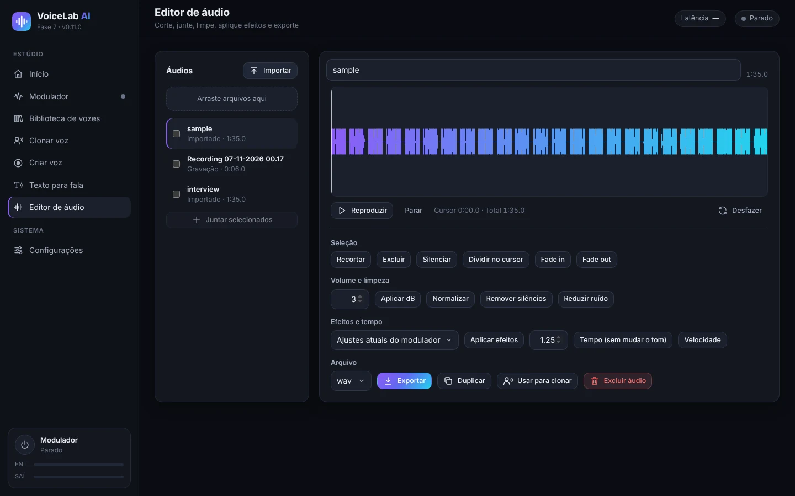

- **Áudios**: importa arquivos (ou arrasta-os); aqui aparecem também as tuas gravações e gerações. Marca vários e clica em **Juntar selecionados** para os juntar.
- **Onda**: arrasta para selecionar. Tens **Reproduzir**, **Parar** e **Desfazer**.
- **Seleção**: cortar, eliminar, silenciar, dividir no cursor, fade in e fade out.
- **Volume e limpeza**: aplicar dB, normalizar, eliminar silêncios e reduzir ruído.
- **Efeitos e tempo**:
  - **Aplicar efeitos** usa as configurações atuais do modulador ou um perfil guardado.
  - **Tempo** muda a velocidade sem mudar o tom.
  - **Velocidade** muda a velocidade e o tom ao mesmo tempo.
- **Arquivo**: escolhe o formato (WAV, MP3, FLAC ou OGG) e clica em **Exportar**. Também podes **Duplicar**, **Usar para clonar** ou **Excluir áudio**.

## 9. Biblioteca de vozes

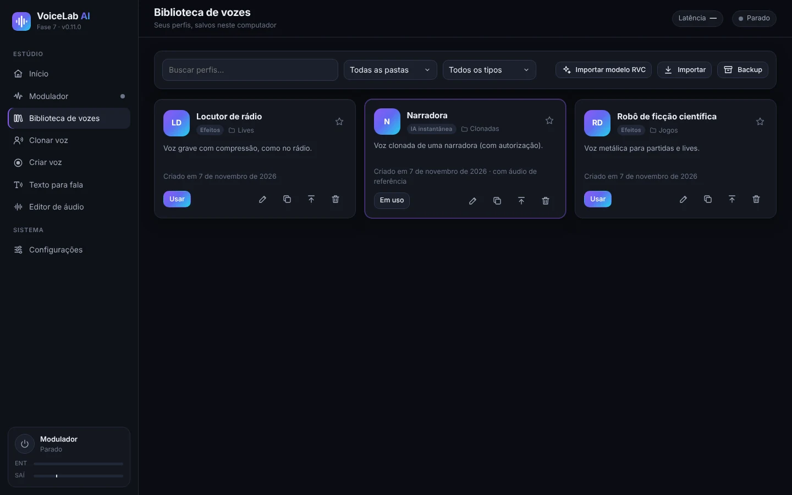

- **Pesquisa** por nome e **filtra** por pasta ou por tipo: efeitos, IA instantânea ou IA treinada (RVC).
- Cada cartão mostra o tipo, a pasta e a descrição do perfil. A estrela marca-o como favorito.
- Botões de cada cartão:
  - **Usar** ativa o perfil no modulador.
  - **Editar** muda o nome, a pasta ou a descrição.
  - **Duplicar**.
  - **Exportar** cria um arquivo `.vlprofile` para o levar para outro PC.
  - **Excluir**.
- **Importar** adiciona perfis exportados (`.vlprofile`). **Importar modelo RVC** adiciona modelos `.onnx`.
- **Backup** guarda todos os teus perfis num único arquivo.

## 10. Configurações

### 10.1 Dispositivos de áudio

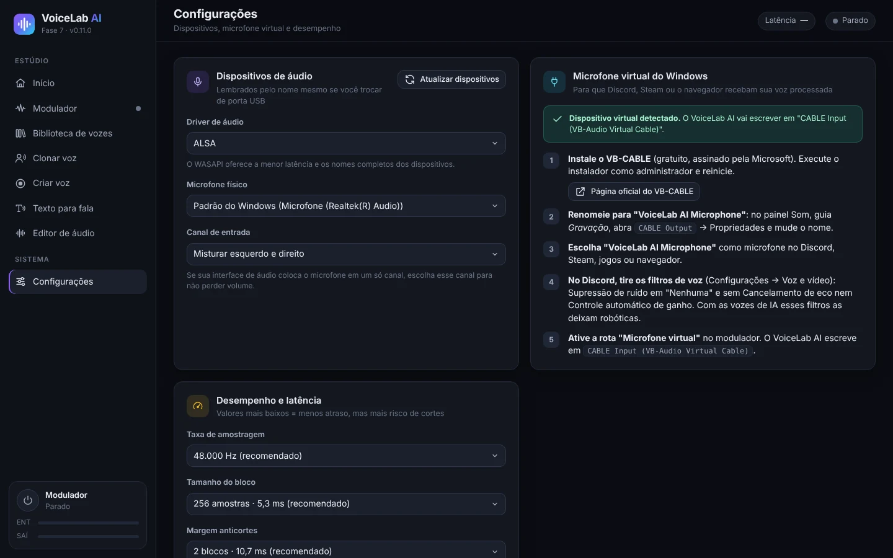

- **Driver de áudio**: no Windows, o **WASAPI** dá a menor latência.
- **Microfone físico** é o microfone real que o VoiceLab ouve. É lembrado pelo nome, mesmo que mudes de porta USB.
- **Canal de entrada**: se a tua interface de áudio põe o microfone só num canal, escolhe esse canal.
- **Atualizar dispositivos** volta a procurar os dispositivos se ligares algo novo.
- O cartão **Microfone virtual do Windows** repete os passos de instalação do VB-CABLE e diz-te se o deteta.

### 10.2 Desempenho e latência

- **Taxa de amostragem**: 48 000 Hz (recomendado) ou 44 100 Hz.
- **Tamanho do bloco**: mais pequeno = menos atraso, mas mais risco de cortes. 256 amostras (5,3 ms) funcionam bem em quase todos os computadores.
- **Margem anticortes**: sobe-a se ouvires estalidos.

### 10.3 Motor de IA e modelos

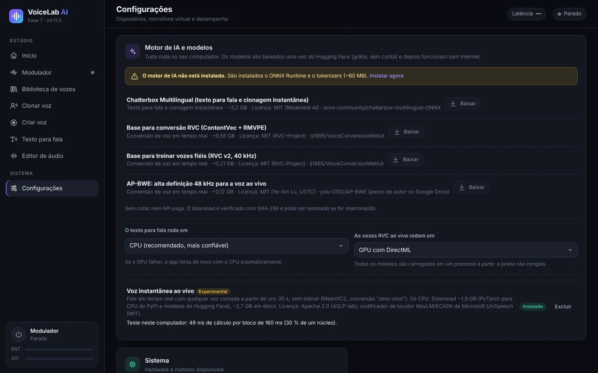

Os modelos descarregam-se uma vez a partir do Hugging Face (grátis e sem conta) e depois funcionam sem Internet. Cada descarga é verificada e pode ser retomada se for interrompida.

| Componente | Tamanho | Para que serve |
|---|---|---|
| Motor de IA | ~60 MB | Necessário para tudo o que é IA |
| Chatterbox Multilingual | ~3,2 GB | Texto para fala e clonagem instantânea |
| Base para conversão RVC (ContentVec + RMVPE) | ~0,55 GB | Vozes RVC em direto (importadas ou treinadas) |
| Base para treinar vozes fiéis (RVC v2, 40 kHz) | ~0,21 GB | Treinar uma voz fiel |
| AP-BWE (alta definição) | ~0,12 GB | Opcional, para a voz instantânea no modo Qualidade |
| Voz instantânea em direto (MeanVC2 + PyTorch para CPU) | ~1,9 GB de descarga | Falar em direto com vozes instantâneas |

Também escolhes onde corre cada parte:

- **O texto para fala roda em**: CPU (recomendado) ou GPU.
- **As vozes RVC ao vivo rodam em**: GPU com DirectML (recomendado se tiveres placa gráfica) ou CPU.

### 10.4 Idioma da interface

O app está disponível em espanhol, inglês, francês, italiano, português, russo, chinês e japonês. Em **Sistema → Idioma da interface**, **Automático** usa o idioma do Windows (inglês, se não for um dos oito). Ao trocar, a janela recarrega na hora; o modulador e os seus perfis não são afetados. O instalador também usa o idioma do Windows.

## 11. Usar a tua voz no Discord, em jogos, no OBS e em editores de vídeo

Com **Em todos os apps** ativado (vê [5.1](#51-saídas)), qualquer programa que use o microfone predefinido do Windows já recebe a tua voz modulada. Alguns programas precisam de mais um passo:

- **Discord**:
  1. Em *Configurações de usuário → Voz e vídeo*, escolhe como **dispositivo de entrada** «CABLE Output» (ou «VoiceLab AI Microphone») ou «Padrão».
  2. Põe a **supressão de ruído** em **Nenhuma**.
  3. Desativa o **cancelamento de eco**, o **controlo automático de ganho** e a **atividade de voz avançada**. Com as vozes de IA, estes filtros fazem-nas soar robóticas.
- **Jogos**: quase todos usam o microfone predefinido. Se um jogo só lê o microfone ao arrancar, abre-o com o modulador já ligado.
- **OBS Studio**: adiciona uma fonte **Captura de entrada de áudio** com «CABLE Output», ou usa «Padrão».
- **DaVinci Resolve** (Premiere, CapCut…): para gravar uma narração com efeitos, escolhe «CABLE Output» ou o microfone predefinido como entrada de gravação.
- **Navegador e videochamadas** (Meet, Teams, Zoom): escolhe «CABLE Output» ou «Padrão» nas configurações de áudio de cada serviço.

## 12. Resolução de problemas

| Problema | O que fazer |
|---|---|
| Ninguém me ouve | Confirma que o modulador está **Ativo** e que a saída **Microfone virtual** está ligada. No outro programa, escolhe «CABLE Output» ou «Padrão». |
| «Microfone virtual não detetado» | Instala o VB-CABLE como administrador e reinicia o PC. Depois clica em **Atualizar dispositivos** em *Configurações*. |
| A voz de IA soa robótica no Discord | Desativa os filtros de voz do Discord (vê [11](#11-usar-a-tua-voz-no-discord-em-jogos-no-obs-e-em-editores-de-vídeo)). |
| Cortes, estalidos ou «O processador não dá conta» | Usa o modo **Qualidade** sem alta definição e fecha programas pesados. Sobe a **Margem anticortes** ou o **Tamanho do bloco**. |
| Muito atraso | Usa **Baixa latência** se a tua CPU aguentar, ou uma **voz fiel** com a GPU. A latência real aparece no modulador. |
| Apito ou microfonia | Usa auscultadores para a monitorização, não colunas. |
| Ouve-se ruído de fundo | Ativa a **Noise gate** e a **Redução de ruído**, ou **Limpar minha voz antes de converter** nas vozes de IA. |
| O texto para fala demora da primeira vez | É normal: o modelo carrega em 1–4 minutos. As gerações seguintes são mais rápidas. |
| Um programa continua com o microfone antigo | Alguns programas só leem o microfone ao abrir: fecha-o e abre-o de novo com o modulador ligado. |
| Preciso dos registos para pedir ajuda | Estão em `%APPDATA%\VoiceLabAI\logs` (`voicelab.log`, `voz-instantanea.log` e `entrenamiento.log`). |

## 13. Privacidade e uso responsável

- **Tudo é processado no teu PC.** A tua voz, os teus perfis e as tuas gravações não são enviados para nenhum servidor. A Internet só é usada para descarregar a aplicação e os modelos.
- **Clona apenas a tua própria voz ou vozes de pessoas que te tenham dado autorização.** A aplicação pede que o confirmes em cada perfil.
- Não uses vozes clonadas para enganar, fazer-te passar por alguém ou cometer fraudes. Em muitos países é ilegal.
- Os modelos de IA têm as suas próprias licenças (MIT e Apache 2.0). Encontras-las em *Configurações → Motor de IA e modelos* e no [README](../../README.md).

---

Atalho: **Ctrl + M** liga e desliga o modulador. Dados da aplicação: `%APPDATA%\VoiceLabAI`.
