# Руководство пользователя VoiceLab AI

[Español](es.md) · [English](en.md) · [Français](fr.md) · [Italiano](it.md) · [Português](pt.md) · **Русский** · [中文](zh.md) · [日本語](ja.md)

VoiceLab AI — голосовая студия для Windows: изменяйте голос в реальном времени, клонируйте голоса с помощью искусственного интеллекта и превращайте текст в речь. Всё работает на вашем компьютере, без подписок и облачных сервисов.

> Руководство относится к версии 0.11. На снимках экрана — примеры профилей и устройств.
>
> **Интерфейс доступен на 8 языках** (Español, English, Français, Italiano, Português, Русский, 中文, 日本語). Он автоматически следует языку Windows, а сменить его можно в **Настройки → Язык интерфейса**. В руководстве кнопки и параметры названы так, как в русском интерфейсе.

## Содержание

1. [Возможности](#1-возможности)
2. [Системные требования](#2-системные-требования)
3. [Установка](#3-установка)
4. [Главный экран](#4-главный-экран)
5. [Модулятор в реальном времени](#5-модулятор-в-реальном-времени)
6. [Голоса на основе ИИ](#6-голоса-на-основе-ии)
7. [Синтез речи](#7-синтез-речи)
8. [Аудиоредактор](#8-аудиоредактор)
9. [Библиотека голосов](#9-библиотека-голосов)
10. [Настройки](#10-настройки)
11. [Голос в Discord, играх, OBS и видеоредакторах](#11-голос-в-discord-играх-obs-и-видеоредакторах)
12. [Решение проблем](#12-решение-проблем)
13. [Конфиденциальность и ответственное использование](#13-конфиденциальность-и-ответственное-использование)

---

## 1. Возможности

- **Изменять голос в прямом эфире** с эффектами (высота тона, форманты, робот, радио, эхо, реверберация…) и передавать его в любую программу через виртуальный микрофон.
- **Клонировать голос** из аудио- или видеофайла и использовать его для озвучивания текста (синтез речи) или для разговора в реальном времени.
- **Обучить «точный голос»**: модель RVC, которая звучит гораздо ближе к оригиналу, для разговора в реальном времени с небольшой задержкой.
- **Записывать и редактировать аудио**: обрезать, склеивать, убирать шум, применять эффекты и экспортировать в WAV, MP3, FLAC или OGG.
- **Упорядочивать голоса** в библиотеке с папками, избранным, экспортом и резервными копиями.

## 2. Системные требования

| | Минимум | Рекомендуется |
|---|---|---|
| Система | Windows 10, 64 бита | Windows 11 |
| Процессор | 4 ядра | 8 ядер (для мгновенного голоса и обучения) |
| Память | 8 ГБ | 16 ГБ и больше |
| Диск | 1 ГБ для программы | +8 ГБ, если установить все модели ИИ |
| Видеокарта | Не обязательна | С поддержкой DirectX 12 (AMD, NVIDIA или Intel) для голосов RVC в реальном времени |
| Виртуальный микрофон | [VB-CABLE](https://vb-audio.com/Cable/) (бесплатно) | — |

Интернет нужен только для загрузки программы и, один раз, выбранных моделей ИИ.

## 3. Установка

### 3.1 Установка программы

1. Скачайте `VoiceLabAI-Setup-x.y.z.exe` со страницы [выпусков (Releases)](https://github.com/demfisalvarez/VoiceLab-AI/releases/latest).
2. Запустите файл. Если Windows покажет «Система Windows защитила ваш компьютер», нажмите **Подробнее → Выполнить в любом случае** (установщик не подписан коммерческим сертификатом).
3. Следуйте указаниям мастера. Программа устанавливается только для вашей учётной записи и не требует прав администратора.
4. Откройте **VoiceLab AI** из меню «Пуск» или с рабочего стола.

Удаление: *Параметры Windows → Приложения → VoiceLab AI → Удалить*. Профили и настройки хранятся в `%APPDATA%\VoiceLabAI`.

### 3.2 Установка виртуального микрофона (VB-CABLE)

Виртуальный микрофон позволяет Discord, играм и браузеру «слышать» ваш изменённый голос.

1. Скачайте VB-CABLE с [официальной страницы](https://vb-audio.com/Cable/) (бесплатно, подписан Microsoft).
2. Распакуйте архив, щёлкните правой кнопкой по `VBCABLE_Setup_x64.exe` → **Запуск от имени администратора** → **Install Driver**.
3. Перезагрузите компьютер.
4. По желанию переименуйте устройство, чтобы его было легче найти. В **Настройки → Открыть панель «Звук»**, на вкладке **Запись**, откройте **CABLE Output → Свойства** и назовите его «VoiceLab AI Microphone».

### 3.3 Первый запуск

После запуска откроется экран **Главная**. Карточка **Начальная настройка** проверяет микрофон и виртуальный микрофон и показывает, чего не хватает.

## 4. Главный экран

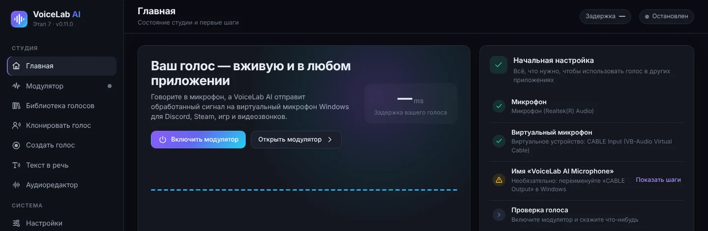

- **Включить модулятор** включает модулятор, не покидая этот экран. В любой момент можно также нажать **Ctrl + M**.
- **Открыть модулятор** открывает полную панель.
- **Начальная настройка** — список необходимого: микрофон, виртуальный микрофон, имя устройства и проверка голоса. Зелёный кружок означает, что шаг выполнен.

Внизу боковой панели всегда видны состояние модулятора и индикаторы входа (**ВХ**) и выхода (**ВЫХ**).

## 5. Модулятор в реальном времени

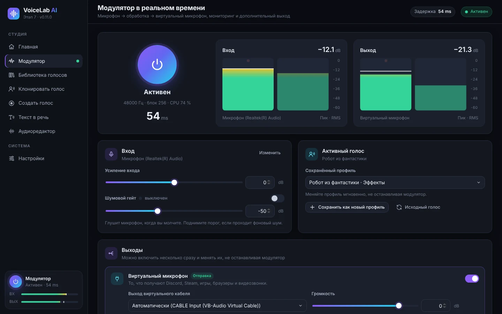

1. Нажмите большую **кнопку питания**. Она переходит в состояние **Активен** и показывает частоту дискретизации, размер блока, загрузку процессора и **задержку** (насколько запаздывает ваш голос, в миллисекундах).
2. Индикаторы **Вход** и **Выход** показывают уровень микрофона и обработанного голоса (пик и RMS). В идеале говорите так, чтобы полоса была между −24 и −12 дБ.
3. В карточке **Вход**:
   - **Изменить** открывает список микрофонов.
   - **Усиление входа** повышает или понижает громкость микрофона до эффектов.
   - **Шумовой гейт** отключает микрофон, когда вы молчите. Включите его и поднимите порог, если слышны фоновые шумы (клавиатура, вентилятор).
4. В карточке **Активный голос** выбирается используемый голос:
   - **Сохранённый профиль** мгновенно переключает профиль, не останавливая модулятор.
   - **Сохранить как новый профиль** сохраняет текущие эффекты в профиль.
   - **Сохранить изменения в профиле** обновляет используемый профиль.
   - **Исходный голос** убирает все эффекты.

### 5.1 Выходы

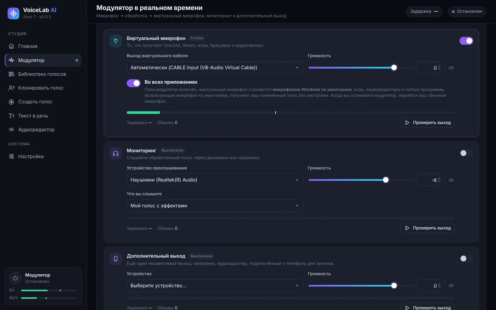

Можно включить несколько выходов одновременно и менять их, не останавливая модулятор.

- **Виртуальный микрофон** передаёт обработанный голос в VB-CABLE. Именно его получают Discord, Steam, игры, браузеры и видеозвонки. В режиме **Автоматически** VoiceLab сам выбирает «CABLE Input».
- **Во всех приложениях**, включено по умолчанию: пока модулятор работает, виртуальный микрофон становится **микрофоном Windows по умолчанию**. Любая программа, использующая микрофон по умолчанию (игры, видеоредакторы, браузер…), получает изменённый голос без настройки. VoiceLab продолжает слушать ваш настоящий микрофон. Когда вы останавливаете модулятор или закрываете программу, Windows возвращает ваш обычный микрофон.
- **Мониторинг** позволяет слушать себя в наушниках. В списке **Что вы слышите** выберите «Мой голос с эффектами» или «Мой исходный микрофон (без эффектов)». Используйте наушники: с колонками возможна обратная связь (свист), и программа предупредит об этом перед включением.
- **Дополнительный выход** — ещё один независимый выход, например аудиоадаптер, подключённый к телефону для звонков.
- У каждого выхода есть **Громкость**, индикатор, своя задержка, счётчик **Обрывы** и кнопка **Проверить выход**, которая воспроизводит тестовый звук.

### 5.2 Эффекты и пресеты

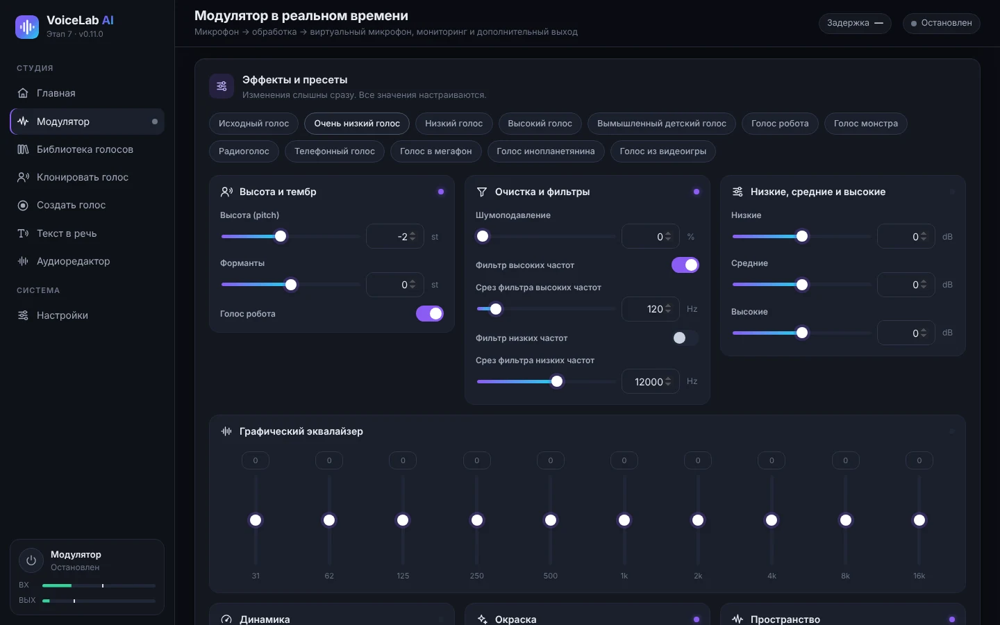

Вверху находятся **пресеты**: исходный голос, очень низкий, низкий, высокий, вымышленный детский, робот, монстр, радио, телефон, мегафон, инопланетянин и видеоигра. Изменения слышны сразу, и все значения можно настроить:

| Группа | Параметры |
|---|---|
| Высота и тембр | **Высота (pitch)** — высота в полутонах, **Форманты** (насколько «большим» или «маленьким» звучит голос) и **Голос робота** |
| Очистка и фильтры | Шумоподавление, фильтр высоких частот и фильтр низких частот |
| Низкие, средние и высокие | Простой трёхполосный эквалайзер |
| Графический эквалайзер | 10 полос, от 31 Гц до 16 кГц |
| Динамика | Компрессор (порог, степень сжатия, компенсация), лимитер и выходное усиление |
| Окраска | Насыщение, дисторшн, 8-битный lo-fi и кольцевая модуляция |
| Пространство | Хорус, эхо и реверберация |

Совет: чтобы голос стал ниже, но звучал естественно, понизьте **Тон** и немного понизьте **Форманты**. Если понизить только тон, голос будет звучать как в мультфильме.

## 6. Голоса на основе ИИ

Есть три вида голосов ИИ:

| Вид | Что нужно | Для чего | Сходство |
|---|---|---|---|
| **Мгновенный ИИ** | 10–30 с голоса | Синтез речи и разговор в реальном времени (задержка 0,25–0,45 с) | Хорошее |
| **Точный голос (обученный)** | Не меньше 1 мин голоса (лучше 10 мин и больше) и от 30 мин до 4 ч обучения | Разговор в реальном времени с небольшой задержкой | Очень высокое |
| **Импортированная модель RVC** | Готовый файл `.onnx` | Разговор в реальном времени | Зависит от модели |

Сначала установите движок ИИ и модели в **Настройки → ИИ-движок и модели**. См. [10.3](#103-движок-ии-и-модели).

### 6.1 Клонирование голоса

1. Откройте **Клонировать голос** и перетащите аудио- или видеофайл либо нажмите **выберите его на компьютере**. Поддерживаются MP3, WAV, FLAC, M4A, AAC, OGG, MP4, MKV, MOV и WEBM. Звук из видео извлекается автоматически. Можно также выбрать аудио, уже добавленное в VoiceLab.

   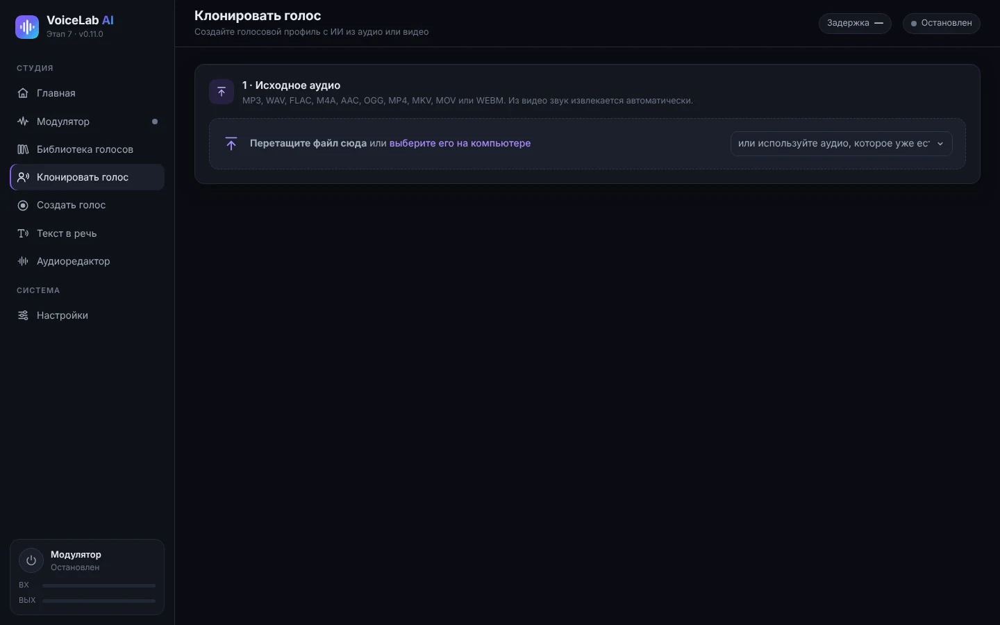

2. **Выберите фрагмент с голосом**: выделите нужный участок на волновой форме. Кнопкой **Прослушать выделение** убедитесь, что говорит только один человек. Для мгновенного голоса идеально 10–30 секунд чистой речи. Если потом вы захотите **обучить точный голос**, выделите всю пригодную речь (не меньше 1 минуты, лучше 10 минут и больше).

   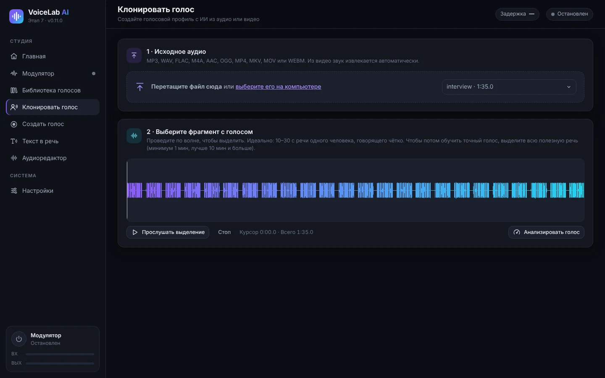

3. Нажмите **Анализировать голос**. Вы увидите количество секунд пригодной речи, отношение сигнал/шум, среднюю высоту тона и уровень. Полоса показывает, для чего этого достаточно: 10 с — для мгновенного голоса, 5 мин — для точного голоса, 10 мин — для идеального точного голоса.
4. **Crear el perfil** (Создать профиль): введите название и язык голоса, при желании — папку и описание. Оставьте отмеченным **Убрать фоновый шум и длинные паузы**.
5. Укажите, что **Это мой собственный голос** или **У меня есть разрешение этого человека**. Это обязательно.
6. Нажмите **Создать голосовой профиль**.

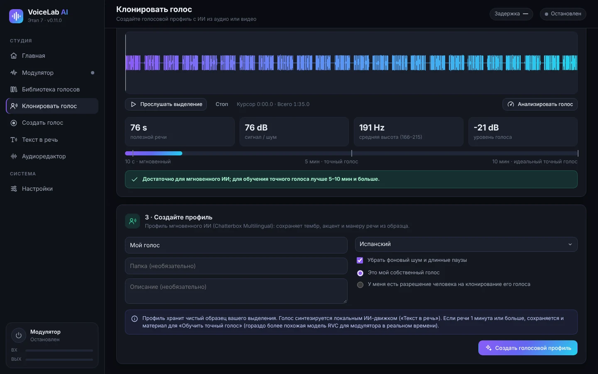

Профиль сохраняет чистый образец. Если в выделении 1 минута речи или больше, сохраняется и материал для обучения точного голоса.

### 6.2 Запись своего голоса (Создать голос)

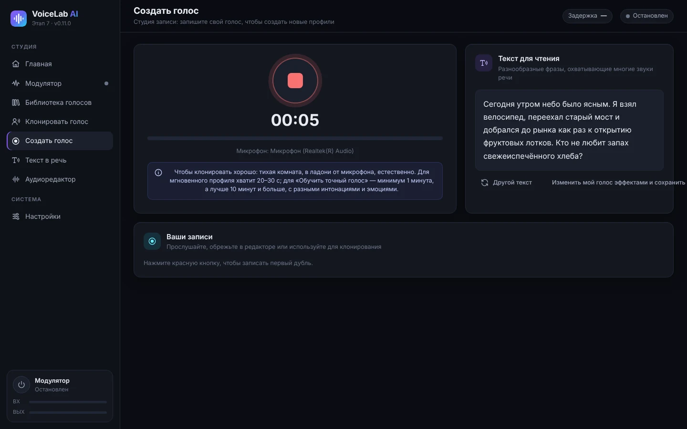

1. Откройте **Создать голос** и нажмите **красную кнопку**, чтобы начать запись. Нажмите ещё раз, чтобы остановить.
2. Читайте фразы из **Текст для чтения**: они охватывают все звуки испанского языка. **Другой текст** показывает другие фразы.
3. Записи появляются в **Ваши записи**. Оттуда их можно прослушать, открыть в редакторе или использовать для клонирования.
4. **Изменить мой голос эффектами и сохранить как профиль** открывает модулятор с вашей записью.

Для хорошей записи: тихая комната, микрофон примерно на расстоянии ладони, естественная речь с разными интонациями и эмоциями.

### 6.3 Разговор в реальном времени мгновенным голосом

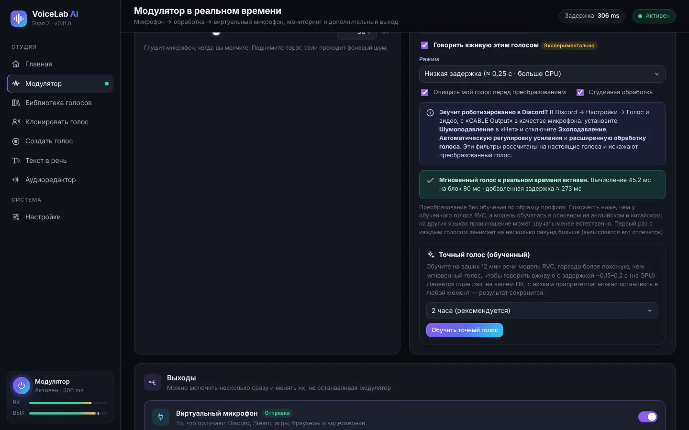

1. В модуляторе выберите в **Сохранённый профиль** профиль типа «Мгновенный ИИ».
2. В первый раз нажмите **Установить голос в реальном времени**. Загрузка — около 1,9 ГБ, на диске — около 2,7 ГБ. После установки программа измерит скорость компьютера и выберет лучший режим.
3. Отметьте **Говорить вживую этим голосом** и включите модулятор. В первый раз с каждым голосом запуск занимает на несколько секунд дольше (вычисляется голосовой отпечаток).
4. **Режим**:
   - **Низкая задержка** (≈ 0,25 с): меньше задержка, но примерно в три раза больше нагрузка на процессор.
   - **Качество** (≈ 0,45 с): голос больше похож на оригинал, нагрузка ниже.
5. Параметры:
   - **Очищать мой голос перед преобразованием** убирает шум микрофона до обработки ИИ.
   - **Студийная обработка** добавляет де-эссер, компрессию и автоматический уровень.
   - **Высокое качество 48 кГц** работает только в режиме «Качество» и если процессор справляется. Это необязательная загрузка 119 МБ.
6. Зелёная строка состояния показывает время обработки на блок и фактическую **добавленную задержку**. Если появилось **Процессор не успевает**, переключитесь на «Качество», отключите высокое качество или закройте тяжёлые программы.

Мгновенный голос не требует обучения, но похож на оригинал меньше, чем точный голос. Модель обучалась в основном на английском и китайском, поэтому на других языках произношение может звучать менее естественно.

### 6.4 Обучение точного голоса (RVC)

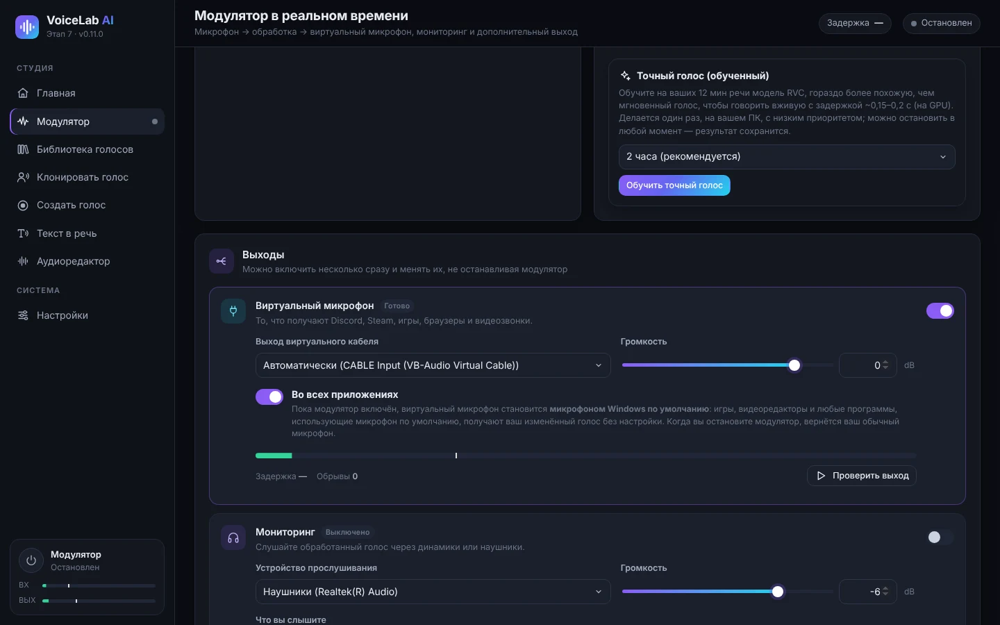

Точный голос — это модель RVC, обученная на вашем аудио прямо на вашем компьютере. Она гораздо больше похожа на исходный голос и в реальном времени даёт небольшую задержку (около 0,15–0,2 с с видеокартой).

1. Включите профиль мгновенного ИИ, созданный из **1 минуты речи или больше** (лучше 10 минут и больше). Если профиль создан из более короткой записи, создайте его заново в **Клонировать голос** из более длинного аудио.
2. В карточке **Точный голос (обученный)** выберите длительность: 30 мин (быстрая проверка), 1 час, **2 часа** (рекомендуется) или 4 часа (максимум). Чем дольше, тем больше сходство.
3. Нажмите **Обучить точный голос**. В первый раз загружаются PyTorch (около 250 МБ) и базовые модели (около 0,2 ГБ).
4. Вы увидите прогресс, текущий этап и оставшееся время. Обучение использует процессор с низким приоритетом, поэтому компьютером можно пользоваться.
5. **Остановить и использовать результат** завершает обучение и создаёт голос из того, что модель успела выучить. Если закрыть программу, прогресс сохранится, и позже появится **Возобновить обучение**.
6. По окончании создаётся новый профиль «*название* (fiel)». Нажмите **Использовать точный голос**, чтобы включить его. Позже его можно улучшить кнопкой **Продолжить обучение**.

**Настройка тона**: точный голос повторяет интонацию вашего голоса. Если исходный голос выше или ниже вашего, используйте **Подстройка высоты для этого голоса**, от −24 до +24 полутонов, в карточке профиля. Ориентир: из мужского голоса в женский обычно подходит от +8 до +12, из женского в мужской — от −8 до −12.

### 6.5 Импорт модели RVC

Если у вас уже есть модель RVC в формате `.onnx`:

1. Установите движок ИИ и **Базу для преобразования RVC** в *Настройки*.
2. Откройте **Библиотека голосов → Импорт модели RVC**, введите название и выберите файл.
3. Включите модель в модуляторе. В карточке профиля есть **Настройка тона**.

Поддерживаются только модели `.onnx`. Файлы `.pth` нужно сначала преобразовать инструментом экспорта RVC.

## 7. Синтез речи

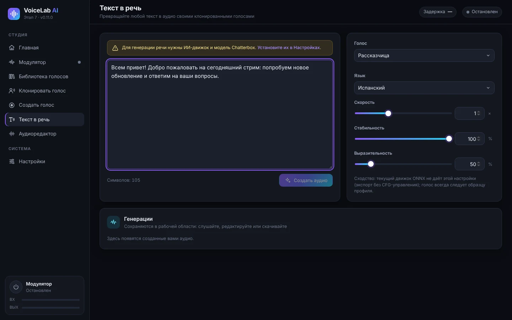

1. Установите движок ИИ и модель **около 3** (2 ГБ) в *Настройки → ИИ-движок и модели*.
2. Откройте **Текст в речь** и введите или вставьте текст.
3. Выберите **Голос** — любой клонированный профиль — и **Язык**. Доступно 23 языка, среди них испанский, английский, французский, итальянский, португальский, русский, китайский и японский.
4. Настройте:
   - **Скорость**.
   - **Стабильность**: выше — ровнее, ниже — разнообразнее.
   - **Выразительность**: больше эмоций и акцентов.
5. Нажмите **Создать аудио**. Первое создание занимает больше времени (модель загружается 1–4 минуты). **Отмена** прерывает процесс.
6. Результат появляется в **Генерации**: его можно прослушать, открыть в редакторе или скачать в WAV, MP3, FLAC или OGG.

По умолчанию синтез речи работает на процессоре. В *Настройки* можно попробовать видеокарту; если она не справится, программа сама вернётся к процессору.

## 8. Аудиоредактор

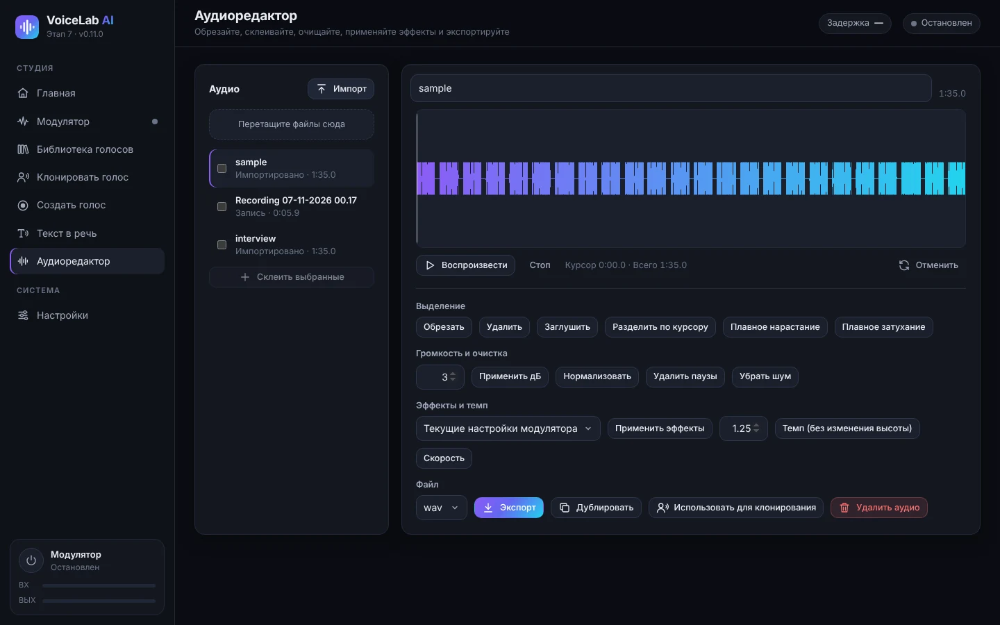

- **Аудио**: импортируйте файлы (или перетащите их); здесь же ваши записи и созданные фрагменты. Отметьте несколько и нажмите **Склеить выбранные**, чтобы склеить их.
- **Волновая форма**: выделяйте перетаскиванием. Есть кнопки **Воспроизвести**, **Стоп** и **Отменить**.
- **Выделение**: обрезать, удалить, заглушить, разделить по курсору, плавное нарастание и плавное затухание.
- **Громкость и очистка**: изменить на N дБ, нормализовать, удалить паузы и убрать шум.
- **Эффекты и темп**:
  - **Применить эффекты** использует текущие настройки модулятора или сохранённый профиль.
  - **Темп** меняет скорость, не меняя высоту тона.
  - **Скорость** меняет скорость и высоту вместе.
- **Файл**: выберите формат (WAV, MP3, FLAC или OGG) и нажмите **Экспорт**. Также можно **Дублировать**, **Использовать для клонирования** или **Удалить аудио**.

## 9. Библиотека голосов

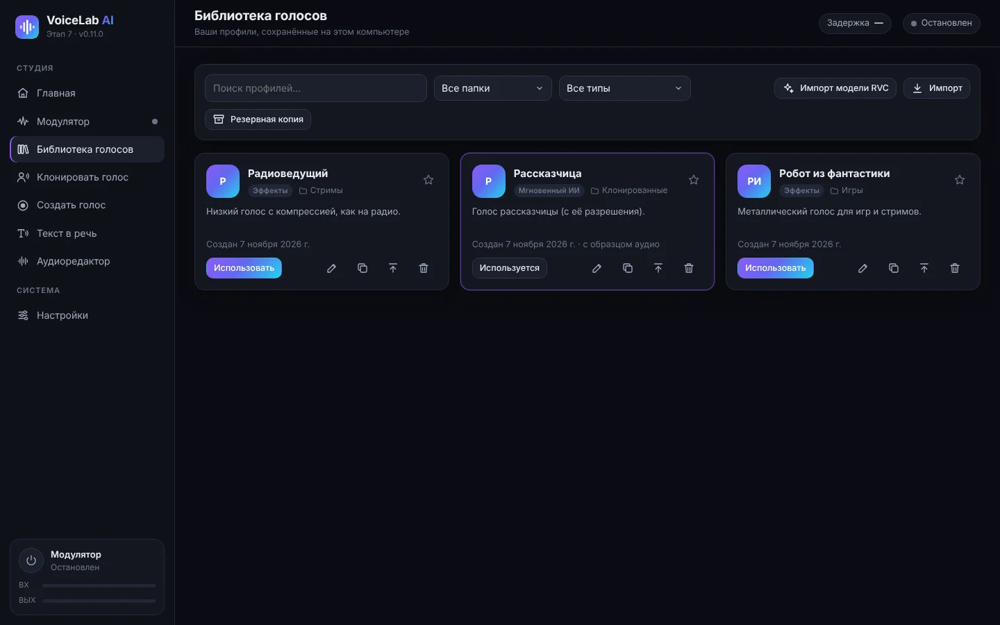

- **Ищите** по названию и **фильтруйте** по папке или типу: эффекты, мгновенный ИИ или обученный ИИ (RVC).
- На каждой карточке указаны тип, папка и описание профиля. Звёздочка добавляет его в избранное.
- Кнопки карточки:
  - **Использовать** включает профиль в модуляторе.
  - **Изменить** — название, папку или описание.
  - **Дублировать**.
  - **Экспортировать** создаёт файл `.vlprofile` для переноса на другой компьютер.
  - **Удалить**.
- **Импорт** добавляет экспортированные профили (`.vlprofile`). **Импорт модели RVC** добавляет модели `.onnx`.
- **Резервная копия** сохраняет все профили в один файл.

## 10. Настройки

### 10.1 Аудиоустройства

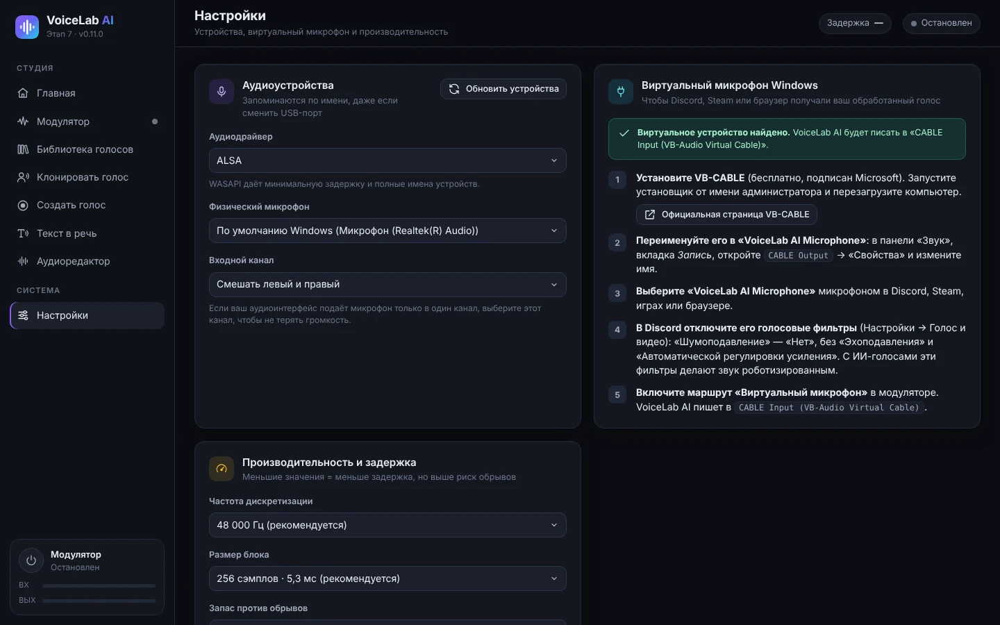

- **Аудиодрайвер**: в Windows наименьшую задержку даёт **WASAPI**.
- **Физический микрофон** — настоящий микрофон, который слушает VoiceLab. Он запоминается по названию, даже если сменить USB-порт.
- **Входной канал**: если аудиоинтерфейс подаёт микрофон только в один канал, выберите этот канал.
- **Обновить устройства** заново ищет устройства, если вы подключили что-то новое.
- Карточка **Виртуальный микрофон Windows** повторяет шаги установки VB-CABLE и показывает, найден ли он.

### 10.2 Производительность и задержка

- **Частота дискретизации**: 48 000 Гц (рекомендуется) или 44 100 Гц.
- **Размер блока**: меньше — меньше задержка, но выше риск пропусков. 256 отсчётов (5,3 мс) подходят почти для любого компьютера.
- **Запас против обрывов**: увеличьте, если слышны щелчки.

### 10.3 Движок ИИ и модели

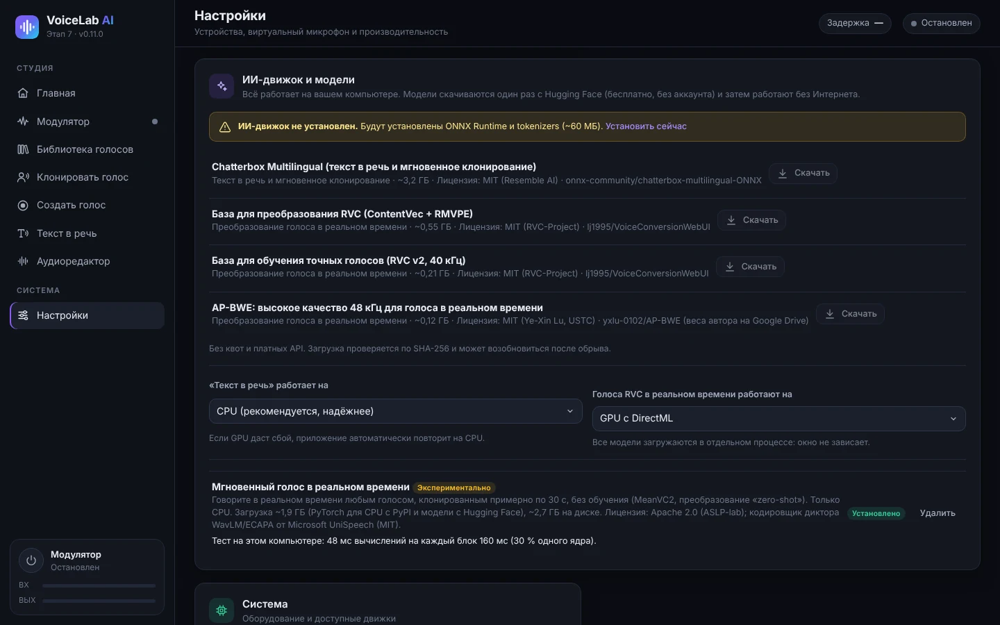

Модели загружаются один раз с Hugging Face (бесплатно, без учётной записи) и затем работают без интернета. Каждая загрузка проверяется и может продолжиться после обрыва.

| Компонент | Размер | Для чего |
|---|---|---|
| Движок ИИ (ONNX Runtime и tokenizers) | ~60 МБ | Нужен для всех функций ИИ |
| Chatterbox Multilingual | ~3,2 ГБ | Синтез речи и мгновенное клонирование |
| База для преобразования RVC (ContentVec + RMVPE) | ~0,55 ГБ | Голоса RVC в реальном времени (импортированные или обученные) |
| База для обучения точных голосов (RVC v2, 40 кГц) | ~0,21 ГБ | Обучение точного голоса |
| AP-BWE (высокое качество) | ~0,12 ГБ | Необязательно, для мгновенного голоса в режиме «Качество» |
| Мгновенный голос в реальном времени (MeanVC2 + PyTorch для процессора) | ~1,9 ГБ загрузки | Разговор мгновенными голосами |

Также можно выбрать, где работает каждая часть:

- **«Текст в речь» работает на**: процессоре (рекомендуется) или видеокарте.
- **Голоса RVC в реальном времени работают на**: видеокарте с DirectML (рекомендуется, если она есть) или процессоре.

### 10.4 Язык интерфейса

Приложение доступно на испанском, английском, французском, итальянском, португальском, русском, китайском и японском. В разделе **Система → Язык интерфейса** вариант **Автоматически** берёт язык Windows (если его нет среди восьми — английский). После смены окно сразу перезагружается; модулятор и ваши профили не затрагиваются. Установщик тоже показывается на языке Windows.

## 11. Голос в Discord, играх, OBS и видеоредакторах

Когда включено **Во всех приложениях** (Во всех приложениях, см. [5.1](#51-выходы)), любая программа, использующая микрофон Windows по умолчанию, уже получает изменённый голос. Некоторым программам нужен ещё один шаг:

- **Discord**:
  1. В *Настройках пользователя → Голос и видео* выберите **устройство ввода** «CABLE Output» (или «VoiceLab AI Microphone») либо «По умолчанию».
  2. Установите **шумоподавление** в значение **Нет**.
  3. Отключите **эхоподавление**, **автоматическую регулировку усиления** и **расширенную активацию по голосу**. Из-за этих фильтров голоса ИИ звучат роботизированно.
- **Игры**: почти все используют микрофон по умолчанию. Если игра проверяет микрофон только при запуске, запускайте её при уже включённом модуляторе.
- **OBS Studio**: добавьте источник **Захват входного аудиопотока** с «CABLE Output» или используйте «По умолчанию».
- **Видеоредакторы** (DaVinci Resolve, Premiere, CapCut…): чтобы записать закадровый голос с эффектами, выберите «CABLE Output» или микрофон по умолчанию как вход записи.
- **Браузер и видеозвонки** (Meet, Teams, Zoom): выберите «CABLE Output» или «По умолчанию» в настройках звука каждого сервиса.

## 12. Решение проблем

| Проблема | Что делать |
|---|---|
| Меня не слышат | Проверьте, что модулятор в состоянии **Активен**, а выход **Виртуальный микрофон** включён. В другой программе выберите «CABLE Output» или «По умолчанию». |
| «Виртуальный микрофон не найден» | Установите VB-CABLE от имени администратора и перезагрузите компьютер. Затем нажмите **Обновить устройства** в *Настройки*. |
| Голос ИИ звучит роботизированно в Discord | Отключите голосовые фильтры Discord (см. [11](#11-голос-в-discord-играх-obs-и-видеоредакторах)). |
| Пропуски, щелчки или «Процессор не успевает» | Используйте режим **Качество** без высокого качества и закройте тяжёлые программы. Увеличьте **Запас против обрывов** или **Размер блока**. |
| Слишком большая задержка | Используйте **Низкая задержка**, если процессор справляется, или **точный голос** на видеокарте. Фактическая задержка показана в модуляторе. |
| Свист или обратная связь | Для мониторинга используйте наушники, а не колонки. |
| Слышен фоновый шум | Включите **Шумовой гейт** и **Шумоподавление** или **Очищать мой голос перед преобразованием** для голосов ИИ. |
| Синтез речи в первый раз долгий | Это нормально: модель загружается 1–4 минуты. Следующие запуски быстрее. |
| Программа всё ещё использует старый микрофон | Некоторые программы считывают микрофон только при открытии: закройте её и откройте снова при включённом модуляторе. |
| Нужны журналы, чтобы попросить помощи | Они находятся в `%APPDATA%\VoiceLabAI\logs` (`voicelab.log`, `voz-instantanea.log` и `entrenamiento.log`). |

## 13. Конфиденциальность и ответственное использование

- **Вся обработка выполняется на вашем компьютере.** Ваш голос, профили и записи никуда не отправляются. Интернет нужен только для загрузки программы и моделей.
- **Клонируйте только свой голос или голоса людей, которые дали на это согласие.** Программа просит подтвердить это для каждого профиля.
- Не используйте клонированные голоса для обмана, выдачи себя за другого человека или мошенничества. Во многих странах это незаконно.
- У моделей ИИ свои лицензии (MIT и Apache 2.0). Они указаны в *Настройки → ИИ-движок и модели* и в [README](../../README.md).

---

Горячая клавиша: **Ctrl + M** включает и выключает модулятор. Данные программы: `%APPDATA%\VoiceLabAI`.
