# VoiceLab AI 使用手册

[Español](es.md) · [English](en.md) · [Français](fr.md) · [Italiano](it.md) · [Português](pt.md) · [Русский](ru.md) · **中文** · [日本語](ja.md)

VoiceLab AI 是一款 Windows 语音工作室：实时变声、用人工智能克隆声音、把文字转成语音。所有功能都在你的电脑上运行，无需订阅，也不依赖云服务。

> 本手册对应 0.11 版。截图中使用的是示例配置和示例设备。
>
> **界面提供 8 种语言**（Español, English, Français, Italiano, Português, Русский, 中文, 日本語）。默认跟随 Windows 的语言，也可以在 **设置 → 界面语言** 中更改。本手册使用中文界面中的按钮和选项名称。

## 目录

1. [功能简介](#1-功能简介)
2. [系统要求](#2-系统要求)
3. [安装](#3-安装)
4. [主页](#4-主页)
5. [实时变声器](#5-实时变声器)
6. [AI 声音](#6-ai-声音)
7. [文字转语音](#7-文字转语音)
8. [音频编辑器](#8-音频编辑器)
9. [声音库](#9-声音库)
10. [设置](#10-设置)
11. [在 Discord、游戏、OBS 和视频剪辑软件中使用](#11-在-discord游戏obs-和视频剪辑软件中使用)
12. [常见问题](#12-常见问题)
13. [隐私与负责任使用](#13-隐私与负责任使用)

---

## 1. 功能简介

- **实时变声**：使用各种效果（音高、共振峰、机器人、收音机、回声、混响……），并通过虚拟麦克风把声音送到任何程序。
- **克隆声音**：从音频或视频中克隆声音，用来朗读文字（文字转语音）或实时说话。
- **训练「逼真声音」**：训练一个更像原声的 RVC 模型，实时说话时延迟很低。
- **录音和编辑**：剪切、拼接、降噪、加效果，并导出为 WAV、MP3、FLAC 或 OGG。
- **管理声音**：在声音库中按文件夹整理，可收藏、导出和备份。

## 2. 系统要求

| | 最低配置 | 推荐配置 |
|---|---|---|
| 系统 | Windows 10 64 位 | Windows 11 |
| 处理器 | 4 核 | 8 核（用于即时声音和训练） |
| 内存 | 8 GB | 16 GB 或以上 |
| 硬盘 | 软件本身 1 GB | 安装全部 AI 模型需再加 8 GB |
| 显卡 | 非必需 | 支持 DirectX 12（AMD、NVIDIA 或 Intel），用于实时 RVC 声音 |
| 虚拟麦克风 | [VB-CABLE](https://vb-audio.com/Cable/)（免费） | — |

只有下载软件和首次下载所选 AI 模型时需要联网。

## 3. 安装

### 3.1 安装软件

1. 在[发布页面（Releases）](https://github.com/demfisalvarez/VoiceLab-AI/releases/latest)下载 `VoiceLabAI-Setup-x.y.z.exe`。
2. 运行安装程序。如果 Windows 提示「Windows 已保护你的电脑」，点击**更多信息 → 仍要运行**（安装程序没有使用商业证书签名）。
3. 按向导完成安装。软件只为当前用户安装，不需要管理员权限。
4. 从开始菜单或桌面打开 **VoiceLab AI**。

卸载方法：*Windows 设置 → 应用 → VoiceLab AI → 卸载*。你的配置和设置保存在 `%APPDATA%\VoiceLabAI`。

### 3.2 安装虚拟麦克风（VB-CABLE）

有了虚拟麦克风，Discord、游戏和浏览器才能「听到」你变声后的声音。

1. 从 [VB-CABLE 官网](https://vb-audio.com/Cable/)下载（免费，已获微软签名）。
2. 解压后右键点击 `VBCABLE_Setup_x64.exe` → **以管理员身份运行** → **Install Driver**。
3. 重启电脑。
4. 可选：重命名设备，方便识别。在 **设置 → 打开“声音”面板**的**录制**选项卡中，打开 **CABLE Output → 属性**，改名为「VoiceLab AI Microphone」。

### 3.3 首次启动

打开软件后会看到 **首页**。**初始设置**卡片会检查你的麦克风和虚拟麦克风，并告诉你还缺什么。

## 4. 主页

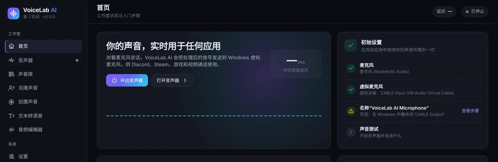

- **开启变声器**：不离开本页即可开启变声器。任何时候也可以按 **Ctrl + M**。
- **打开变声器**：进入完整面板。
- **初始设置**：列出所需的步骤：麦克风、虚拟麦克风、设备名称和声音测试。绿色圆圈表示该步骤已完成。

侧边栏底部始终显示变声器状态，以及输入（**入**）和输出（**出**）电平表。

## 5. 实时变声器

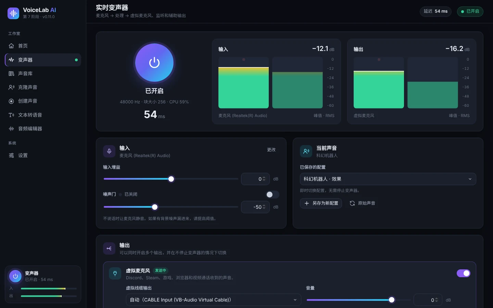

1. 按下大的**电源按钮**。状态变为 **已开启**，并显示采样率、块大小、CPU 占用和**延迟**（声音被延后的时间，单位毫秒）。
2. **输入**和 **输出**电平表显示麦克风和处理后声音的电平（峰值和 RMS）。说话时电平最好在 −24 到 −12 dB 之间。
3. **输入**卡片：
   - **更改**：打开麦克风列表。
   - **输入增益**：在加效果之前调大或调小麦克风音量。
   - **噪声门**：不说话时让麦克风静音。如果有背景噪音（键盘、风扇），请开启并调高阈值。
4. **当前声音**卡片用于选择正在使用的声音：
   - **已保存的配置**：立即切换配置，无需停止变声器。
   - **另存为新配置**：把当前效果保存为配置。
   - **保存对配置的更改**：更新正在使用的配置。
   - **原始声音**：去掉所有效果。

### 5.1 输出

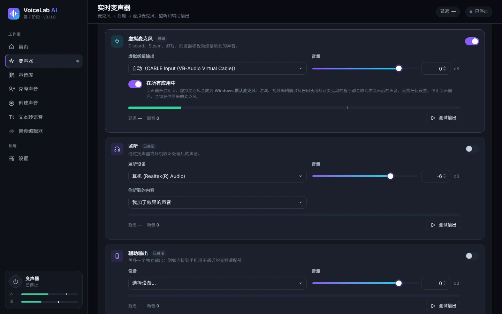

可以同时开启多个输出，并且在不停止变声器的情况下随时更改。

- **虚拟麦克风**：把处理后的声音送到 VB-CABLE。Discord、Steam、游戏、浏览器和视频通话都从这里接收你的声音。选择 **自动**时，VoiceLab 会自动选用「CABLE Input」。
- **在所有应用中**，默认开启：变声器运行时，虚拟麦克风会成为 **Windows 默认麦克风**。这样，任何使用默认麦克风的程序（游戏、视频剪辑软件、浏览器……）无需设置就能收到变声后的声音。VoiceLab 仍然从你的真实麦克风收音。停止变声器或关闭软件后，Windows 会恢复你原来的麦克风。
- **监听**：用耳机听自己的声音。在 **你听到的内容**中选择「我加了效果的声音」或「我的原始麦克风（无效果）」。请使用耳机：用音箱可能产生啸叫，软件在开启前会提醒你。
- **辅助输出**：另一个独立的输出，例如连接手机打电话用的音频转接器。
- 每个输出都有自己的 **音量**、电平表、延迟、**断音**和 **测试输出**按钮，后者会播放一段测试音。

### 5.2 效果与预设

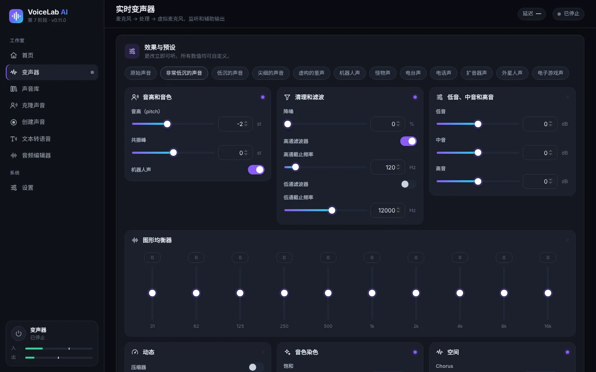

顶部是**预设**：原声、超低沉、低沉、尖细、童声、机器人、怪物、收音机、电话、扩音器、外星人和游戏音效。改动会立即生效，所有参数都可以调节：

| 分组 | 参数 |
|---|---|
| 音高和音色 | **音高（pitch）**、**共振峰**（声音听起来「大」还是「小」）和 **机器人声** |
| 清理和滤波 | 降噪、高通滤波和低通滤波 |
| 低音、中音和高音 | 简单的三段均衡器 |
| 图形均衡器 | 10 段，31 Hz 到 16 kHz |
| 动态 | 压缩器（阈值、压缩比、补偿）、限幅器和输出增益 |
| 音色染色 | 饱和、失真、8 位低保真和环形调制 |
| 空间 | 合唱、回声和混响 |

提示：想要更低沉但自然的声音，降低 **音高**，同时把 **共振峰**也稍微降低。只降低音高的话，声音会像卡通人物。

## 6. AI 声音

AI 声音有三种：

| 类型 | 需要什么 | 用途 | 相似度 |
|---|---|---|---|
| **即时 AI** | 10–30 秒人声 | 文字转语音和实时说话（延迟 0.25–0.45 秒） | 好 |
| **逼真声音（已训练）** | 至少 1 分钟人声（最好 10 分钟以上），训练 30 分钟到 4 小时 | 低延迟实时说话 | 非常高 |
| **导入的 RVC 模型** | 已有的 `.onnx` 文件 | 实时说话 | 取决于模型 |

使用前，请在 **设置 → AI 引擎和模型**中安装 AI 引擎和模型，见 [10.3](#103-ai-引擎和模型)。

### 6.1 克隆声音

1. 进入 **克隆声音**，把音频或视频文件拖进来，或点击 **从电脑中选择**。支持 MP3、WAV、FLAC、M4A、AAC、OGG、MP4、MKV、MOV 和 WEBM，视频中的音频会自动提取。也可以选择 VoiceLab 中已有的音频。

   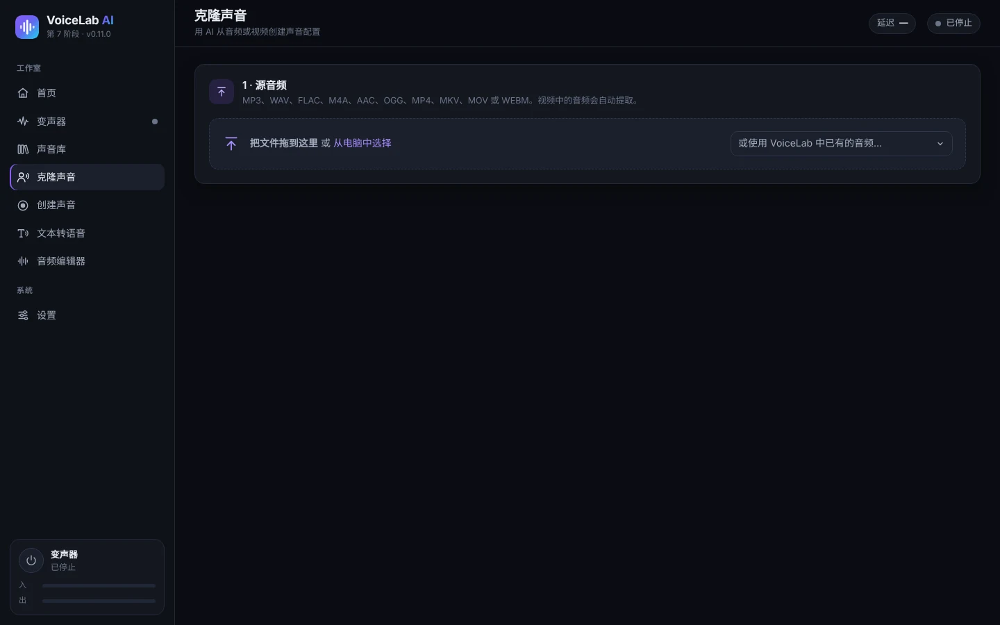

2. **选择有人声的片段**：在波形上拖动来选择。用 **试听选区**确认只有一个人在说话。即时声音最好用 10–30 秒清晰的人声。如果之后想**训练逼真声音**，请选中所有可用的人声（至少 1 分钟，最好 10 分钟以上）。

   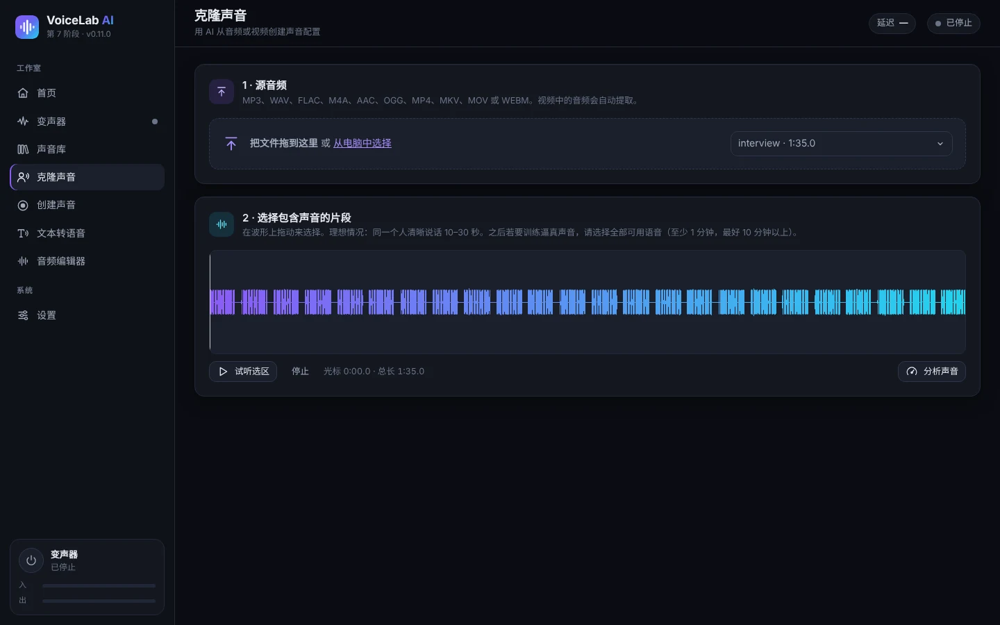

3. 点击 **分析声音**。会显示有效人声秒数、信噪比、平均音高和电平。进度条说明这些素材够做什么：10 秒可做即时声音，5 分钟可做逼真声音，10 分钟可做理想的逼真声音。
4. **Crear el perfil**（创建配置）：填写名称和语言，可选填文件夹和说明。保持勾选 **去除背景噪声和长时间静音**。
5. 确认 **这是我自己的声音**或 **我已获得本人授权**。此项必选。
6. 点击 **创建声音配置**。

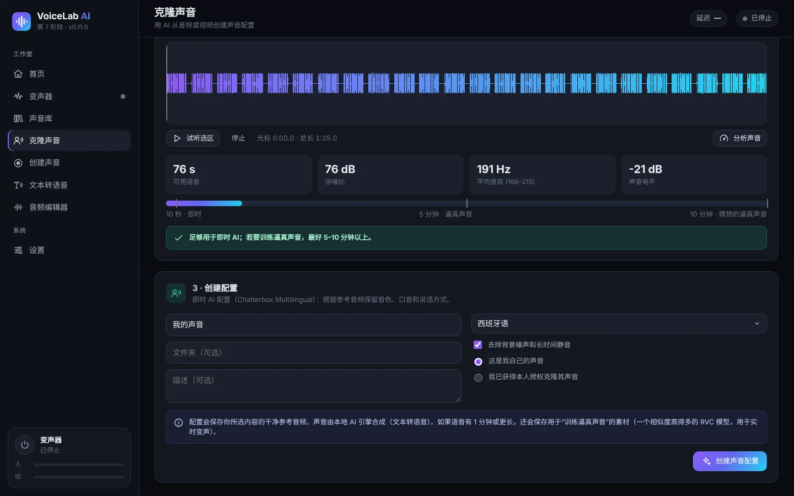

配置会保存一段干净的参考音频。如果选区中有 1 分钟或更多人声，还会保存用于训练逼真声音的素材。

### 6.2 录制自己的声音（创建声音）

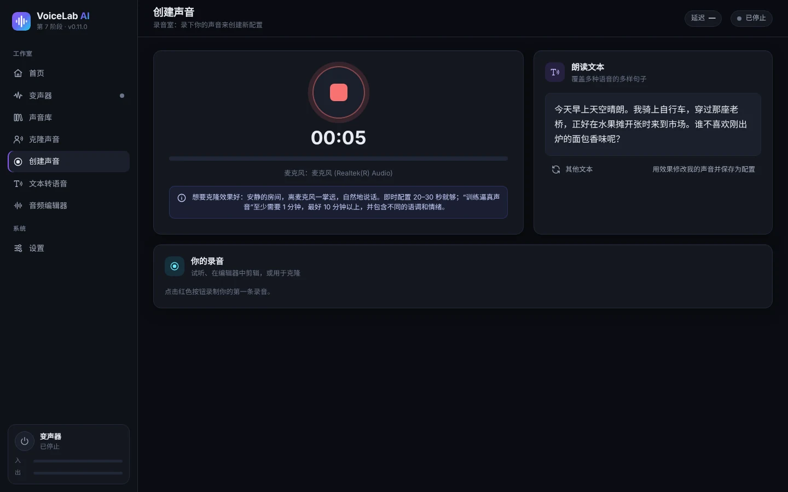

1. 进入 **创建声音**，按**红色按钮**开始录音，再按一次停止。
2. 朗读 **朗读文本**中的句子，这些句子覆盖了西班牙语的所有发音。**其他文本**会显示其他句子。
3. 录音会出现在 **你的录音**中，可以试听、在编辑器中打开或用于克隆。
4. **用效果修改我的声音并保存为配置**会带着录音进入变声器。

录音建议：在安静的房间里，嘴距麦克风约一掌，自然地说话，并带有不同的语调和情绪。

### 6.3 用即时声音实时说话

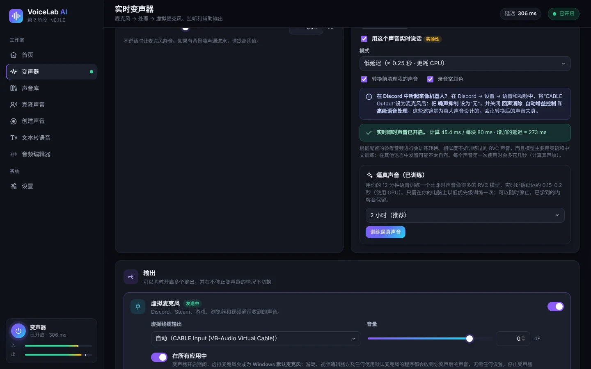

1. 在变声器的 **已保存的配置**中选择「即时 AI」类型的配置。
2. 第一次使用时点击 **安装实时声音**，需下载约 1.9 GB，占用约 2.7 GB。安装完成后，软件会测试电脑速度并选择最合适的模式。
3. 勾选 **用这个声音实时说话**并开启变声器。每个声音第一次使用时会多花几秒（计算声纹）。
4. **模式**：
   - **低延迟**（约 0.25 秒）：延迟更低，但 CPU 占用约为三倍。
   - **质量**（约 0.45 秒）：声音更像，CPU 占用更低。
5. 选项：
   - **转换前清理我的声音**：在 AI 处理前去除麦克风噪音。
   - **录音室润色**：加入去齿音、压缩和自动电平。
   - **48 kHz 高清**：只在「质量」模式下、且 CPU 跟得上时可用。需额外下载 119 MB（可选）。
6. 绿色状态栏显示每个块的计算时间和实际的 **增加的延迟**。如果出现 **「处理器跟不上」**，请切换到「质量」模式、关闭高清，或关闭占用大的程序。

即时声音无需训练，但相似度不如逼真声音。该模型主要用英语和中文训练，其他语言的发音可能不够自然。

### 6.4 训练逼真声音（RVC）

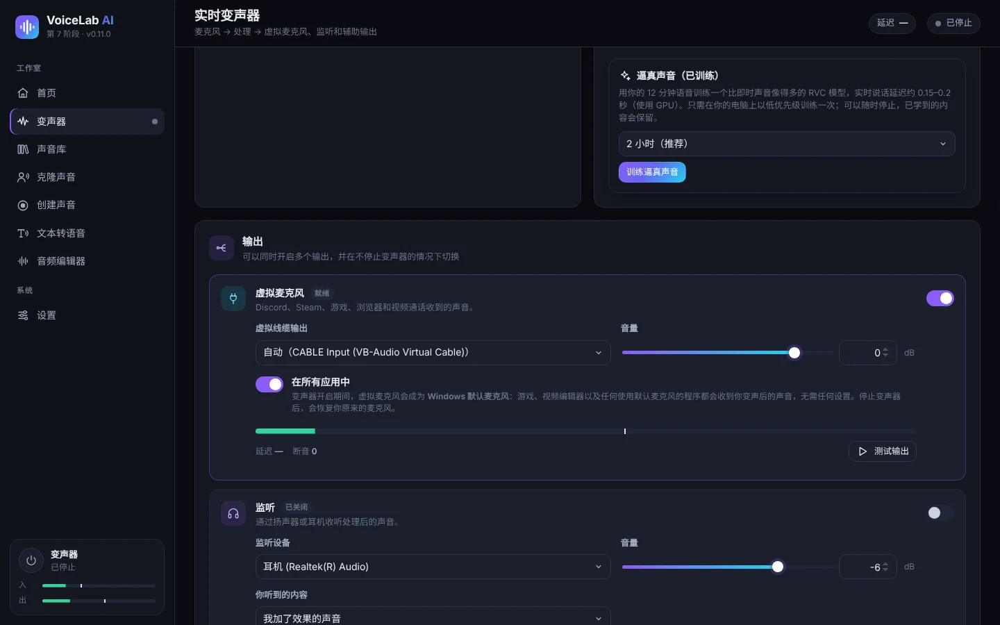

逼真声音是在你的电脑上用你的音频训练出来的 RVC 模型。它更像原声，实时延迟也低（使用显卡时约 0.15–0.2 秒）。

1. 启用一个用 **1 分钟以上人声**（最好 10 分钟以上）创建的即时 AI 配置。如果配置创建时人声不足，请在 **克隆声音**中用更长的音频重新创建。
2. 在 **逼真声音（已训练）**卡片中选择训练时长：30 分钟（快速测试）、1 小时、**2 小时**（推荐）或 4 小时（最佳）。时间越长越像。
3. 点击 **训练逼真声音**。第一次会下载 PyTorch（约 250 MB）和基础模型（约 0.2 GB）。
4. 你会看到进度、当前阶段和剩余时间。训练以低优先级使用 CPU，期间可以正常使用电脑。
5. **停止并使用已学到的内容**会结束训练，并用目前学到的内容生成声音。如果关闭软件，进度会被保存，之后会出现 **恢复训练**。
6. 完成后会新建一个名为「*名称* (fiel)」的配置。点击 **使用逼真声音**即可启用。之后还可以用 **继续训练**进一步提升。

**音高调整**：逼真声音会跟随你自己的语调。如果原声比你的声音高或低，请在配置卡片中使用 **此声音的音高调整**，范围 −24 到 +24 个半音。参考：男声变女声一般用 +8 到 +12，女声变男声一般用 −8 到 −12。

### 6.5 导入 RVC 模型

如果你已有 `.onnx` 格式的 RVC 模型：

1. 在 *设置*中安装 AI 引擎和 **RVC 转换基础模型**。
2. 进入 **声音库 → 导入 RVC 模型**，输入名称并选择文件。
3. 在变声器中启用。配置卡片中有 **音高调整**。

只支持 `.onnx` 模型。`.pth` 模型需要先用 RVC 的导出工具转换。

## 7. 文字转语音

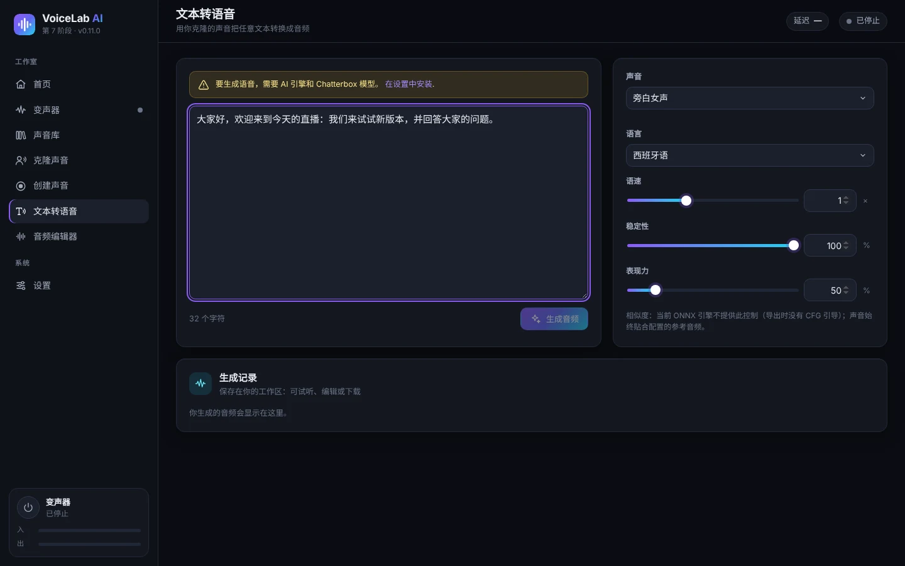

1. 在 *设置 → AI 引擎和模型*中安装 AI 引擎和 **Chatterbox Multilingual** 模型（约 3.2 GB）。
2. 进入 **文本转语音**，输入或粘贴文字。
3. 选择 **声音**和 **语言**。共支持 23 种语言，包括西班牙语、英语、法语、意大利语、葡萄牙语、俄语、中文和日语。
4. 调整：
   - **语速**。
   - **稳定性**：越高越平稳，越低越多变。
   - **表现力**：更多情感和重音。
5. 点击 **生成音频**。第一次生成较慢（模型加载需要 1–4 分钟）。**取消**可中止生成。
6. 结果出现在 **生成记录**中：可以试听、在编辑器中打开，或下载为 WAV、MP3、FLAC 或 OGG。

文字转语音默认在 CPU 上运行。可以在 *设置*中尝试 GPU；如果失败，软件会自动切回 CPU。

## 8. 音频编辑器

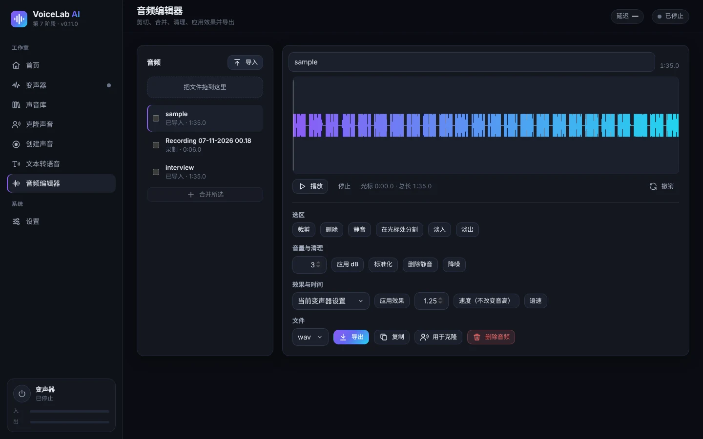

- **音频**：导入文件（或直接拖入），你的录音和生成的音频也会显示在这里。勾选多个后点击 **合并所选**即可拼接。
- **波形**：拖动来选择。有 **播放**、**停止**和 **撤销**。
- **选区**：剪切、删除、静音、在光标处分割、淡入和淡出。
- **音量与清理**：调整 dB、标准化、删除静音和降噪。
- **效果与时间**：
  - **应用效果**：使用变声器当前的设置或已保存的配置。
  - **速度**：改变速度但不改变音高。
  - **语速**：速度和音高一起改变。
- **文件**：选择格式（WAV、MP3、FLAC 或 OGG）后点击 **导出**。还可以 **复制**、**用于克隆**或 **删除音频**。

## 9. 声音库

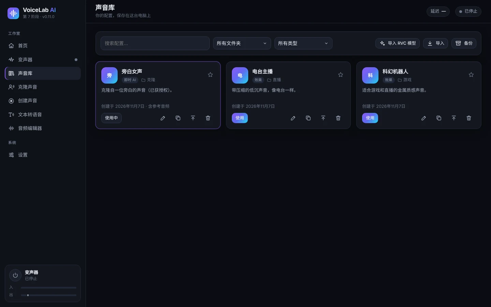

- 按名称**搜索**，按文件夹或类型**筛选**：效果、即时 AI、训练过的 AI（RVC）。
- 每张卡片显示配置的类型、文件夹和说明。星标表示收藏。
- 卡片上的按钮：
  - **使用**：在变声器中启用该配置。
  - **编辑**：修改名称、文件夹或说明。
  - **复制**。
  - **导出**：生成 `.vlprofile` 文件，以便转移到其他电脑。
  - **删除**。
- **导入**可添加导出的配置（`.vlprofile`）。**导入 RVC 模型**可添加 `.onnx` 模型。
- **备份**会把所有配置保存为一个文件。

## 10. 设置

### 10.1 音频设备

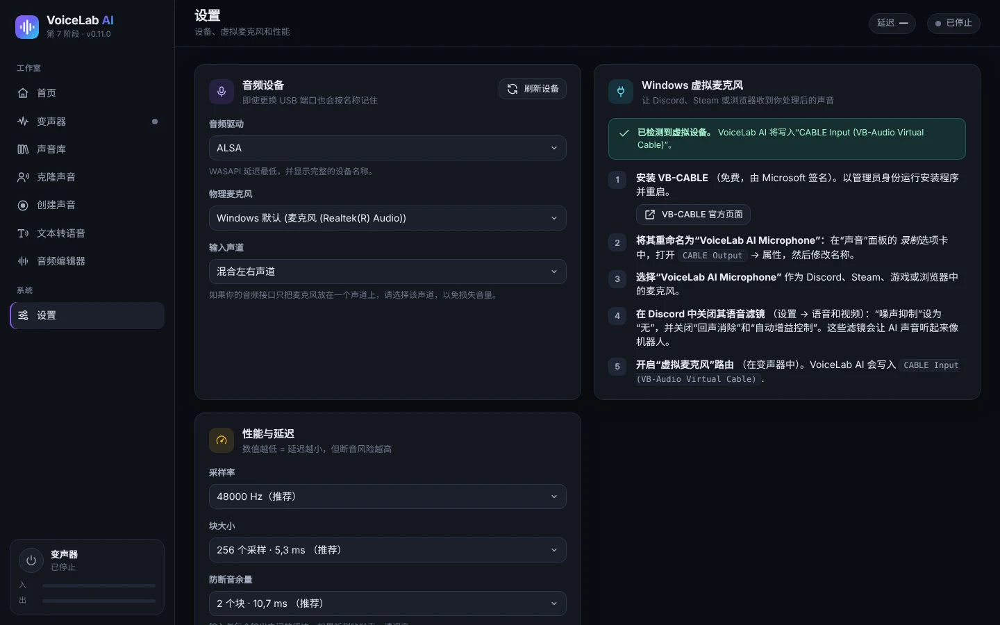

- **音频驱动**：在 Windows 上，**WASAPI** 延迟最低。
- **物理麦克风**：VoiceLab 收音用的真实麦克风。它按名称记忆，即使更换 USB 接口也能识别。
- **输入声道**：如果你的声卡只在一个声道上输入麦克风，请选择该声道。
- **刷新设备**：接入新设备后重新搜索。
- **Windows 虚拟麦克风**卡片会重复 VB-CABLE 的安装步骤，并显示是否检测到它。

### 10.2 性能与延迟

- **采样率**：48000 Hz（推荐）或 44100 Hz。
- **块大小**：越小延迟越低，但越容易断音。256 个采样点（5.3 毫秒）适合几乎所有电脑。
- **防断音余量**：听到咔嗒声时调高。

### 10.3 AI 引擎和模型

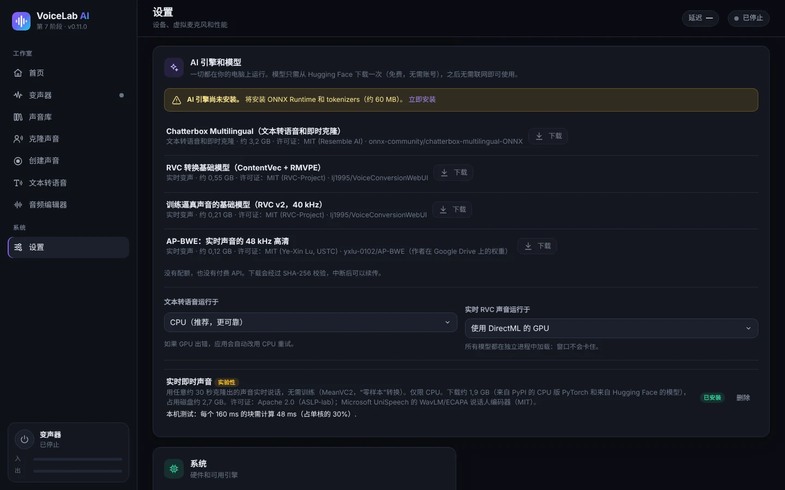

模型只需从 Hugging Face 下载一次（免费，无需账号），之后可离线使用。每次下载都会校验，中断后可以续传。

| 组件 | 大小 | 用途 |
|---|---|---|
| AI 引擎（ONNX Runtime 和 tokenizers） | 约 60 MB | 所有 AI 功能都需要 |
| Chatterbox Multilingual | 约 3.2 GB | 文字转语音和即时克隆 |
| RVC 转换基础模型（ContentVec + RMVPE） | 约 0.55 GB | 实时 RVC 声音（导入或训练的） |
| 逼真声音训练基础模型（RVC v2，40 kHz） | 约 0.21 GB | 训练逼真声音 |
| AP-BWE（高清） | 约 0.12 GB | 可选，用于「质量」模式下的即时声音 |
| 实时即时声音（MeanVC2 + CPU 版 PyTorch） | 下载约 1.9 GB | 用即时声音实时说话 |

还可以选择各部分在哪里运行：

- **文本转语音运行于**：CPU（推荐）或 GPU。
- **实时 RVC 声音运行于**：使用 DirectML 的 GPU（有显卡时推荐）或 CPU。

### 10.4 界面语言

应用支持西班牙语、英语、法语、意大利语、葡萄牙语、俄语、中文和日语。在 **系统 → 界面语言** 中，**自动** 会使用 Windows 的语言（如果不在这八种语言中，则使用英语）。更改后窗口会立即重新加载；变声器和你的配置不受影响。安装程序也会使用 Windows 的语言。

## 11. 在 Discord、游戏、OBS 和视频剪辑软件中使用

开启 **在所有应用中**（所有应用，见 [5.1](#51-输出)）后，任何使用 Windows 默认麦克风的程序都会直接收到变声后的声音。有些程序还需要多做一步：

- **Discord**：
  1. 在*用户设置 → 语音和视频*中，把**输入设备**设为「CABLE Output」（或「VoiceLab AI Microphone」）或「默认」。
  2. 把**噪音抑制**设为**无**。
  3. 关闭**回声消除**、**自动增益控制**和**高级语音活动检测**。这些滤镜会让 AI 声音听起来像机器人。
- **游戏**：几乎都使用默认麦克风。如果某个游戏只在启动时读取麦克风，请先开启变声器再启动游戏。
- **OBS Studio**：添加一个**音频输入采集**来源并选择「CABLE Output」，或使用「默认」。
- **视频剪辑软件**（DaVinci Resolve、Premiere、剪映/CapCut……）：要录制带效果的旁白，请把录音输入设为「CABLE Output」或默认麦克风。
- **浏览器和视频通话**（Meet、Teams、Zoom）：在各服务的音频设置中选择「CABLE Output」或「默认」。

## 12. 常见问题

| 问题 | 解决方法 |
|---|---|
| 别人听不到我 | 确认变声器处于 **已开启**，并且 **虚拟麦克风**输出已开启。在对方程序中选择「CABLE Output」或「默认」。 |
| 「未检测到虚拟麦克风」 | 以管理员身份安装 VB-CABLE 并重启电脑，然后在 *设置*中点击 **刷新设备**。 |
| AI 声音在 Discord 里像机器人 | 关闭 Discord 的语音滤镜（见 [11](#11-在-discord游戏obs-和视频剪辑软件中使用)）。 |
| 断音、咔嗒声或「处理器跟不上」 | 使用不带高清的 **质量**模式，并关闭占用大的程序。调高 **防断音余量**或 **块大小**。 |
| 延迟太大 | CPU 足够时使用 **低延迟**，或用显卡运行**逼真声音**。变声器中会显示实际延迟。 |
| 啸叫或回授 | 监听时请用耳机，不要用音箱。 |
| 有背景噪音 | 开启 **噪声门**和 **降噪**，AI 声音可开启 **转换前清理我的声音**。 |
| 第一次文字转语音很慢 | 属于正常情况：模型加载需要 1–4 分钟，之后会更快。 |
| 某个程序仍在用原来的麦克风 | 有些程序只在打开时读取麦克风：请在变声器开启后重新打开该程序。 |
| 求助时需要日志 | 日志位于 `%APPDATA%\VoiceLabAI\logs`（`voicelab.log`、`voz-instantanea.log` 和 `entrenamiento.log`）。 |

## 13. 隐私与负责任使用

- **所有处理都在你的电脑上完成**。你的声音、配置和录音不会发送到任何服务器。联网仅用于下载软件和模型。
- **只克隆你自己的声音，或已经同意的人的声音**。软件在创建每个配置时都会要求你确认。
- 不要用克隆的声音欺骗他人、冒充他人或进行诈骗。在许多国家这是违法的。
- AI 模型有各自的许可证（MIT 和 Apache 2.0），可在 *设置 → AI 引擎和模型*和 [README](../../README.md) 中查看。

---

快捷键：**Ctrl + M** 开启或关闭变声器。软件数据：`%APPDATA%\VoiceLabAI`。
